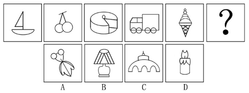

# 数量规律-曲线数（等差递增）

考点：[[20-考点/判断推理/图形推理/数量规律-曲线数（等差递增）|图形推理 / 数量规律-曲线数（等差递增）]]

**问法模型**：『选最合适的一个填入问号处，使之呈现一定规律性』→ 元素组成不同且无属性规律时，转数量规律，本题按曲线数等差递增验证选项

## 推理链
1. 第1步：题干五图（帆船、樱桃、蛋糕、卡车、冰淇淋）元素组成各不相同，先查属性（对称、曲直、开闭）无统一规律，转向数量规律
2. 第2步：观察发现五个图形『均含曲线』，按『有曲线优先数曲线』的优先级，逐图数曲线条数
3. 第3步：帆船仅船底为1条曲线（帆与桅杆为直线），樱桃2个圆为2条曲线，蛋糕含3条曲线，卡车含4条曲线，冰淇淋含5条曲线，构成1、2、3、4、5的等差递增
4. 第4步：由等差规律推定问号处图形应含6条曲线
5. 第5步：逐项数选项曲线数：A项12条、B项5条、C项6条、D项10条，仅C项为6条，与规律吻合，故选C

**最快解法**：⚡ 数曲线法+排除法：确认题干每图含曲线后，直接数曲线条数得1~5递增，再数四个选项曲线数，锁定唯一为6条的C项，其余选项数量差距大（12/5/10），排除极快

## 易错点
- ⚠ 曲线与直线混数：樱桃果柄、帆船桅杆、冰淇淋蛋筒为直线，误计入会破坏1~5的递增规律
- ⚠ 复合图形漏数或重数：蛋糕、卡车、冰淇淋由多段弧线拼合，易漏数被遮挡或相交处的弧段
- ⚠ 属性规律走死胡同：先入为主找对称或开闭特征，发现『无属性规律』后未及时切换到『全含曲线→数曲线』这一数量优先级

## 母题抽象
> 🧩 当题干图形元素组成不同、属性（对称/曲直整体/开闭）无统一规律、且每个图形都含曲线时，优先逐图数曲线数，验证是否构成等差或常数规律，再逐一数选项曲线数匹配问号处所需数值

**同类特征**：元素组成不同、无属性规律、每个图形均含曲线、曲线数依次为1、2、3、4、5、问号处求等差数列下一项

## 相关题
- [[10-真题/判断推理/图形推理/12019740 数量规律-交点数（曲直交点）|12019740]]（浙江 2026，相关度2）
- [[10-真题/判断推理/图形推理/12536392 数量规律-黑色区域面积（宫格面积折算）|12536392]]（四川 2024，相关度2）
- [[10-真题/判断推理/图形推理/13504389 图形推理-笔画数（奇点数定一笔画-多笔画）|13504389]]（云南 2025，相关度2）
- [[10-真题/判断推理/图形推理/1797382 数量规律-部分数（不相连独立元素计数）|1797382]]（山东 2016，相关度2）
- [[10-真题/判断推理/图形推理/2033324 数量规律-面数量（等差数列）|2033324]]（河南 2016，相关度2）

---

### 题干

从所给的四个选项中，选择最合适的一个填入问号处，使之呈现一定的规律性：

### 选项
- A. A
- B. B
- C. C　✅
- D. D

### 官方解析
元素组成不同，且无属性规律，考虑数量规律。观察题干图形发现，每个图形中均存在曲线，可优先考虑曲线数。题干图形中的曲线数依次为1、2、3、4、5，故问号处应选择有6条曲线的图形。选项曲线数分别为A项12条、B项5条、C项6条、D项10条，只有C项符合题干规律。
故正确答案为C。

### 给定材料
（无）
