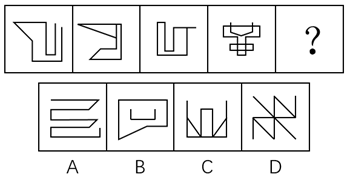

# 数量规律-笔画数（一笔画判定）

考点：[[20-考点/判断推理/图形推理/数量规律-笔画数（一笔画判定）|图形推理 / 数量规律-笔画数（一笔画判定）]]

**问法模型**：『使图形呈现一定的规律性』且题干图形元素组成不同、属性无规律 → 转向数量规律，用『奇点计数法』判笔画数，选与题干最少笔画数一致（一笔画）的选项

## 推理链
1. 第1步：题干四图线条构成各异（折线回勾形、多重折线形、带方框折线形、多线交叉形），元素组成不同，对称、封闭、曲直等属性规律均不成立
2. 第2步：题干图形均含明显端点（折线端头）与交叉线，提示考查笔画数；一笔画判定规则：图形连通且奇点（引出奇数条线的点，端点度数为1也算奇点）个数为0或2，最少笔画数=奇点数÷2
3. 第3步：逐一数题干各图奇点：图1、图2、图3、图4均连通且奇点数只有0个或2个，故四图全部为『一笔画』图形
4. 第4步：对选项逐项数奇点：A项连通且奇点数为0或2，一笔画；B项奇点数为4，两笔画；C项奇点数为4，两笔画；D项有6个端点类奇点，三笔画
5. 第5步：问号处需延续题干『均为一笔画』的规律，四个选项中仅A项为一笔画图形，故选A

**最快解法**：⚡ 奇点计数法（口诀：连通+奇点0或2可一笔画，笔画数=奇点数÷2）：快速点数每图的端点与交叉引线，题干四图奇点均≤2全为一笔画；选项中B、C奇点为4、D奇点为6，仅A奇点≤2，直接锁定A

## 易错点
- ⚠ 漏数端点：折线端头度数为1也是奇点，漏数会把一笔画误判为两笔画
- ⚠ B、C项外形看似简单、仿佛能一笔绕出，实际存在4个奇点，是两笔画图形，易误选
- ⚠ 数D项时把十字交叉点误当奇点：交叉点度数为4属偶点不算奇点，应只数端点（6个）得三笔画；同时勿忽略一笔画的连通性前提

## 母题抽象
> 🧩 当图形元素组成不同、对称/封闭/曲直等属性规律均不成立，且图形出现明显端点或多线交叉时，优先考笔画数：数奇点（端点计入），连通且奇点0或2即一笔画，选出与题干笔画数一致的选项

**同类特征**：元素组成不同、无属性规律、图形有明显端点、折线与交叉线并存、一笔画图形、奇点数0或2

## 相关题
- [[10-真题/判断推理/图形推理/2742162 数量规律-笔画数（一笔画判定）|2742162]]（江苏 2021，相关度3）
- [[10-真题/判断推理/图形推理/5102356 数量规律-笔画数（一笔画判定）|5102356]]（浙江 2022，相关度3）
- [[10-真题/判断推理/图形推理/12019740 数量规律-交点数（曲直交点）|12019740]]（浙江 2026，相关度2）
- [[10-真题/判断推理/图形推理/12536392 数量规律-黑色区域面积（宫格面积折算）|12536392]]（四川 2024，相关度2）
- [[10-真题/判断推理/图形推理/13504389 图形推理-笔画数（奇点数定一笔画-多笔画）|13504389]]（云南 2025，相关度2）

---

### 题干

请从四个选项中选出最恰当的一项填在问号处，使图形呈现一定的规律性：

### 选项
- A. A　✅
- B. B
- C. C
- D. D

### 官方解析
观察图形发现，元素组成不同，且无属性规律，考虑数量规律。观察发现，题干图形中出现明显一笔画成的图形和有端点的图形，考虑笔画数。进一步观察发现，题干中各图均为一笔画图形，而选项中A项为一笔画图形、B项和C项为两笔画图形、D项为三笔画图形。
故正确答案为A。

### 给定材料
（无）
