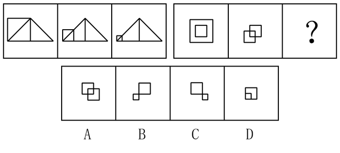

# 图形推理-位置规律（元素逐次缩小+方向固定，参照元素不变）

考点：[[20-考点/判断推理/图形推理/图形推理-位置规律（元素逐次缩小+方向固定，参照元素不变）|图形推理 / 图形推理-位置规律（元素逐次缩小+方向固定，参照元素不变）]]

**问法模型**：两组三格类比型'符合变化规律'问法 → 在第一组找'变什么、不变什么、怎么变'，再把同一变化量与方向套到第二组图2之后

## 推理链
1. 第1步：第一组图1→图2，左下角正方形边长明显缩小并贴向左边，而三角形大小、位置完全不动
2. 第2步：图2→图3，该正方形继续缩小、仍贴左侧，三角形依旧不变——归纳规律为'一个元素逐次缩小且方向固定，另一元素作参照保持不变'
3. 第3步：第二组图1为大正方形内套中正方形（同心），图2中外框正方形已缩小并移到左下方与中正方形相交，中正方形未动
4. 第4步：按规律类推问号处：左侧小正方形应比图2更小且仍偏左，中正方形大小位置不变
5. 第5步：对照选项，B项左下小正方形比图2更小、仍贴左，另一正方形与图2一致，符合
6. 第6步：排除干扰项：A项左侧正方形没有继续缩小；C项缩小后跑到右下方，方向错误；D项缩小后回到大正方形内部（中间），相当于回退到图1的包含关系，均不符

**最快解法**：⚡ 排除法+定点比较：先锁定'不动的参照元素'（第一组三角形、第二组中正方形），只追踪'变化元素'的两个维度——大小是否继续变小、方向是否仍贴左；图2左下小正方形应再缩一号，秒选B，其余三项分别死在'没变小/变到右边/变回中间'

## 易错点
- ⚠ 只确认'有小正方形'而忽略变化的连续性，误选没有继续缩小的A项
- ⚠ 忽略第一组确立的'始终贴左'方向限定，把C项'缩小到右边'当成合理变化
- ⚠ 被D项'同心包含'形态迷惑，误以为与图1呼应即为规律，实际问号处应承接图2继续变化而非回退

## 母题抽象
> 🧩 当两组图题中出现'某元素逐帧变小（或移动）而另一元素纹丝不动'时，用'不变元素作参照+变化元素盯大小和方向两个维度'的方法逐项排除，验证问号处是上一帧变化的延续而非回退

**同类特征**：两组三格类比、元素逐次缩小、方向固定（贴左）、参照元素不变、第一组三角形不动、第二组两正方形由内含变相交

## 相关题
（暂无）

---

### 题干

下列选项中，符合所给图形的变化规律的是（    ）。

### 选项
- A. A
- B. B　✅
- C. C
- D. D

### 官方解析
观察第一组图形发现，图1到图2，正方形缩小到左边，三角形不变；图2到图3，正方形继续缩小到左边，三角形不变。第二组也应遵循此规律，从图1到图2外框正方形缩小到左边，中间的正方形不变；从图2到？处，左边的正方形继续缩小到左边，中间的正方形不变，对应B项。A项左边的正方形没有继续缩小，排除。C项左边的正方形缩小到了右边，排除。D项左边的正方形缩小到了中间，排除。
故正确答案为B。

### 给定材料
（无）
