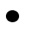
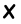

# 样式规律-自定义叠加（相邻图形逐位元素叠加运算，金字塔阵列）

考点：[[20-考点/判断推理/图形推理/样式规律-自定义叠加（相邻图形逐位元素叠加运算，金字塔阵列）|图形推理 / 样式规律-自定义叠加（相邻图形逐位元素叠加运算，金字塔阵列）]]

**问法模型**：金字塔相邻两图叠加求顶层'？'→ 用底层已知相邻格逐位对照上层格求出自定义叠加规则，再逐层上推至顶层与选项比对

## 推理链
1. 第1步：题干为四层金字塔，每格内含○/●/×三个小元素，下层相邻两格同位叠加生成上层一格，顶层为'？'，元素组成相同、样式发生运算变化
2. 第2步：用底层（第4层）最左两格'×○●'与'●●●'对照第3层左格'○×●'逐位求规则：×+●=○，○+●=×，●+●=●
3. 第3步：用底层其余相邻对交叉验证：'●●●'+'○●×'→'×●○'（●+○=×，●+×=○），'○●×'+'×○●'→'●×○'（○+×=●），规则一致
4. 第4步：归纳完整叠加规则——同种元素相加保持原样（●+●=●，○+○=○），不同元素相加得第三种元素（●+○=×，×+●=○，○+×=●）
5. 第5步：用第3层→第2层复验：'○×●'+'×●○'='●○×'，'×●○'+'●×○'='○○○'（含○+○=○），规则全部成立
6. 第6步：顶层=第2层左格'●○×'与右格'○○○'逐位叠加：●+○=×，○+○=○，×+○=●，得'×○●'
7. 第7步：对照选项，C项恰为'×○●'，其余A'○×●'、B'●○×'、D'×●○'均不符，故选C

**最快解法**：⚡ 自定义叠加口诀法：由底层最左两格'×○●'与'●●●'对上层格'○×●'一次读出规则'相同不变、不同变第三种'，直接口算顶层'●○×'⊕'○○○'='×○●'，秒选C

## 易错点
- ⚠ 叠加方向看反：规则是下层相邻两格自下而上生成上层一格，误从顶层向下拆分则无法建立规则
- ⚠ 逐位错位：每格内三个小图必须按左/中/右同位一一叠加，位置错开后会误以为规则不统一
- ⚠ 只用一组样例草率归纳、未交叉验证'相同不变、不同取第三'的完整规则，导致顶层算错而误选A、B或D

## 母题抽象
> 🧩 当题干出现金字塔/三角阵列且'下层相邻两图合成上层一图'时，从底角两格与上层对应格逐位对照求自定义叠加规则（同种得原样、异种得第三者），再逐层上推顶层并与选项比对

**同类特征**：金字塔（三角形）图形阵列、每格含○/●/×三个小元素、相邻两格叠加生成上层一格、自定义叠加规则（相同不变、不同得第三者）、顶层为问号待求、元素组成相同

## 相关题
- [[10-真题/判断推理/图形推理/2172768 位置规律（旋转-翻转）|2172768]]（海南 2021，相关度1）
- [[10-真题/判断推理/图形推理/10204458 位置规律-平移（特征交点沿内圈循环平移）|10204458]]（甘肃 2024，相关度1）
- [[10-真题/判断推理/图形推理/10204614 图形推理-位置规律（旋转+翻转交替循环）|10204614]]（黑龙江 2024，相关度1）
- [[10-真题/判断推理/图形推理/10297399 位置规律—平移（多黑块分组循环平移）|10297399]]（四川 2025，相关度1）
- [[10-真题/判断推理/图形推理/11226892 位置规律-九宫格小元素沿固定循环链移动|11226892]]（上海 2025，相关度1）

---

### 题干

下列选项中，符合所给图形的变化规律的是<u>      </u>。

### 选项
- A. A
- B. B
- C. C　✅
- D. D

### 官方解析

元素组成相同，考虑位置关系。题干为金字塔型，考了紧邻形成三角形图形之间的关系，观察发现，从下往上数第一层左边两个图形内部相同位置的小图形叠加的规律：和叠加后变为第二层左边图形的，和叠加后变为第二层左边图形的，和叠加后变为第二层左边图形的，第一层中间两个图内部图形按照和叠加变为，和叠加后变为，和叠加后变为，从而组成第二层中间图的内部三个小图，第一层右边两个图形的内部小图也是按照和叠加后变为，和叠加后变为，和叠加后变为的规律最后形成了第二行最右侧的图形。照此规律，第二层的左边相邻两个图形内部小图相互叠加则变为第三层的左边图形，第二层右边相邻两图形内部小图相互叠加则变为第三层右边的图形，叠加规律为：和叠加后变为，和叠加后变为，和叠加变为，和叠加后变为，以此类推，第三层的两个图形内部小图相同位置进行叠加后变为顶层的图形，叠加规律为：和叠加后变为的，和叠加后变为，和叠加后变为，只有C项符合。

故正确答案为C.

### 给定材料
（无）

> [!warning] 疑点（官方解析可能有误，待人工复核）
> 官方解析首句'元素组成相同，考虑位置关系'归类欠准确：本题实质为样式类自定义叠加运算（相同不变、不同取第三种），而非位置平移/旋转；但解析的叠加推导过程与答案C本身经验证完全正确，不影响结论。
