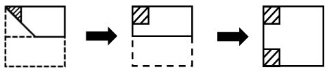

# 空间重构-折纸剪切与展开（镜像还原）

考点：[[20-考点/判断推理/图形推理/空间重构-折纸剪切与展开（镜像还原）|图形推理 / 空间重构-折纸剪切与展开（镜像还原）]]

**问法模型**：“折叠后剪去一角、完全展开得到什么图形”→逆向逐层镜像展开模型：沿折痕把剪口逐步镜像还原

## 推理链
1. 第1步：读图1→图2：正方形沿水平中线向上对折，下半部分为虚线（已折起），得到双层矩形，折痕在该矩形下边缘
2. 第2步：读图2→图3：双层矩形沿从左上角到下边中点的对角虚线再折一次，左侧三角翻向右侧，折痕斜线恰好经过左上角
3. 第3步：图4在左上角剪去带阴影的小直角三角形，该剪口的两条直角边分别压在两条折痕（水平折痕与对角折痕）交汇处
4. 第4步：应用展开规则：折痕是镜像对称轴，剪口跨过折痕则镜像拼合，剪口边落在折痕上则展开后变成完整直线边
5. 第5步：先展开最后一次对角折叠：小三角形沿斜折痕镜像，与原剪口拼成菱形，落在折痕上的边还原为直线
6. 第6步：再展开水平折叠：图形上下镜像一次，上下两部分对称拼合，缺口两两直角边相接，构成一个方正的矩形（正方形）缺口，开口朝向左侧原折边
7. 第7步：逐项对照：A、C缺口呈三角形，B为斜切角（斜边缺口），只有D的缺口四边平直、呈矩形凹口

**最快解法**：⚡ 逆向镜像展开法：从最后一次折叠往回展开，先沿对角折痕镜像剪口、再沿水平折痕镜像；抓住“剪口两条直角边正好压在折痕上→展开后变直线”这一特征，三角形缺口两次镜像后拼成矩形缺口，直接锁定D

## 易错点
- ⚠ 只展开一次就对照选项，误选A或C（以为展开后仍是三角形缺口）
- ⚠ 把剪口斜边当成最终缺口边，误选B（误以为角被斜切成八边形）
- ⚠ 忽略“剪口直角边落在折痕上”这一关键特征，想不到折痕上的剪口边展开后会变直，缺口由三角变方口

## 母题抽象
> 🧩 当题干出现“折纸折叠后剪角/剪口、求完全展开图形”时，用逆向逐层镜像展开法，重点核对剪口与折痕的位置关系：剪口边压在折痕上→展开成直线边，剪口跨折痕→镜像拼合成对称缺口

**同类特征**：两次折叠、先对折再斜折、剪去三角形（剪角）、完全展开求图形、剪口位于折痕交汇处、选项为不同形状缺口

## 相关题
（暂无）

---

### 题干

如下图所示，由图1折叠成图2，再折叠成图3，然后剪去图4的阴影三角部分，现将其完全展开后得到的图形是<u>      </u>。

### 选项
- A. A
- B. B
- C. C
- D. D　✅

### 官方解析

观察题干发现，从图1到图3折叠两次，且剪去一三角形得到图4，现想知将其完全展开后的图形形状，只需将折叠部分依次展开即可，如下图所示： 

故正确答案为D。

### 给定材料
（无）
