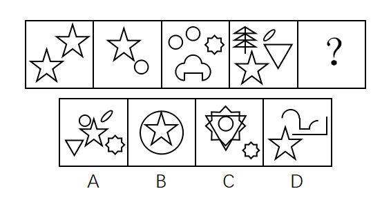

# 数量规律-元素种类数递增（1、2、3、4、5）

考点：[[20-考点/判断推理/图形推理/数量规律-元素种类数递增（1、2、3、4、5）|图形推理 / 数量规律-元素种类数递增（1、2、3、4、5）]]

**问法模型**：图形组成不同且无属性规律 → 优先数独立小元素的种类数，寻找递增等差规律并匹配选项

## 推理链
1. 第1步：观察题干四幅图+问号，每个图形均由多个独立小元素拼成，元素组成不同，且对称、曲直、封闭等属性无明显规律
2. 第2步：转向数量规律，优先数每幅图中独立小元素的种类数（同形算一种）
3. 第3步：图1仅五角星1种；图2为五角星+圆2种；图3为圆、八角星、云朵形3种；图4为树、椭圆、五角星、三角形4种
4. 第4步：种类数依次为1、2、3、4，呈等差递增，故问号处应填元素种类为5的图形
5. 第5步：逐项对照：A含圆、椭圆、五角星、三角形、八角星共5种，满足；B仅圆与五角星2种；C中大五角星套小五角星为同一种元素，仅4种；D约3种；只有A满足规律

**最快解法**：⚡ 数元素种类法：快速清点各图独立小元素的种类，确认1→2→3→4递增后，直接在选项中找含5种不同小元素的图形，秒选A

## 易错点
- ⚠ 混淆元素'个数'与'种类'，误把图1的两个五角星当作2种元素
- ⚠ 忽略C项大五角星套小五角星属同一种元素，误判其为5种而错选C
- ⚠ 把云朵形、喇叭形等组合轮廓拆成多种元素导致种类多数

## 母题抽象
> 🧩 当题干各图由独立小元素组成、元素组成不同且属性无规律时，数小元素的种类数；若呈等差递增，则在选项中找对应种类数的图形

**同类特征**：元素组成不同、独立小元素构成、无明显属性规律、元素种类数1、2、3、4递增、小图形种类清晰可数

## 相关题
- [[10-真题/判断推理/图形推理/10204454 数量规律-部分数（黑白球连通区域数做和）|10204454]]（甘肃 2024，相关度2）
- [[10-真题/判断推理/图形推理/10297050 数量规律-特殊计数（线条穿过小白球的数量）|10297050]]（天津 2025，相关度2）
- [[10-真题/判断推理/图形推理/10297262 数量规律-面的形状种类（封闭面种类数分组）|10297262]]（浙江 2025，相关度2）
- [[10-真题/判断推理/图形推理/10297314 数量规律-交点数（曲直交点）|10297314]]（浙江 2025，相关度2）
- [[10-真题/判断推理/图形推理/11454020 数量规律-小元素按行排布（每行个数自上而下递增1）|11454020]]（选调 2024，相关度2）

---

### 题干

从所给四个选项中，选择最合适的一个填入问号处，使之呈现一定的规律性：

### 选项
- A. A　✅
- B. B
- C. C
- D. D

### 官方解析
元素组成不同，且无明显属性规律，考虑数量规律。观察发现每个图形均由独立小元素组成，优先考虑数元素的种类和个数。题干图形元素种类分别为1、2、3、4、？，故？处应为元素种类为5的图形，只有A项满足规律。
故正确答案为A。

### 给定材料
（无）
