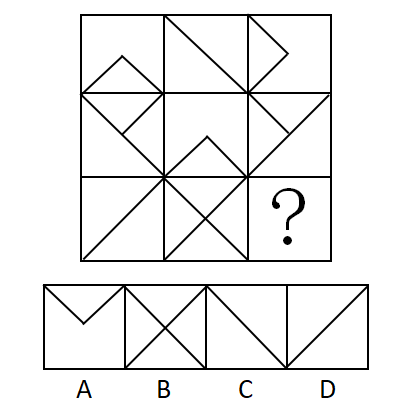

# 样式规律-叠加运算（去同存异-求异）

考点：[[20-考点/判断推理/图形推理/样式规律-叠加运算（去同存异-求异）|图形推理 / 样式规律-叠加运算（去同存异/求异）]]

**问法模型**：'选择最合适的一个填入问号处，使之呈现一定的规律性'且九宫格图形线条相似、相同线条重复出现 → 优先横行找样式运算规律（去同存异）

## 推理链
1. 第1步：九宫格各图均由外框加内部直线构成，相同的斜线在多幅图中重复出现，属于'元素组成相似'，优先考虑样式规律中的运算规律
2. 第2步：九宫格优先看横行；第一行图1与图2叠加后去掉相同线条、只保留不同线条（去同存异），恰好得到图3
3. 第3步：第二行验证：图1与图2去同存异后的结果与图3完全一致，说明'去同存异'规律在第二行同样成立
4. 第4步：第三行套用规律：图1与图2共有的左斜线属于'同'应消去，仅图2出现的右斜线属于'异'应保留
5. 第5步：对照选项：A项多出无关的V形折线，B项保留了应消去的左斜线（呈完整X形），D项只含应消去的左斜线，只有C项仅保留右斜线，故选C

**最快解法**：⚡ 去同存异（叠加消线）口诀：九宫格横行看，两图叠加'同线消、异线留'；第三行两图共有的左斜线消去、仅图2有的右斜线保留，直接锁定C

## 易错点
- ⚠ 看错行列：九宫格若先按列或对角线找规律会走弯路，应优先横行验证再套用
- ⚠ 混淆'去同存异'与'去异存同'：相同线条应消去而非保留，误将全部线条叠加会错选B
- ⚠ 忽视斜线方向辨析：左斜线与右斜线方向不同即视为'异'，D项正是只保留'同'方向斜线设置的陷阱

## 母题抽象
> 🧩 当九宫格图形元素组成相似、相同线条重复出现时，优先按横行做'去同存异'叠加运算，先用第二行验证规律成立，再套用到第三行锁定答案

**同类特征**：九宫格、元素组成相似、相同线条重复出现、方框内斜线/直线、样式运算规律、去同存异

## 相关题
- [[10-真题/判断推理/图形推理/2742144 样式规律-加减同异（旋转+去同存异）|2742144]]（江苏 2021，相关度4）
- [[10-真题/判断推理/图形推理/10204610 样式规律-加减同异（去同存异），九宫格列规律|10204610]]（辽宁 2024，相关度3）
- [[10-真题/判断推理/图形推理/12019768 样式规律-加减同异（求同）与位置旋转的复合规律|12019768]]（浙江 2026，相关度3）
- [[10-真题/判断推理/图形推理/16070178 样式规律-加减同异（翻转+去同存异）|16070178]]（重庆 2026，相关度3）
- [[10-真题/判断推理/图形推理/17056529 样式规律-求同求异（分元素：直线求同、小圆圈求异）|17056529]]（上海 2026，相关度3）

---

### 题干

从所给四个选项中，选择最合适的一个填入问号处，使之呈现一定的规律性：

### 选项
- A. A
- B. B
- C. C　✅
- D. D

### 官方解析
图形元素组成相似，相同的线条重复出现，优先考虑样式规律中的运算规律。九宫格优先看横行，第一行中图1与图2去同求异后得到图3，第二行同样满足此规律。第三行应遵循该规律，图1和图2去同求异后，相同的左斜线应去掉，不同的右斜线应保留，只有C项符合。
故正确答案为C。

### 给定材料
（无）
