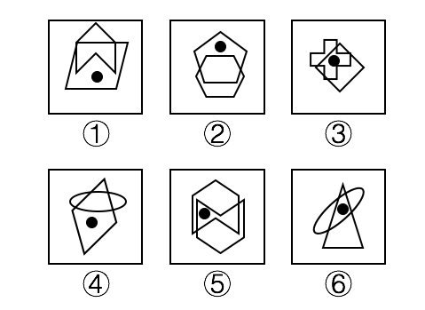

# 功能元素-黑点标记两图形相交区域的内部与外部

考点：[[20-考点/判断推理/图形推理/功能元素-黑点标记两图形相交区域的内部与外部|图形推理 / 功能元素-黑点标记两图形相交区域的内部与外部]]

**问法模型**：六个图形分为两类、每类有各自共同特征 → 优先找各图共有元素（黑点）的标记作用，比较其标记位置的区别

## 推理链
1. 第1步：六幅图均为'两个封闭图形叠放+一个黑点'的相同结构，问法为分组分类，优先考虑黑点作为功能元素的标记作用
2. 第2步：确定观察维度——黑点落在'两图形的公共重叠区之内'还是'仅在其中某一个图形内（即相交区域之外）'
3. 第3步：图①黑点在平行四边形内、箭头五边形外，图②黑点在上方五边形内、六边形外，图④黑点在风筝形内、椭圆外，三者黑点均位于两图形相交区域之外
4. 第4步：图③黑点在十字形与斜正方形的重叠中心，图⑤黑点在六边形与'M'形线条围成的重叠区内部，图⑥黑点在三角形与椭圆的重叠区内部，三者黑点均位于两图形相交区域之内
5. 第5步：据此分组：①②④一组（黑点标记相交区外部），③⑤⑥一组（黑点标记相交区内部）
6. 第6步：与选项对照，C项为'①②④，③⑤⑥'，与推理结论一致，故选C

**最快解法**：⚡ 黑点定位法：一眼锁定黑点是否在两图形的重叠区内——①②④黑点只在单个图形内部（重叠区外），③⑤⑥黑点在两图形重叠区内部，直接锁定C

## 易错点
- ⚠ 只验证到'黑点在某个图形内部'就停止：六图黑点其实都至少在一个图形内，必须进一步辨析是否落在两图形的重叠区，否则无法分组
- ⚠ 把'相交的外部'误解为'黑点在最外侧正方形框之外'，导致六个图全部无法归组
- ⚠ 图⑤中'M'形线条与六边形叠放遮挡关系复杂，易误判黑点所属封闭区域，漏看其处于重叠区内部

## 母题抽象
> 🧩 当每幅图都含有同一功能小元素（黑点/小圆/箭头）且图形之间存在相交叠放时，用功能元素标记法，验证该元素标记的是两图形相交区域的内部还是外部（或交点、锐角、最长边等）

**同类特征**：分组分类题、每图含黑点（功能元素）、两个封闭图形相交叠放、黑点位置分重叠区内外、结构相同找位置差异

## 相关题
- [[10-真题/判断推理/图形推理/12561867 数量规律-相同元素的位置关系（对角相对-边邻相邻）分组分类|12561867]]（浙江 2024，相关度1）
- [[10-真题/判断推理/图形推理/12561900 数量规律-面与外框的位置关系（面是否有公共边-悬空面）|12561900]]（浙江 2024，相关度1）
- [[10-真题/判断推理/图形推理/2133606 图形间关系（面与面的连接方式：公共边连接 vs 点连接）|2133606]]（国考 2018，相关度1）
- [[10-真题/判断推理/图形推理/2133620 图形推理-数量规律（一笔画-奇点数）|2133620]]（国考 2018，相关度1）
- [[10-真题/判断推理/图形推理/2136754 数量规律-面数量相同时看面的形状特征（是否存在完全相同的面）|2136754]]（河南 2017，相关度1）

---

### 题干

把下面的六个图形分为两类，使每一类图形都有各自的共同特征或规律，分类正确的一项是：

### 选项
- A. ①④⑤，②③⑥
- B. ①④⑥，②③⑤
- C. ①②④，③⑤⑥　✅
- D. ①⑤⑥，②③④

### 官方解析
本题为分组分类题目。题干每幅图形中均有黑点，考虑功能元素的标记作用。观察发现，图①②④中黑点的位置在两个图形相交的外部，图③⑤⑥中黑点的位置在两个图形相交的内部，因此图①②④为一组，图③⑤⑥为一组。
故正确答案为C。

### 给定材料
（无）
