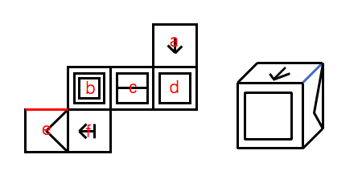

# 空间重构-六面体纸盒折叠（相邻面公共边与特征面指向定位）

考点：[[20-考点/判断推理/图形推理/空间重构-六面体纸盒折叠（相邻面公共边与特征面指向定位）|图形推理 / 空间重构-六面体纸盒折叠（相邻面公共边与特征面指向定位）]]

**问法模型**：'左边展开图，右边哪一项能折叠而成' → 相对面排除＋特征面公共边定位法（以箭头/三角形指向侧所邻接的面为锚点逐项比对）

## 推理链
1. 第1步：展开图为阶梯形排布，六个面为：↓箭头面、回字形嵌套面、横线'二'面、嵌套□面、'<'三角形面（面e）、带尾横线的左箭头面（面f）
2. 第2步：折叠后相对面不能同时出现在立体图中，且箭头、三角形等特征图案的指向一侧的公共边所邻接的面必须与展开图完全一致
3. 第3步：A项由面a、b、c组成，三个面在展开图中两两相邻，公共边上图案的相对位置与指向和展开图一致
4. 第4步：B项由面d、e、f组成：展开图中面f箭头右侧的公共边挨着面b，而B项中面f箭头右侧挨着面d，特征公共边不符，排除
5. 第5步：C项由面a、d、e组成：展开图中面e三角形右侧（红线处）挨着面b，而C项中面e三角形右侧（蓝线处）挨着面a，排除
6. 第6步：D项由面d、e、f组成：展开图中面f箭头右侧挨着面b，而D项中面f箭头右侧挨着面d，与B项同一错误，排除
7. 第7步：仅A项的面的组合及公共边特征与展开图完全一致，故正确答案为A

**最快解法**：⚡ 特征公共边法（画边法）：锁定带指向图案的面f（箭头）和面e（三角形），记住展开图中'箭头右侧、三角形右侧'均挨着面b；B、C、D三项中该特征边分别挨面d、a、d，直接三步排除，仅A吻合

## 易错点
- ⚠ 只核对选项中出现的面的图案种类，忽略箭头右侧、三角形右侧等'特征公共边'所邻接的面是否正确
- ⚠ 选项中特征面被旋转后未同步跟踪图案指向，误以为B、D中箭头面与展开图一致
- ⚠ 阶梯形展开图中相对面判断失误，误把不相邻的面当成相邻面组合

## 母题抽象
> 🧩 当六面体展开图中存在带箭头或三角形等有方向的特征面时，以该特征面为基准画公共边，验证其指向一侧所邻接的面与展开图是否一致，不一致者直接排除

**同类特征**：纸盒外表面展开图、阶梯形错位排布、特征面含↓箭头和带尾↤箭头、含'<'三角形面、含回字形嵌套正方形面、问哪一立体图能折叠而成

## 相关题
- [[10-真题/判断推理/图形推理/12536419 空间折叠（六面体）-相对面排除与相邻面位置关系（画边法-公共点法）|12536419]]（四川 2024，相关度1）
- [[10-真题/判断推理/图形推理/16593173 空间重构-展开图折叠（相邻面公共边特征）|16593173]]（海南 2024，相关度1）
- [[10-真题/判断推理/图形推理/1805286 空间重构-立体折叠（五棱柱展开图，相邻面黑白关系排除）|1805286]]（上海 2016，相关度1）
- [[10-真题/判断推理/图形推理/18643899 空间重构-纸盒折叠（相邻面公共边定位法）|18643899]]（四川 2026，相关度1）
- [[10-真题/判断推理/图形推理/18650003 空间重构-六面体折叠（相对面关系判定）|18650003]]（选调 2025，相关度1）

---

### 题干

左边给定的是纸盒外表面的展开图，右边哪一项能由它折叠而成？

### 选项
- A. A　✅
- B. B
- C. C
- D. D

### 官方解析

本题为空间重构题目。


A项：由面a、b、c组成，与题干一致，当选；

B项：由面d、e、f组成，题干面f中箭头右侧挨着面b，而该选项面f的箭头右侧挨着面d，与题干不一致，排除；

C项：由面a、d、e组成，题干面e的三角形右侧（图中标红线处）挨着面b，而该选项面e的三角形右侧（即蓝线处）挨着面a，与题干不一致，排除；


D项：由面d、e和f组成，题干中面f的箭头右侧挨着面b，而该选项面f的箭头右侧挨着面d，与题干不一致，排除。


故正确答案为A。


### 给定材料
（无）
