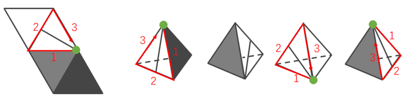

# 空间重构-四面体折叠（唯一点顺时针描边法）

考点：[[20-考点/判断推理/图形推理/空间重构-四面体折叠（唯一点顺时针描边法）|图形推理 / 空间重构-四面体折叠（唯一点顺时针描边法）]]

**问法模型**：『左边展开图、右边哪一项能由它折叠而成』的四面体折纸盒问法 → 以带直线面上的唯一点为起点顺时针给三条边编号，逐一比对立体图中各边邻接的面

## 推理链
1. 第1步：展开图为四面体（四个三角形面），其中白色面上有一条由某顶点出发的直线，该顶点是全图唯一带线的顶点，定为『唯一点』，带线面即四个立体选项中含直线的可见面
2. 第2步：用『唯一点顺时针描边法』：以唯一点为起点，沿带线面的三条边顺时针依次记为边1、边2、边3，在展开图中三边邻面依次为——边1邻灰色面、边2邻白色面、边3邻黑色面
3. 第3步：折叠后同一顶点处的边序不变，故正确的立体图中从唯一点顺时针看，三边邻面仍须保持『灰、白、黑』的顺序
4. 第4步：A项从唯一点顺时针边1邻接的是黑色面，而题干边1邻灰色面，排除
5. 第5步：C项从唯一点顺时针边3邻接的是白色面，而题干中邻白色面的是边2，顺序不符，排除
6. 第6步：D项从唯一点顺时针边3邻接的是灰色面，而题干中邻灰色面的是边1，顺序不符，排除
7. 第7步：B项从唯一点顺时针三边邻面顺序与展开图完全一致，当选

**最快解法**：⚡ 唯一点顺时针描边法：锁定带直线面的唯一点，顺时针数三条边，记住展开图口诀『边1灰、边2白、边3黑』，四个选项按此口诀直接排除A、C、D，锁定B

## 易错点
- ⚠ 顺时针方向搞反：若以镜像视角观察，顺逆时针颠倒，会把正确项B误排除
- ⚠ 只验证『与哪个面相邻』而不验证边的先后顺序：四个选项均有含直线的面且相邻面相似，必须按边1、2、3逐一对应才能区分
- ⚠ 唯一点找错：若把直线与对边的交点当成唯一点，描边起点错，全部对应关系随之错乱

## 母题抽象
> 🧩 当四面体展开图中出现带唯一标记（一条线或一个点）的特征面时，以该唯一点为起点顺时针给三边编号并记录各边邻面顺序，再核对立体图中同一顶点顺时针的邻面顺序是否一致，不一致即排除

**同类特征**：四面体展开图、某面含一条直线、存在唯一点（唯一带线顶点）、顺时针画边、相邻面灰/白/黑顺序、『哪一项能由它折叠而成』问法

## 相关题
- [[10-真题/判断推理/图形推理/2367987 空间重构-四面体展开图折叠（画边法-公共边法）|2367987]]（江苏 2019，相关度2）
- [[10-真题/判断推理/图形推理/1789614 空间重构-四面体展开图（画边法-唯一点法）|1789614]]（江苏 2016，相关度1）
- [[10-真题/判断推理/图形推理/2042726 空间重构-四面体折叠（相邻面相对位置-画箭头法）|2042726]]（江苏 2017，相关度1）
- [[10-真题/判断推理/图形推理/2367814 空间重构-四面体折叠（相邻面公共边与特征线-箭头指向检验）|2367814]]（江苏 2019，相关度1）
- [[10-真题/判断推理/图形推理/2367988 空间重构-四面体展开图折叠（公共边法）|2367988]]（江苏 2019，相关度1）

---

### 题干

左边给定的是纸盒外表面的展开图，右边哪一项能由它折叠而成？

### 选项
- A. A
- B. B　✅
- C. C
- D. D

### 官方解析

本题为四面体的空间重构题目。四个选项均有含一条直线的面，且该面有唯一点（如下图中绿色点所示），故以这点为起点开始顺时针画边。如下图所示。



A项：边1对应的是黑色面，而题干边1对应的是灰色面，与题干不一致，排除；


B项：选项与题干一致，当选；


C项：边3对应的是白色面，而题干边2对应的是白色面，与题干不一致，排除；


D项：边3对应的是灰色面，而题干边1对应的是灰色面，与题干不一致，排除。


故正确答案为B。


### 给定材料
（无）
