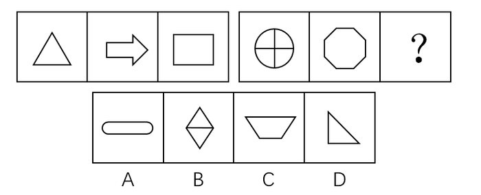

# 数量规律-线数量（两组图运算：图一线数+图三线数=图二线数）

考点：[[20-考点/判断推理/图形推理/数量规律-线数量（两组图运算：图一线数+图三线数=图二线数）|图形推理 / 数量规律-线数量（两组图运算：图一线数+图三线数=图二线数）]]

**问法模型**：两组图'第一组三图、第二组前两图+问号'的问法 → 多边形明显时优先数线，在第一组内建立数量运算式，代入第二组求问号

## 推理链
1. 第1步：两组图式命题：第一组为三角形、向右箭头、长方形，第二组为圆内十字、八边形、问号；元素组成不同且无明显属性规律，转向数量规律
2. 第2步：题干以多边形为主（三角形、箭头、长方形、八边形），优先数线：第一组线数依次为3、7、4，发现3+4=7，规律为'图一线数+图三线数=图二线数'
3. 第3步：第二组数线：圆内十字=1条外圆曲线+2条直径直线共3条线，八边形8条线，代入运算式得3+？=8，问号处应为5条线的图形
4. 第4步：逐项数线：A圆角矩形约4条（2直+2曲）、C梯形4条、D直角三角形3条，均非5条
5. 第5步：B项为菱形加中横线结构，外4边+1条中横共5条线，唯一符合，故选B（点数量规律虽可推出D，但数线特征更明显，官方倾向数线）

**最快解法**：⚡ 数线法+组内加和：第一组3、7、4直接看出'3+4=7'；第二组圆内十字数3条线、八边形8条，锁定问号=5条线；B为'双三角共底'恰5条线，秒选B

## 易错点
- ⚠ 第二组图一'圆内十字'漏数外圆曲线，只数2条直径误得问号=6条线
- ⚠ B项看成两个三角形误数成6条线，实为两三角共用一条中横边，共5条线
- ⚠ 本题为争议题：点数量规律（第一组3、7、4满足加和，第二组5、8、？→？应为3个点）指向D且同样唯一，先数点易误选D；多边形明显时应优先数线

## 母题抽象
> 🧩 当两组图且元素组成不同、属性无规律时，优先数线/点/面等数量要素，在第一组内验证'图一数量+图三数量=图二数量'的运算式，再代入第二组求出问号数值并逐项排除

**同类特征**：两组图式命题（第一组三图+第二组问号）、元素组成不同、无明显属性规律、图形以多边形线框为主（三角形/箭头/长方形/八边形）、第二组首图为圆与直线混合图形、组内存在数量加和运算关系、线数量与点数量双规律并存

## 相关题
- [[10-真题/判断推理/图形推理/11454021 数量规律-小元素个数与边数的等量关系（叠加白色同形区域验证）|11454021]]（选调 2024，相关度1）
- [[10-真题/判断推理/图形推理/2434290 数量规律-线数量（直线数与曲线数做差运算）|2434290]]（新疆 2019，相关度1）
- [[10-真题/判断推理/图形推理/4678642 图形推理-数量规律（黑白面积关系-面积比例）|4678642]]（选调 2020，相关度1）
- [[10-真题/判断推理/图形推理/5445911 图形推理-数量规律（一笔画-笔画数·奇点计数）|5445911]]（国考 2023，相关度1）
- [[10-真题/判断推理/图形推理/5509907 数量规律-汉字横线数量（折笔中的水平线段计入）|5509907]]（内蒙古 2023，相关度1）

---

### 题干

根据所给图形的既有规律，选择一个最合理的答案（    ）。

### 选项
- A. A
- B. B　✅
- C. C
- D. D

### 官方解析
方法一：元素组成不同，且无明显属性规律，考虑数量规律。观察题干发现，题干图形中出现多边形，优先考虑数线。第一组图形的线数量分别为3、7、4，图一线数量与图三线数量之和为图二线数量，第二组图形的线数量分别为3、8、？，则？处应为5条线组成的图形。只有B项符合。
方法二：元素组成不同，且无明显属性规律，考虑数量规律。观察题干发现，第一组图形的点数量分别为3、7、4，图一点数量与图三点数量之和为图二点数量，第二组图形的点数量分别为5、8、？，则？处应为有3个交点的图形。A项点数量为4个，B项点数量为4个，C项点数量为4个，D项点数量为3个。只有D项符合。
本题为争议题，线数量和点数量均能选出唯一答案，但本题数线特征更为明显，优先考虑数量规律，更倾向于线数量的命题特征，因此粉笔倾向于数线的规律。
故正确答案为B。

### 给定材料
（无）

> [!warning] 疑点（官方解析可能有误，待人工复核）
> 官方已标注本题为争议题：线数量规律（3+4=7；3+？=8→5条线→B）与点数量规律（3+4=7；5+？=8→3个点→D）均自洽且各自得出唯一答案，官方以'数线特征更为明显'为由倾向数线取B；此属命题歧义而非解析错误，答案仍以官方B为准

<!-- CODEX-ANSWER-REVIEW:BEGIN -->
### 本次独立复核

**复核状态：** `resolved`（答案与解析已核定）

**计分答案：** B（可计分）

**复核解析：**

原题官方解析另指出交点数也构成同样的两组运算，交点规则导向D；所以原题本身有双解。此修订版明确只考线段数。第一组为3+4=7；第二组已知3+8，问号需为5条线。选项B由菱形外边4段和中间横线1段构成5段，其他选项线段数不是5，故修订版唯一答案B。

**修订题干：**

【修订版：限定线段数量规律】仅按每幅图中可数的线段总数建立运算关系：第一组“第1图线段数+第3图线段数=第2图线段数”，第二组也遵循同一关系。选择问号处图形。

**相关信息：**

图形推理—线段数量；若多种计数规律均自洽，题干需明确优先统计的对象。

**题源依据：** [固定版本原题](https://github.com/Mentat-Uran/kaogongzhentizhengliu/blob/84ab93d4b64b61d897bece8a1c0a5bab06b4feb2/10-%E7%9C%9F%E9%A2%98/%E5%88%A4%E6%96%AD%E6%8E%A8%E7%90%86/%E5%9B%BE%E5%BD%A2%E6%8E%A8%E7%90%86/2144665%20%E6%95%B0%E9%87%8F%E8%A7%84%E5%BE%8B-%E7%BA%BF%E6%95%B0%E9%87%8F%EF%BC%88%E4%B8%A4%E7%BB%84%E5%9B%BE%E8%BF%90%E7%AE%97%EF%BC%9A%E5%9B%BE%E4%B8%80%E7%BA%BF%E6%95%B0%2B%E5%9B%BE%E4%B8%89%E7%BA%BF%E6%95%B0%3D%E5%9B%BE%E4%BA%8C%E7%BA%BF%E6%95%B0%EF%BC%89.md)；固定内容 commit `84ab93d4b64b61d897bece8a1c0a5bab06b4feb2`，Markdown blob `65a1f9062d7ca01231d80ae250f31d362fcf43a4`。
<!-- CODEX-ANSWER-REVIEW:END -->
