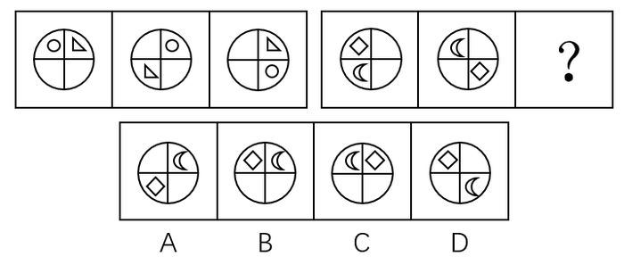

# 图形推理-位置规律（平移-移动格数）

考点：[[20-考点/判断推理/图形推理/图形推理-位置规律（平移-移动格数）|图形推理 / 图形推理-位置规律（平移/移动格数）]]

**问法模型**：两组三图对比、第二组末位为'？'→ 归纳第一组各元素的移动规律，原样套用到第二组外推问号处图形

## 推理链
1. 第1步：两组图形均为圆内分四格（四象限），第一组含'三角形+圆形'，第二组含'菱形+月亮'，元素组成相同，优先考虑位置移动规律
2. 第2步：将四格按顺时针编号：左上①、右上②、右下③、左下④，逐图记录每个元素所在格
3. 第3步：第一组三角形：②→④→②，每次移动两格（四格制下顺/逆时针走两格等价）；圆形：①→②→③，每次顺时针移动一格
4. 第4步：将规律套入第二组菱形：①→③→应回到①（左上），验证'每次移动两格'成立
5. 第5步：月亮：④→①→应在②（右上），验证'每次顺时针一格'成立
6. 第6步：逐项对照：A月亮位置对但菱形在④不符；B菱形在①、月亮在②，完全吻合；C两元素位置均不符；D月亮在③不符。只有B符合，故选B

**最快解法**：⚡ 位置追踪法：四格顺时针编号后，菱形每步走两格→问号处回到左上，月亮每步顺时针一格→问号处到右上，直接锁定B（或先排除C，再用月亮一步排除A、D更快）

## 易错点
- ⚠ 忽略'移动两格时顺/逆时针等价'，纠结方向浪费时间
- ⚠ 只盯一个元素（如菱形在左上就选D），漏验月亮位置导致误选D
- ⚠ 把格内元素自转/形状变化当规律，偏离平移主线

## 母题抽象
> 🧩 当两组图元素组成相同、仅位置变化时，给四格顺时针编号，逐一追踪每个元素每次移动的格数与方向，再外推到问号处逐项排除

**同类特征**：两组三图对比、圆分四格（田字象限）、每组含两个小元素、元素组成相同位置不同、移动步数呈周期规律、问号位于第二组末位

## 相关题
- [[10-真题/判断推理/图形推理/12536549 图形间关系-相交线（两图相交于线的线段条数呈等差递增）|12536549]]（深圳市考 2024，相关度1）
- [[10-真题/判断推理/图形推理/12881946 样式规律-求同（两图叠加保留相同部分-去异存同）|12881946]]（广东 2025，相关度1）
- [[10-真题/判断推理/图形推理/13432345 图形推理-位置规律（旋转-分组类比）|13432345]]（深圳市考 2025，相关度1）
- [[10-真题/判断推理/图形推理/2256359 数量规律-面数量（封闭区域数）|2256359]]（江西 2018，相关度1）

---

### 题干

根据所给图形的既有规律，选出一个最合理的答案（    ）。

### 选项
- A. A
- B. B　✅
- C. C
- D. D

### 官方解析
元素组成相同，优先考虑位置规律。第一组图形中，三角形每次顺时针或逆时针移动两格，圆形每次顺时针移动一格，第二组图形中，菱形每次顺时针或逆时针移动两格，月亮每次顺时针移动一格，则？处也应符合此规律，只有B项符合该规律。
故正确答案为B。

### 给定材料
（无）
