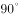

# 位置规律（旋转+翻转复合变换）

考点：[[20-考点/判断推理/图形推理/位置规律（旋转+翻转复合变换）|图形推理 / 位置规律（旋转+翻转复合变换）]]

**问法模型**：两组式图形推理，第一组给出变换规律 → 归纳第一组'旋转+翻转'规则后机械套用到第二组求问号图形

## 推理链
1. 第1步：两组图形均由5个小方格拼成同一形状（2×2方块外加1格），元素组成相同、仅整体朝向不同，优先考虑位置规律（旋转/翻转），而非样式或数量规律。
2. 第2步：第一组图1→图2：将图1整体顺时针旋转90°，左下单格转到上方、右侧2×2主体转到左侧竖排，与图2完全重合，确认第一步变换为'顺时针旋转90°'。
3. 第3步：第一组图2→图3：将图2再顺时针旋转90°后，以水平中轴做上下翻转，单格与2×2主体的相对位置与图3完全吻合，确认第二步变换为'顺时针旋转+上下翻转'。
4. 第4步：第二组遵循同一规律：图1→图2已呈现顺时针旋转90°，故问号处图形=第二组图2'顺时针旋转90°后再上下翻转'的结果。
5. 第5步：对第二组图2执行变换：顺时针转90°后底部单格转到左侧偏下；再上下翻转后单格移至左上、2×2主体位于右下，与A项轮廓及小方格相对位置完全一致。
6. 第6步：逐项对照：B项为竖向排布未完成翻转、C项朝向不符、D项与第一组图1同形（旋转不足、缺翻转），均无法由该复合变换得到，排除后锁定A。

**最快解法**：⚡ 位置规律口诀'先转后翻'：抓住第一组规律'顺时针旋转90°＋上下翻转'，对第二组图2依次执行两步变换，直接匹配A；配合排除法，先排除未翻转（B、D）和朝向不符（C）的选项。

## 易错点
- ⚠ 只考虑旋转、漏掉上下翻转，误选与图2同形或仅旋转的干扰项（如D）
- ⚠ 把'上下翻转'误做成'左右翻转'，选成镜像方向的错误选项
- ⚠ 只看大致轮廓不看单格与2×2主体的相对位置，被形状相同但朝向不同的干扰项迷惑

## 母题抽象
> 🧩 当两组式图形元素组成相同、仅朝向不同时，先从第一组归纳'旋转+翻转'的复合位置规律，再逐步套用到第二组，用小方格相对位置验证唯一匹配项。

**同类特征**：元素组成相同、两组式图形、小方格拼合轮廓（2×2外加1格）、仅朝向不同、旋转与翻转复合、位置规律

## 相关题
- [[10-真题/判断推理/图形推理/2172768 位置规律（旋转-翻转）|2172768]]（海南 2021，相关度2）
- [[10-真题/判断推理/图形推理/17499 位置规律-元素位置不重复（位置遍历）|17499]]（天津 2019，相关度2）
- [[10-真题/判断推理/图形推理/1758954 图形推理-位置规律（翻转：先左右翻转、再上下翻转）|1758954]]（上海 2016，相关度2）
- [[10-真题/判断推理/图形推理/2185066 位置规律-旋转（双图形分别旋转，一逆一顺）|2185066]]（广东 2018，相关度2）
- [[10-真题/判断推理/图形推理/2188058 位置规律（旋转+翻转复合变换）|2188058]]（选调 2018，相关度2）

---

### 题干

从所给四个选项中，选择最合适的一个填入问号处，使之呈现一定的规律性：

### 选项
- A. A　✅
- B. B
- C. C
- D. D

### 官方解析

元素组成相同，考虑位置规律。第一行图，第一个图形顺时针旋转得到第二个图形，第二个图形顺时针旋转后再上下翻转得到第三个图形。第二行图按照此规律，将第二个图形先顺时针旋转后再上下翻转。

故正确答案为A。

### 给定材料
（无）
