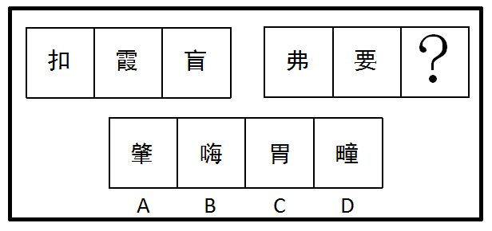

# 数量规律-面数量（汉字封闭区域计数）

考点：[[20-考点/判断推理/图形推理/数量规律-面数量（汉字封闭区域计数）|图形推理 / 数量规律-面数量（汉字封闭区域计数）]]

**问法模型**：两组各三个汉字填问号呈现规律 → 元素组成不同时先看属性、属性无规律则分组数面（封闭区域数）找等差规律

## 推理链
1. 第1步：题干分两组汉字，第一组为'扣、霞、盲'，第二组为'弗、要、？'，选项A肇、B晦、C胃、D疃也均为汉字
2. 第2步：元素组成不同，优先考虑属性规律，对称/开闭/曲直均无规律；图形均由汉字构成且封闭区域明显，转而数面
3. 第3步：数第一组面数量：'扣'仅'口'1个封闭区域=1，'霞'=2，'盲'中'目'被两横分割=3，呈1、2、3的等差规律
4. 第4步：第二组套用同一规律：'弗'=4，'要'=5，故问号处应为面数量=6的汉字
5. 第5步：逐项数面：A肇、B晦（日2+母2=4）、D疃的面数均不为6；C'胃'=田（4面）+月（2面）=6面
6. 第6步：只有C项面数量为6，满足第二组4、5、6的等差规律，故选C

**最快解法**：⚡ 数面法+部件面数口诀：熟记'口=1、日=2、目=3、田=4、月=2'，第二组'弗'4面、'要'5面，直接锁定需6面的字，'胃'=田4+月2=6，秒选C

## 易错点
- ⚠ 数复杂汉字时漏数被内部笔画分割出的封闭区域（如'胃'的'田'要算4面、'月'要算2面）
- ⚠ 误把汉字笔画数、部分数（偏旁个数）当作数量规律，与面数量混淆而选错
- ⚠ 对'弗''要'等字数面不准，导致第二组首两图数字估错，等差规律错位后排除掉正确选项

## 母题抽象
> 🧩 当题干图形全部为汉字且属性（对称、开闭、曲直）无规律时，优先按组数面找等差规律（如1、2、3、4、5、6），用常用部件面数口诀（口1日2目3田4）快速拆字计数验证选项

**同类特征**：图形全部由汉字组成、元素组成不同、属性规律无效、封闭区域（面）数量特征明显、两组图各三幅的类比型排布、面数量成等差数列

## 相关题
- [[10-真题/判断推理/图形推理/2033324 数量规律-面数量（等差数列）|2033324]]（河南 2016，相关度2）
- [[10-真题/判断推理/图形推理/4675394 数量规律-面数量（汉字封闭区域数，奇偶分组）|4675394]]（选调 2021，相关度2）
- [[10-真题/判断推理/图形推理/5908625 数量规律-面数量（汉字封闭区域计数）|5908625]]（山东 2024，相关度2）
- [[10-真题/判断推理/图形推理/10204454 数量规律-部分数（黑白球连通区域数做和）|10204454]]（甘肃 2024，相关度1）
- [[10-真题/判断推理/图形推理/10204604 数量规律-线数量（汉字横线数）|10204604]]（辽宁 2024，相关度1）

---

### 题干

从所给四个选项中，选择最合适的一个填入问号处，使之呈现一定的规律性：

### 选项
- A. A
- B. B
- C. C　✅
- D. D

### 官方解析
元素组成不同，考虑属性与数量规律。属性无规律，图形均为汉字组成，面数量较多，考虑数面。第一组图中：面数量分别为1、2、3。第二组图中：面数量分别为4、5、?，?处应该为6，只有C选项面的个数是6。
故正确答案为C。

### 给定材料
（无）
