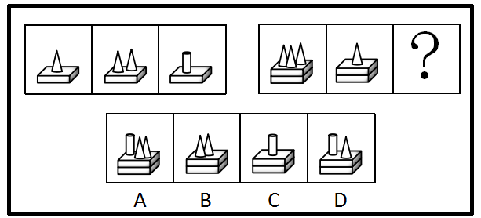
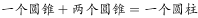
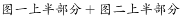
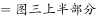
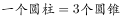

# 样式规律-图形相加与等价换算（3个圆锥=1个圆柱，底部长方体不变）

考点：[[20-考点/判断推理/图形推理/样式规律-图形相加与等价换算（3个圆锥=1个圆柱，底部长方体不变）|图形推理 / 样式规律-图形相加与等价换算（3个圆锥=1个圆柱，底部长方体不变）]]

**问法模型**：两组图类比对号入座：第一组图找完整规律（上下分开看：底座不变+上方元素相加换算），第二组套用同一规律得问号处图形

## 推理链
1. 第1步：两组图元素组成相似，每幅图均由“下方1个长方体平台+上方的圆锥/圆柱”构成，第一组上方依次为1个圆锥、2个圆锥、1个圆柱，考虑样式规律且上下分开看
2. 第2步：下半部分长方体数量不变（第一组三图均为1个平台）；上半部分满足“图1+图2=图3”的相加关系：1个圆锥+2个圆锥=3个圆锥，恰好对应图3的1个圆柱，即等价换算“3个圆锥=1个圆柱”（同底等高时圆柱体积为圆锥的3倍）
3. 第3步：将规律套用到第二组：图1上方3个圆锥+图2上方1个圆锥=4个圆锥
4. 第4步：按等价换算，4个圆锥=1个圆柱（3个圆锥换成1个圆柱）+剩余1个圆锥，故问号处上方应为“1个圆柱+1个圆锥”
5. 第5步：下半部分长方体数量不变，问号处下方仍为单个长方体平台；A项平台呈双层叠加样式，与“长方体不变”不符，排除A
6. 第6步：逐项对照：B为2个圆锥、C为1个圆柱，均与“1个圆柱+1个圆锥”不符；D为长方体上1个圆柱+1个圆锥，与推导完全一致，故选D

**最快解法**：⚡ 相加+等价换算法：第二组上方3锥+1锥=4锥，由第一组“3个圆锥=1个圆柱”知4锥=1圆柱+1圆锥，底部长方体不变，直接锁定D

## 易错点
- ⚠ 忽略等价换算：直接数个数得到“4个圆锥”，发现四个选项均无4个圆锥而卡壳，实质是3个圆锥合为1个圆柱
- ⚠ 换算比例记错：误按“2个圆锥=1个圆柱”换算成2个圆柱或1个圆柱，错选C
- ⚠ 只盯上半部分元素、忽略下半部分长方体数量不变这一约束，误选平台为双层叠加样式的A

## 母题抽象
> 🧩 当两组图形均为“固定底座+上方同类不同量的小元素”时，用‘上下分开看+图1加图2等价换算’：先由第一组确定换算比例（如3个圆锥=1个圆柱），再对第二组元素相加后按比例换算选答案

**同类特征**：两组图对比类推、元素组成相似、底座（长方体）+上方圆锥/圆柱、小立体数量逐图变化、图一+图二=图三、等价替换/数量运算

## 相关题
- [[10-真题/判断推理/图形推理/10204610 样式规律-加减同异（去同存异），九宫格列规律|10204610]]（辽宁 2024，相关度1）
- [[10-真题/判断推理/图形推理/10297349 样式规律-黑白运算|10297349]]（浙江 2025，相关度1）
- [[10-真题/判断推理/图形推理/10297407 样式规律-黑白运算（定义叠加）|10297407]]（四川 2025，相关度1）
- [[10-真题/判断推理/图形推理/11226895 图形推理-样式规律（叠加求同-保留相同部分）|11226895]]（上海 2025，相关度1）
- [[10-真题/判断推理/图形推理/11226896 样式规律-加减同异（分区域：上圆内部求异+下椭圆内部求同）|11226896]]（上海 2025，相关度1）

---

### 题干

从所给四个选项中，选择最合适的一个填入问号处，使之呈现一定的规律性：

### 选项
- A. A
- B. B
- C. C
- D. D　✅

### 官方解析

元素组成相似，考虑样式规律。第一组图中每幅图均有一个长方体，长方体上分别有一个圆锥、两个圆锥、一个圆柱，把图形分成上下两个部分来看，上半部分的，下半部分长方体数量不变，所以规律是：，，下半部分的长方体数量不变。第二组图按照此规律进行相加，？处上半部分为4个圆锥，而。

故正确答案为D。

### 给定材料
（无）

> [!warning] 疑点（官方解析可能有误，待人工复核）
> 官方解析中关键换算公式文字缺失（“规律是：，，”及“而。”处内容显示不全），但依据答案D与两组图形可唯一还原为“3个圆锥=1个圆柱”的等价换算，还原后解析自洽，不影响正确答案

<!-- CODEX-ANSWER-REVIEW:BEGIN -->
### 本次独立复核

**复核状态：** `confirmed`（独立复算确认答案）

**计分答案：** D（可计分）

**复核解析：**

第一组建立的数量对应关系是3个圆锥体等于1个圆柱体；底座形状在各图中保持不变。第二组已给出3个圆锥体和1个圆柱体，共相当于4个圆锥体，因此空格应补成1个圆柱体加1个圆锥体，只有D满足，选D。

**相关信息：**

判断推理—图形数量等价替换；先将第一组中的立体图形化为共同计量单位，再保持底座等其他不变属性。

**题源依据：** [固定版本原题](https://github.com/Mentat-Uran/kaogongzhentizhengliu/blob/84ab93d4b64b61d897bece8a1c0a5bab06b4feb2/10-%E7%9C%9F%E9%A2%98/%E5%88%A4%E6%96%AD%E6%8E%A8%E7%90%86/%E5%9B%BE%E5%BD%A2%E6%8E%A8%E7%90%86/2166151%20%E6%A0%B7%E5%BC%8F%E8%A7%84%E5%BE%8B-%E5%9B%BE%E5%BD%A2%E7%9B%B8%E5%8A%A0%E4%B8%8E%E7%AD%89%E4%BB%B7%E6%8D%A2%E7%AE%97%EF%BC%883%E4%B8%AA%E5%9C%86%E9%94%A5%3D1%E4%B8%AA%E5%9C%86%E6%9F%B1%EF%BC%8C%E5%BA%95%E9%83%A8%E9%95%BF%E6%96%B9%E4%BD%93%E4%B8%8D%E5%8F%98%EF%BC%89.md)；固定内容 commit `84ab93d4b64b61d897bece8a1c0a5bab06b4feb2`，Markdown blob `1854eb67cea250a3edfd78ae3cb13031d2a79b01`。
<!-- CODEX-ANSWER-REVIEW:END -->
