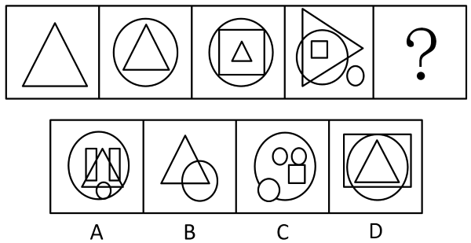

# 数量规律-数素（元素个数递增）+特定图形特征（三角形）二次验证

考点：[[20-考点/判断推理/图形推理/数量规律-数素（元素个数递增）+特定图形特征（三角形）二次验证|图形推理 / 数量规律-数素（元素个数递增）+特定图形特征（三角形）二次验证]]

**问法模型**：问号处填入符合前四个图形变化规律的图形 → 元素组成不同且无属性规律时数元素个数，呈等差递增后用贯穿特征图形二次筛选

## 推理链
1. 第1步：题干四图元素组成不同，对称、曲直等属性无明显统一规律，转向数量规律考虑'数素'
2. 第2步：逐图数元素个数：图1为1个三角形，图2为三角形+大圆共2个，图3为三角形+正方形+圆共3个，图4为三角形+正方形+圆+小圆共4个，个数依次为1、2、3、4，构成等差递增
3. 第3步：故？处图形应含5个元素；B项仅三角形+圆共2个元素，D项仅正方形+圆+三角形共3个元素，据元素个数排除B、D
4. 第4步：A项含大圆、两个矩形、三角形、小圆共5个元素，C项含大圆、两个小圆、正方形、小圆共5个元素，均满足5个元素，需二次验证
5. 第5步：再次观察发现题干四个图形中均包含1个三角形，A项含三角形而C项不含三角形，只有A项同时满足'5个元素+含三角形'，故选A

**最快解法**：⚡ 数素法+特征图形验证：先数元素个数1、2、3、4→？为5，排除B(2个)、D(3个)；再用'每图均含1个三角形'在A、C中锁定A

## 易错点
- ⚠ A、C两项均为5个元素，若只做'数个数'一级验证不进行'含三角形'二级验证，易误选C
- ⚠ 数C项元素时可能将两个并列小圆误并为一个而误判为4个元素，干扰排除判断
- ⚠ 只盯整体个数递增规律，忽略'每图包含1个三角形'这一贯穿全部题干图形的特征

## 母题抽象
> 🧩 当图形元素组成不同且无明显属性规律时，数每幅图的元素个数；若呈等差递增，先按个数排除部分选项，再以贯穿题干所有图形的特定图形（如三角形）作为二级特征验证，锁定唯一答案

**同类特征**：元素组成不同、无明显属性规律、元素个数1、2、3、4等差递增、每个图形均含1个三角形、问号处填入第五个图形

## 相关题
- [[10-真题/判断推理/图形推理/10204454 数量规律-部分数（黑白球连通区域数做和）|10204454]]（甘肃 2024，相关度2）
- [[10-真题/判断推理/图形推理/10297050 数量规律-特殊计数（线条穿过小白球的数量）|10297050]]（天津 2025，相关度2）
- [[10-真题/判断推理/图形推理/10297262 数量规律-面的形状种类（封闭面种类数分组）|10297262]]（浙江 2025，相关度2）
- [[10-真题/判断推理/图形推理/10297314 数量规律-交点数（曲直交点）|10297314]]（浙江 2025，相关度2）
- [[10-真题/判断推理/图形推理/11454020 数量规律-小元素按行排布（每行个数自上而下递增1）|11454020]]（选调 2024，相关度2）

---

### 题干

请选择最适合的一项填入问号处，使之符合之前四个图形的变化规律。

### 选项
- A. A　✅
- B. B
- C. C
- D. D

### 官方解析
图形元素组成不同，且无明显属性规律，考虑数量规律。观察发现，题干图形出现了若干元素，考虑数素。题干图形中元素的个数分别为：1、2、3、4，故？处应为5个元素，排除B、D两项。再次观察图形发现，题干每个图形中均包含1个三角形，只有A项符合。
故正确答案为A。

### 给定材料
（无）
