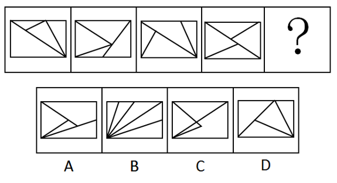

# 数量规律-面（面数量+面的形状二级辨析）

考点：[[20-考点/判断推理/图形推理/数量规律-面（面数量+面的形状二级辨析）|图形推理 / 数量规律-面（面数量+面的形状二级辨析）]]

**问法模型**：填入问号处使之符合前四个图形的变化规律 → 元素组成不同且无属性规律时，优先数面数量，数量无法锁定唯一答案时再做面的形状二级验证

## 推理链
1. 第1步：题干四幅图均为矩形被内部线条分割成多个封闭区域，元素组成不同、对称等属性规律不明显，转入数量规律
2. 第2步：'封闭区域被分割'是数面的典型信号，优先数面：图1至图4的面数量均为4
3. 第3步：对照选项先筛面数：B项多条线自同一顶点放射，面数明显多于4，排除B
4. 第4步：面数4不能唯一锁定答案（A、C面数亦可能为4），启动二级验证：题干所有面的形状均为三角形，无四边形面
5. 第5步：逐项验证形状：A、C项中均含有非三角形的封闭面（四边形区域），排除
6. 第6步：D项面数为4且每个面均为三角形，与题干'面数量+面形状'双重规律完全吻合，故选D

**最快解法**：⚡ 数面法+面形状二级辨析（口诀：分割图形先数面，数量不够看形状）：先数出面数量均为4排除B；再验证'所有面均为三角形'，A、C含四边形面排除，锁定D

## 易错点
- ⚠ 只数面数量不验证面形状：A、C面数同为4，仅凭数量规律会误选
- ⚠ B项多线交汇于同一顶点，面数易漏数错数
- ⚠ 见到分割图形先去数线段/交点/角，未优先数面，考场浪费时间

## 母题抽象
> 🧩 当图形元素组成不同、无明显属性规律且整体被线条分割出封闭区域时，用'数面→面的形状'两级规律：先数面数量筛除不一致项，再以'所有面均为X边形'做二级辨析锁定唯一答案

**同类特征**：元素组成不同、无明显属性规律、封闭区域被分割、面数量均为4、面的形状均为三角形、矩形内部线条分割

## 相关题
- [[10-真题/判断推理/图形推理/10204454 数量规律-部分数（黑白球连通区域数做和）|10204454]]（甘肃 2024，相关度2）
- [[10-真题/判断推理/图形推理/10297050 数量规律-特殊计数（线条穿过小白球的数量）|10297050]]（天津 2025，相关度2）
- [[10-真题/判断推理/图形推理/10297262 数量规律-面的形状种类（封闭面种类数分组）|10297262]]（浙江 2025，相关度2）
- [[10-真题/判断推理/图形推理/10297314 数量规律-交点数（曲直交点）|10297314]]（浙江 2025，相关度2）
- [[10-真题/判断推理/图形推理/11454020 数量规律-小元素按行排布（每行个数自上而下递增1）|11454020]]（选调 2024，相关度2）

---

### 题干

请选择最适合的一项填入问号处，使之符合之前四个图形的变化规律。

### 选项
- A. A
- B. B
- C. C
- D. D　✅

### 官方解析
图形元素组成不同，且无明显属性规律，考虑数量规律。观察发现，题干图形均为封闭区域被分割，优先考虑数面。观察发现，题干图形面的数量均为4，排除B项。再次观察发现，题干图形的面的形状均为三角形，故？处图形的面也应均为三角形，只有D项符合。
故正确答案为D。

### 给定材料
（无）
