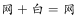
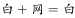
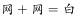
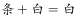
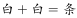
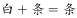

# 样式规律-定义叠加（黑白运算，网格-竖线-白三色运算表）

考点：[[20-考点/判断推理/图形推理/样式规律-定义叠加（黑白运算，网格-竖线-白三色运算表）|图形推理 / 样式规律-定义叠加（黑白运算，网格/竖线/白三色运算表）]]

**问法模型**：问'填入问号使之符合整个图形的变化规律'且每行图形轮廓相同、仅填充图案不同 → 按横行逐位置做'定义叠加（黑白运算）'，先从前两行归纳运算规则，再套用到第三行

## 推理链
1. 第1步：九宫格每行轮廓一致（第一行6个圆、第二行3个三角形、第三行2×3矩形格），仅内部填充为'网格、竖线、白'三种且分布不同，属元素组成相似，考虑样式叠加
2. 第2步：按横行同位置归纳叠加表：网格+网格=白、白+白=竖线、网格+白=网格、白+网格=白、白+竖线=竖线、竖线+白=白（即'异色相加保留第一个图形的填充，同色相加变为下一色'）
3. 第3步：用第一行验证：顶部圆'网格+白=网格'、左中圆'网格+网格=白'、中右圆'白+网格=白'、右下圆'网格+网格=白'，与第三图完全吻合
4. 第4步：用第二行验证：顶三角'竖线+白=白'、中三角'白+白=竖线'、底三角'白+竖线=竖线'，与第三图一致，规则成立
5. 第5步：将规则套用第三行六格：左上'网格+网格=白'、右上'白+网格=白'、左中'白+竖线=竖线'、右中'网格+白=网格'、左下'竖线+白=白'、右下'白+白=竖线'
6. 第6步：对照选项，问号处应为'第一行两白、第二行左竖线右网格、第三行左白右竖线'，仅B项完全符合，故选B

**最快解法**：⚡ 定义叠加+排除法：只看第三行图形的最上一行两格即可排除——左上'网格+网格'由第一行同位置规律知=白，排除C（左上网格）；右上'白+网格'知=白，排除A、D（右上网格），直接锁定B

## 易错点
- ⚠ 套用常规'同色得白、异色得阴影'口诀会出错，本题'白+白=竖线、白+网格=白'是特殊规则，必须从前两行完整归纳三色运算表
- ⚠ 九宫格若先看列或整体数阴影个数将找不到规律，本题规律在横行逐位置相加
- ⚠ 第三行同时含'网格'与'竖线'两种阴影，逐格相加时易混淆两种阴影类型（如把'白+竖线'误当'白+网格'处理）

## 母题抽象
> 🧩 当九宫格（或两组式）图形轮廓相同、仅内部填充图案不同时，按横行同位置做定义叠加：先从前两行穷举出各图案对的运算结果表，再逐格套用到第三行对照选项排除

**同类特征**：九宫格、每行轮廓相同、填充图案不同、网格/竖线/白色三种填充、黑白运算（定义叠加）、逐位置相加、第三行问号求图

## 相关题
- [[10-真题/判断推理/图形推理/10204610 样式规律-加减同异（去同存异），九宫格列规律|10204610]]（辽宁 2024，相关度1）
- [[10-真题/判断推理/图形推理/10297349 样式规律-黑白运算|10297349]]（浙江 2025，相关度1）
- [[10-真题/判断推理/图形推理/10297407 样式规律-黑白运算（定义叠加）|10297407]]（四川 2025，相关度1）
- [[10-真题/判断推理/图形推理/10975255 数量规律-元素个数与部分数（黑白球连通堆数）|10975255]]（江苏 2024，相关度1）
- [[10-真题/判断推理/图形推理/11367791 属性类-对称性（对称轴方向与条数、轴对称+中心对称）＋数量类-面数量（九宫格横行复合规律）|11367791]]（江苏 2025，相关度1）

---

### 题干

请选择最适合的一项填入问号处，使之符合整个图形的变化规律。（  ）

### 选项
- A. A
- B. B　✅
- C. C
- D. D

### 官方解析

图形元素组成相似，考虑样式规律。九宫格图形优先按横行来看，观察发现，每一行的三个图形轮廓相同、内部颜色不同，考虑黑白运算。第一行中，，，；第二行中，，，；第三行也应该符合此规律，运算可得B项。

故正确答案为B。

### 给定材料
（无）
