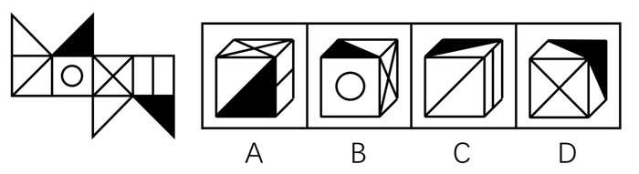
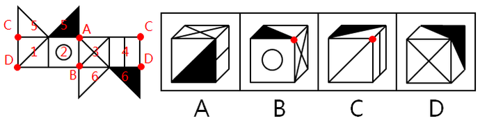

# 空间重构-六面体折纸盒（相对面排除＋公共点法）

考点：[[20-考点/判断推理/图形推理/空间重构-六面体折纸盒（相对面排除＋公共点法）|图形推理 / 空间重构-六面体折纸盒（相对面排除＋公共点法）]]

**问法模型**：题干给纸盒外表面展开图、问'右边哪一项能由它折叠而成'→ 折纸盒模型：先排相对面，再定位相邻三面公共点验证图案特征与方向。

## 推理链
1. 第1步：给展开图各面编号：面1（对角线面）、面2（圆面）、面3（对角线/X面）、面4（竖线面）、面5（含黑色三角形）、面6（含白色与黑色三角形），其中面5与面6折叠后互为相对面。
2. 第2步：所用规则——相对面不能在立体图中同时出现；相邻三个面的公共点在展开图中位置唯一，公共点所压的图案特征（三角形直角点、对角线交点）必须与选项完全一致。
3. 第3步：D项由面3、面5和面6组成，而'面5与面6互为相对面，不能同时出现'，直接排除D。
4. 第4步：B项由面2、面3和面5或面6组成，三面公共点在展开图中为A点或B点——'A点面5中为黑色三角形直角点、B点为面6中白色三角形的直角点'，而选项中三面公共点'既不是黑色三角形的直角点，又不是白色三角形的直角点'，排除B。
5. 第5步：C项由面1、面4和面5或面6组成，公共点为C点或D点；只有当三面为面1、面4、面6时D点与面1对角线相交，此时'D点也应与面6中黑三角形的直角点重合'，但选项中公共点不与黑三角形直角点重合，排除C。
6. 第6步：A项由面3、面4和面6组成，三个面两两相邻，图案种类、相对位置及公共点关系均与展开图一致，当选。

**最快解法**：⚡ 相对面排除＋公共点法：先用'面5与面6为相对面'秒杀D项；再对B、C项用三面公共点定位——展开图中公共点必须落在黑白三角形的直角点上，而B、C选项的公共点均未落在直角点上，排除，故选A。

## 易错点
- ⚠ 忽略面5、面6是由三角形拼合的面且互为相对面，误以为可同时出现而误选D项
- ⚠ 只核对三面图案种类是否齐全，忽略公共点必须落在特征图案（黑/白三角形直角点）上的方向验证
- ⚠ 展开图中三角形面折叠后的拼合关系看错，导致A、B、C、D公共点定位错误

## 母题抽象
> 🧩 当六面体展开图中出现'黑白三角形等带直角顶点特征的面'时，先用相对面排除删项，再用三个相邻面的公共点法，验证公共点是否落在特征图案的直角点/交点上。

**同类特征**：纸盒外表面展开图折叠、黑白三角形面（直角顶点特征）、圆面/对角线面/竖线面等特征图案、三面公共点定位、相对面不能同时出现、问'哪一项能由它折叠而成'

## 相关题
- [[10-真题/判断推理/图形推理/2367990 空间重构-六面体折叠（相对面排除＋相邻面特征边验证）|2367990]]（江苏 2019，相关度3）
- [[10-真题/判断推理/图形推理/12561915 空间重构-六面体折叠（相对面排除+公共点法）|12561915]]（浙江 2024，相关度2）
- [[10-真题/判断推理/图形推理/1746880 空间重构-六面体折叠（相对面排除+画边法）|1746880]]（国考 2016，相关度2）
- [[10-真题/判断推理/图形推理/4004562 空间重构-六面体折纸盒（相对面排除＋公共点法）|4004562]]（新疆 2021，相关度2）
- [[10-真题/判断推理/图形推理/4928010 空间重构-折纸盒（相对面排除+公共边-公共点法）|4928010]]（选调 2022，相关度2）

---

### 题干

左边给定的是纸盒的外表面，右边哪一项能由它折叠而成？（  ）

### 选项
- A. A　✅
- B. B
- C. C
- D. D

### 官方解析

先对题干展开图的各面进行编号，如下图所示。

A项：由面3、面4和面6组成，与题干展开图一致，当选；

B项：由面2、面3和面5或面6组成，在题干展开图中，其三个面的公共点为A点或B点，其中A点面5中为黑色三角形直角点、B点为面6中白色三角形的直角点，而在选项中，三个面的公共点既不是黑色三角形的直角点，又不是白色三角形的直角点，选项与题干展开图不一致，排除；

C项：由面1、面4和面5或面6组成，在题干展开图中，其三个面的公共点为C点或D点，其中只有在选项三个面分别为面1、面4和面6的时候，D点会与面1中的对角线相交，但此时D点也应与面6中黑三角形的直角点重合，但选项中三个面的公共点并不与黑三角形的直角点重合，选项与题干展开图不一致，排除；

D项：由面3、面5和面6组成 ，其中面5与面6互为相对面，不能同时出现，选项与题干展开图不一致，排除。

故正确答案为A。

### 给定材料
（无）
