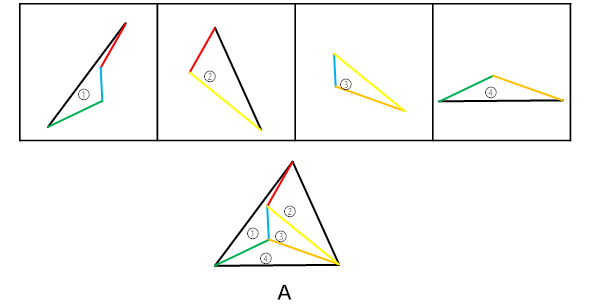

# 平面拼合-平行且等长相消

考点：[[20-考点/判断推理/图形推理/平面拼合-平行且等长相消|图形推理 / 平面拼合-平行且等长相消]]

**问法模型**：四个小图形限定'只能平移'拼合、问拼成哪个轮廓 → 用平行且等长相消法消去内部重合线段，剩余轮廓对照选项

## 推理链
1. 第1步：提取规则——题干限定四个图形'只能通过上、下、左、右平移'拼合，即各碎片方向固定，不可旋转、翻转
2. 第2步：提取碎片特征——①为带凹口的凹四边形（箭头形），②为细长三角形，③为小三角形，④为扁平钝角三角形
3. 第3步：采用'平行且等长相消'法——两块碎片上平行且等长的边对接后重合相消，剩余外围线段即为拼合轮廓
4. 第4步：先看①与③：①凹口的两条边与③小三角形的两条边平行且等长，将③嵌入①的凹口，消去重合边后合成一个大三角形
5. 第5步：再将②、④的斜边与该轮廓上平行且等长的边依次对接相消，消去全部内部线段
6. 第6步：逐项对照选项——剩余外围轮廓为一个完整大三角形，与A一致；B为四边形、C为五边形、D为顶角被切的梯形，轮廓形状与边数均不符
7. 第7步：故四个图形仅经平移拼合的结果唯一对应A

**最快解法**：⚡ 平行且等长相消法＋轮廓锁定：先把③小三角形嵌入①的凹口（两边平行等长相消）合成大三角形，再将②、④沿平行等长的斜边对接相消，剩余轮廓为三角形，直接锁定A；辅助验证——B（四边）、C（五边）、D（梯形四边）边数均与三角形不符，可快速排除

## 易错点
- ⚠ 误以为碎片可以旋转或翻转后拼合，题干明确限定只能上、下、左、右平移，各边斜率方向必须保持原样
- ⚠ 只看轮廓大致相似，把B、D这类近似三角形的四边形误认，未做平行且等长的严格验证
- ⚠ 忽略凹四边形①的凹口必须由③小三角形填补这一关键步骤，导致拼不出完整轮廓而错选

## 母题抽象
> 🧩 当题干出现'多个小图形拼合、只能平移'的特征时，用平行且等长相消法：先找平行且等长的边两两对接（注意凹口需由对应三角形碎片填补），消去全部内部重合线段后，将剩余轮廓与选项比对即得答案

**同类特征**：平面拼合、只能上、下、左、右平移（不可旋转翻转）、碎片含凹四边形与多个三角形、平行且等长相消、拼合轮廓为三角形、选项以四边形/五边形作干扰

## 相关题
- [[10-真题/判断推理/图形推理/11367796 平面拼合-平行且等长相消|11367796]]（江苏 2025，相关度4）
- [[10-真题/判断推理/图形推理/2367804 平面拼合-平行且等长相消|2367804]]（江苏 2019，相关度3）
- [[10-真题/判断推理/图形推理/2452786 平面拼合-平行且等长相消|2452786]]（江苏 2020，相关度3）
- [[10-真题/判断推理/图形推理/2742172 平面拼合-平行且等长相消|2742172]]（江苏 2021，相关度3）
- [[10-真题/判断推理/图形推理/10975247 图形推理-平面拼合（平行且等长相消法）|10975247]]（江苏 2024，相关度2）

---

### 题干

下边四个图形中，只有一个是由上边的四个图形拼合（只能通过上、下、左、右平移）而成的，请把它找出来。

### 选项
- A. A　✅
- B. B
- C. C
- D. D

### 官方解析

本题考查平面拼合，可采用平行且等长相消的方式解题。消去平行且等长的线段后进行组合即可得到轮廓图，即为A选项。平行且等长相消的方式如下图所示：

故正确答案为A。

### 给定材料
（无）
