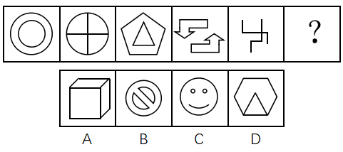

# 数量规律-笔画数（奇点数法，两笔画规律）

考点：[[20-考点/判断推理/图形推理/数量规律-笔画数（奇点数法，两笔画规律）|图形推理 / 数量规律-笔画数（奇点数法，两笔画规律）]]

**问法模型**：“填入问号处，使其呈现一定的规律性”→元素组成不同且属性无统一规律时，转向数量规律，本题以笔画数特征图锁定笔画数考点

## 推理链
1. 第1步：题干五图元素组成不同（同心圆、“田”字变形圆、五边形套三角形、双箭头、多端点折线），对称、曲直、封闭等属性无统一规律，转向数量规律
2. 第2步：识别笔画数特征图：图2为“田”字变形，图5有多个端点，均为笔画数典型特征图，故优先考虑笔画数
3. 第3步：数奇点验证题干：图1两个独立圆=2笔；图2外圆加十字有4个奇点（圆周4个三线交点，圆心为偶点）=2笔；图3五边形与三角形两个独立封闭图形=2笔；图4两个独立箭头=2笔；图5多端点折线为2笔，规律：题干均为两笔画
4. 第4步：问号处应填入两笔画图形
5. 第5步：逐项数笔画：A项立方体有4个奇点=两笔画；B项禁止符号（外圆+内圆+斜杠）=三笔画；C项笑脸（外圆+双眼+嘴）=四笔画；D项六边形内接三角形仅2个奇点=一笔画
6. 第6步：只有A项满足两笔画规律，故选A

**最快解法**：⚡ 特征图定位法：见“田”字变形、多端点折线即锁定笔画数考点；先用奇点数÷2确认题干均为两笔画，再快速数选项：A立方体4奇点=2笔，直接锁定A，无需细算B/C/D（可作排除复核：B为3笔、C为4笔、D为1笔）

## 易错点
- ⚠ 看到A项立方体、C项笑脸这类带“外观含义”的图形，误入对称/封闭面等属性或面数量规律，漏掉笔画数这一核心考点
- ⚠ 立方体A项奇点数易数错：须逐点检查每条棱交汇处的连线数，4个奇点才是两笔画，勿误判为一笔画
- ⚠ 忽略“田”字变形与多端点图形是笔画数的典型提示信号，先去数面（如把图3当“内外两个封闭区域”）会走进死胡同

## 母题抽象
> 🧩 当图形元素组成不同、属性规律不统一，且出现“田”字变形、多端点折线、多个独立图形相套等特征时，用奇点数法数笔画数（奇点数÷2），题干全为两笔画时问号处也选两笔画图形

**同类特征**：元素组成不同、属性规律不明显、“田”字变形、多端点折线、独立图形相套（同心圆/外多边形内图形）、两笔画规律

## 相关题
- [[10-真题/判断推理/图形推理/19591589 属性规律（轴对称）+数量规律（笔画数-两笔画）|19591589]]（选调 2025，相关度2）
- [[10-真题/判断推理/图形推理/2184682 图形推理-数量规律（一笔画-奇点计数）|2184682]]（选调 2018，相关度2）
- [[10-真题/判断推理/图形推理/2262791 数量规律-笔画数（奇点法判定一笔画-两笔画）|2262791]]（天津 2016，相关度2）
- [[10-真题/判断推理/图形推理/2444712 数量规律-小元素种类数（九宫格按行递增）|2444712]]（四川 2019，相关度2）
- [[10-真题/判断推理/图形推理/2725328 数量规律-部分数（相同图形的连通性）|2725328]]（四川 2020，相关度2）

---

### 题干

从四个图中选出唯一的一项，填入问号处，使其呈现一定的规律性。

### 选项
- A. A　✅
- B. B
- C. C
- D. D

### 官方解析
图形元素组成不同，无明显属性规律，考虑数量规律。观察发现，图2为“田”字变形，图5有多个端点，均为笔画数特征图，故考虑笔画数。题干均为两笔画图形，A项为两笔画图形，B项为三笔画图形，C项为四笔画图形，D项为一笔画图形，只有A项满足。
故正确答案为A。

### 给定材料
（无）
