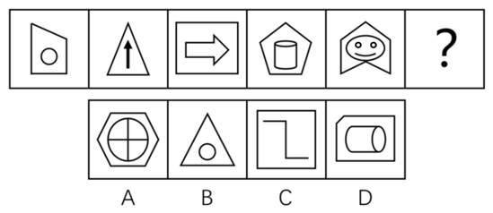

# 图形推理-数量规律（面数量与外框边数的差值恒定）

考点：[[20-考点/判断推理/图形推理/图形推理-数量规律（面数量与外框边数的差值恒定）|图形推理 / 图形推理-数量规律（面数量与外框边数的差值恒定）]]

**问法模型**：图形组成不同且无明显属性规律 → 优先数面数量，面数量单独无规律时，寻找面数量与另一数量特征（外框边数）的复合运算规律（差值恒定）

## 推理链
1. 第1步：题干五幅图均由'外框+内部元素'构成，封闭区域明显，先数面数量：依次为2、1、2、3、4，单独看不成规律
2. 第2步：转换思路观察外框：每幅图都有明显外框，外框边数依次为4（四边形）、3（三角形）、4（矩形）、5（五边形）、6（盾形六边框）
3. 第3步：对两组数列做减法运算：外框边数-面数量=4-2=2、3-1=2、4-2=2、5-3=2、6-4=2，差值恒为2
4. 第4步：归纳规律——问号处图形应满足'外框边数-面数量=2'
5. 第5步：逐项验证：A六边形框6边，内部十字将圆分为4面加外框共5面，6-5=1，排除；B三角形框3边，内含圆共2面，3-2=1，排除；C矩形框4边，内部为Z形折线不封闭仅1面，4-1=3，排除；D切角五边形框5边，内部横放圆柱2个封闭面加外框共3面，5-3=2，符合

**最快解法**：⚡ 差值恒定法：先数面数量得2、1、2、3、4（无规律），立刻再数外框边数得4、3、4、5、6，发现'边数-面数'恒为2；代入选项验算：D为5边框-3面=2，秒选D

## 易错点
- ⚠ 只数面数量发现2、1、2、3、4无规律就放弃，没想到与外框边数做减法运算的复合数列规律
- ⚠ 圆柱、块状箭头等图形封闭面数错：圆柱算2个封闭面，箭头须区分开放折线（图2不计面）与封闭块箭头（图3计1面）
- ⚠ D项外框左上角被切角，误看成普通四边形导致边数数错（实为5边形）
- ⚠ 第5幅盾形外框边数误数成5，漏数顶部缺口处的一条边（应为6边）

## 母题抽象
> 🧩 当题干图形都有明显外框、面数量单独无规律时，考虑'外框边数与面数量的差值（或和值）恒定'这一复合数量规律，逐项验证差值是否等于常数

**同类特征**：元素组成不同、每幅图均有外框、封闭区域（面）明显、面数量单独无规律、外框边数依次4/3/4/5/6、边数-面数差值恒为2

## 相关题
- [[10-真题/判断推理/图形推理/12100999 数量规律-面数量（封闭区域数）|12100999]]（江苏 2025，相关度2）
- [[10-真题/判断推理/图形推理/15137567 数量规律-线与面的数量做差运算（直线数-面数量）|15137567]]（湖北 2024，相关度2）
- [[10-真题/判断推理/图形推理/2307699 数量规律-面数量与外框边数的差值恒定规律|2307699]]（辽宁 2018，相关度2）
- [[10-真题/判断推理/图形推理/2578703 数量规律-面数量（封闭区域个数）|2578703]]（湖南 2020，相关度2）
- [[10-真题/判断推理/图形推理/2730814 数量规律-面数量（封闭区域数）等差递增，辅以属性规律-轴对称排除|2730814]]（深圳市考 2020，相关度2）

---

### 题干

从四个图中选出唯一的一项，填入问号处，使其呈现一定的规律性。 

### 选项
- A. A
- B. B
- C. C
- D. D　✅

### 官方解析
元素组成不同，且无明显属性规律，优先考虑数量规律。题干图形封闭区域明显，优先考虑面数量，题干图形的面数量依次为2、1、2、3、4，单独数面无规律。再次观察发现，题干每幅图形都有一个外框，外框边数分别为4、3、4、5、6，题干图形的外框边数-面数量=2，故“？”处图形的外框边数-面数量=2，只有D项符合。
故正确答案为D。

### 给定材料
（无）
