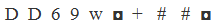

# 字符规律-位置对应关系（相同符号位置+字符类型分布）

考点：[[20-考点/判断推理/图形推理/字符规律-位置对应关系（相同符号位置+字符类型分布）|图形推理 / 字符规律-位置对应关系（相同符号位置+字符类型分布）]]

**问法模型**：题干给出一串字符，要求选出与题干符号间规律完全一致的选项 → 给题干字符逐位标号，按'相同符号对、独占符号位置、字符类型分布'三层规律逐项比对

## 推理链
1. 第1步：题干共10个字符'M M 5 8 e ※ ▓ ■ ■ ※'，从相同符号入手：位置1、2同为'M'，位置6、10同为'※'，位置8、9同为'■'
2. 第2步：确认独占性——位置3、4、5、7（'5''8''e''▓'）上的符号在全串中独一无二，不与任何其他位置重复
3. 第3步：归纳字符类型分布——位置1、2、5为字母（M、M、e），位置3、4为数字（5、8），其余位置6、7、8、9、10为特殊字符
4. 第4步：将三层规律（相同对(1,2)(6,10)(8,9)、独占位3/4/5/7、类型分布）作为筛选标准逐项对照
5. 第5步：A项相同符号位置与独占位置均符合，但位置4是字母而非数字，类型分布不符，排除
6. 第6步：B项位置8、9符号不相同，破坏(8,9)相同对，排除；D项位置1、2符号不相同，破坏(1,2)相同对，排除
7. 第7步：C项相同对(1,2)(6,10)(8,9)、独占位3、4、5、7、且1/2/5为字母、3/4为数字全部吻合，与题干规律一致，当选

**最快解法**：⚡ 位置标号法+排除法：先标出题干相同符号对(1,2)(6,10)(8,9)，一眼排除B（8、9不同）、D（1、2不同）；再核对A的位置4是否为数字，排除A，锁定C

## 易错点
- ⚠ 只比对相同符号的位置，忽略'位置1、2、5为字母、位置3、4为数字'的类型分布条件，误选A
- ⚠ 位置8、9为连续相同的'■■'，容易数错位置或把两个相同符号看成一个整体，漏掉(8,9)相同对
- ⚠ 忽略位置3、4、5、7须'与其他位置均不相同'的独占性条件，只验证部分规律就匆忙选择

## 母题抽象
> 🧩 当题干是一串字符/符号、要求找结构规律一致的选项时，先逐位标号找'相同符号对'，再核对'独占符号位置'与'字母/数字/字符类型分布'，用排除法逐项验证

**同类特征**：字符符号序列类比、相同符号的位置对应、独占符号位置、字母-数字-字符类型分布、逐位标号比对、10字符定长

## 相关题
（暂无）

---

### 题干

### 选项
- A. 

- B. 

- C. 

　✅
- D. 

### 官方解析
第一步：分析题干符号间关系。
从相同符号的位置入手：位置1、2的符号相同；位置6、10的符号相同；位置8、9的符号相同；位置3、4、5、7上的符号与其他位置均不相同，且位置1、2、5为字母，位置3、4为数字，剩余位置为字符。
第二步：判断选项符号间关系。
A项：位置1、2的符号相同；位置6、10的符号相同；位置8、9的符号相同；并且位置3、4、5、7上的符号与其他位置均不相同。但是位置4并不是数字，而是字母，与题干不一致，排除；
B项：位置1、2的符号相同；位置6、10的符号相同；但是位置8、9的符号不相同，与题干不一致，排除； 
C项：位置1、2的符号相同；位置6、10的符号相同；位置8、9的符号相同；位置3、4、5、7上的符号与其他位置均不相同，且位置1、2、5为字母，位置3、4为数字，剩余位置为字符，与题干一致，当选；
D项：位置1、2的符号不相同，与题干不一致，排除。
故正确答案为C。

### 给定材料
（无）
