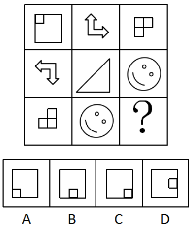

# 对称性-轴对称图形对称轴方向（顺时针旋转）

考点：[[20-考点/判断推理/图形推理/对称性-轴对称图形对称轴方向（顺时针旋转）|图形推理 / 对称性-轴对称图形对称轴方向（顺时针旋转）]]

**问法模型**：九宫格图形'元素组成不同'→按行找属性规律，锁定'均为轴对称+对称轴方向依次顺时针旋转'，选对称轴方向吻合的选项

## 推理链
1. 第1步：九宫格中三行图形元素组成各不相同（方块、箭头、三角形、笑脸混杂），优先考虑属性规律，且优先按行观察
2. 第2步：第一行三图——左上缺角正方形、折角双头箭头、L形三连方块——均为轴对称图形，且对称轴方向依次顺时针旋转90°（在'左上—右下\'与左下—右上/'两条对角线方向间交替）
3. 第3步：第二行验证：折角双头箭头、等腰直角三角形、笑脸三图同样均为轴对称图形且对称轴依次顺时针旋转，与第一行规律一致，规律成立
4. 第4步：第三行应用：图1为L形三连方块，其'角'在右下、缺口在左上，对称轴为过右下角的左上—右下对角线'\'；按规律图2笑脸对称轴顺时针旋转为'/'，则问号处对称轴应继续顺时针旋转回到'\'方向
5. 第5步：对照选项中小方块位置（位置决定对称轴过哪个角/边）：A小方块在左下角→对称轴为'/'方向；B小方块在底边中点→对称轴竖直；C小方块在右下角→对称轴为左上—右下'\'方向；D小方块在右边中点→对称轴水平
6. 第6步：只有C项对称轴为'\'方向，符合第三行对称轴顺时针旋转规律，故选C

**最快解法**：⚡ 对称轴方向排除法：直接看第三行图1，L形缺角在左上，对称轴为过右下角的左上—右下对角线'\'；由'每行对称轴依次顺时针旋转'知图2为'/'、问号处回到'\'；选项中A为'/'、B竖直、D水平，只有C（小方块在右下角）对称轴为'\'，秒选C

## 易错点
- ⚠ 只验证'是否轴对称'而忽略'对称轴的方向'——四个选项其实都是轴对称图形，仅靠有无对称轴无法排除任何选项
- ⚠ 把第三行图1（L形方块）的对称轴方向判反，误认为问号处应为'/'方向而错选A
- ⚠ 元素组成不同时误走数量规律（数小方块个数、数面个数），浪费时间；同时勿忽视B、D设置的竖直/水平对称轴干扰

## 母题抽象
> 🧩 当九宫格（或一组）图形形状各异但都呈对称状时，逐图标出对称轴方向；若方向依次顺（逆）时针旋转，则问号处按旋转后的对称轴方向匹配选项（对称轴方向常由缺角、开口、内部小元素的位置暗示）

**同类特征**：九宫格按行观察、元素组成不同、每行三图均为轴对称图形、对称轴方向依次顺时针旋转、缺角/开口位置暗示对称轴、选项仅差异在小方块位置（即对称轴方向）

## 相关题
- [[10-真题/判断推理/图形推理/5690255 属性规律-对称性（对称轴方向顺时针旋转）|5690255]]（上海 2017，相关度2）
- [[10-真题/判断推理/图形推理/10204454 数量规律-部分数（黑白球连通区域数做和）|10204454]]（甘肃 2024，相关度1）
- [[10-真题/判断推理/图形推理/10204604 数量规律-线数量（汉字横线数）|10204604]]（辽宁 2024，相关度1）
- [[10-真题/判断推理/图形推理/10297050 数量规律-特殊计数（线条穿过小白球的数量）|10297050]]（天津 2025，相关度1）
- [[10-真题/判断推理/图形推理/10297127 图形间关系-相交图形中不相交边数量（黑白图形相交）|10297127]]（天津 2025，相关度1）

---

### 题干

从所给的四个选项中，选择最恰当的一个填入问号处，使之呈现一定的规律性。

### 选项
- A. A
- B. B
- C. C　✅
- D. D

### 官方解析

图形元素组成不同，优先考虑属性规律。九宫格优先按行看，第一行中，三幅图都是轴对称图形，并且对称轴的方向依次顺时针旋转，第二行与第一行规律相同，第三行也应该满足此规律，只有C项符合。

故正确答案为C。

### 给定材料
（无）
