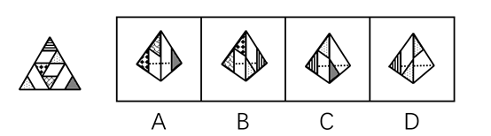
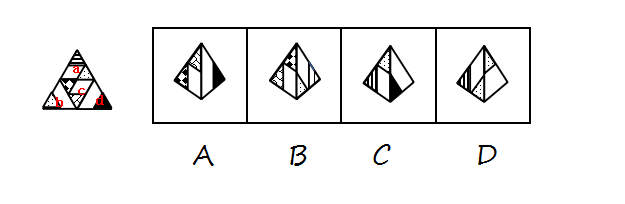
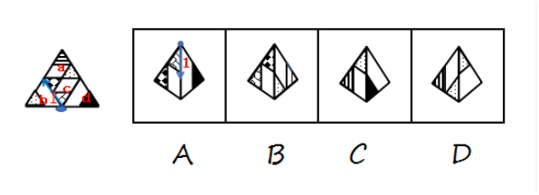

# 空间重构-三棱锥展开图折叠（相邻面公共边判定·画边法）

考点：[[20-考点/判断推理/图形推理/空间重构-三棱锥展开图折叠（相邻面公共边判定·画边法）|图形推理 / 空间重构-三棱锥展开图折叠（相邻面公共边判定·画边法）]]

**问法模型**：'哪个可由左边图形折叠而成'的三棱锥折叠问法 → 采用画边法（描边法）：以面上的特征点为起点顺时针给边编号，对照选项中公共边两侧图案的相对位置是否与题干一致。

## 推理链
1. 第1步：题干为一个大三角形分成4个小三角形的三棱锥展开图，从上至下标记面a（顶）、面b（右）、面c（中）、面d（左），各面图案（条纹、点、斜线）各不相同，折叠后每两个相邻面构成一个观察视角。
2. 第2步：由于四个面图案互异但面可旋转，不能只看图案本身，须用画边法：选定含特征点（蓝点/黄点）的面，从该点出发顺时针依次给三条边编号，再对照选项中公共边两侧图案次序。
3. 第3步：A项由面c和面d构成——题干沿面c的蓝色点顺时针画边，边1挨着面b；选项沿同一蓝点顺时针画边，边1却挨着面d，公共边两侧关系不一致，排除。
4. 第4步：B项由面c和面a构成——沿特征点顺时针画边后，公共边两侧图案的对应次序与题干完全一致，当选。
5. 第5步：C项由面a和面d构成——题干沿面a的黄色点顺时针画边，边2挨着面c；选项沿同一黄点画边，边2却挨着面d，排除。
6. 第6步：D项由面a和面b构成——题干沿面a黄点顺时针画边，边2挨着面c；选项沿同一黄点画边，边2却挨着面b，排除。
7. 第7步：逐项对照后仅B项与题干相邻关系一致，故正确答案为B。

**最快解法**：⚡ 画边法：先认准展开图中含特征点（面c蓝点、面a黄点）的面，从特征点起顺时针给三边标1、2、3号；再对每个选项沿同一特征点同向画边，比较公共边编号两侧的面/图案是否与题干同序，不 同序即排除——A、C、D均异序，唯B同序。

## 易错点
- ⚠ 忽略折叠后面的旋转与翻转，只凭图案形状配对面（如误认为A的面c+面d可拼合）
- ⚠ 特征点找错或起画方向不一致（蓝点与黄点混淆、顺/逆时针用错），导致边序全错
- ⚠ 展开图中'挨着'关系须经公共边判读，直接按平面上下左右相邻记忆，误判公共边两侧图案

## 母题抽象
> 🧩 当题干为'大三角形内分4个小三角形'且各面图案互异的三棱锥展开图时，用画边法：以特征点为起点顺时针编号三边，验证选项中公共边两侧图案次序与题干是否一致，唯一同序者即答案。

**同类特征**：三棱锥展开图（大三角分四小三角）、问'哪个可由左边图形折叠而成'、四个面图案互异（条纹/点/斜线）、选项均为折叠后两个相邻面的视角、面上有可作起画起点的特征点（蓝点/黄点）

## 相关题
（暂无）

---

### 题干

选项四个图形中，哪个可由左边图形折叠而成？

### 选项
- A. A
- B. B　✅
- C. C
- D. D

### 官方解析

题干图形从上至下分别标上面a、b、c、d。 

A项：由面c和面d构成，题干沿面c蓝色的点顺时针画边，题干边1挨着面b，选项沿相同点顺时针画边，边1挨着面d，选项与题干不一致，排除；

B项：由面c和面a构成，与题干一致，当选； 

C项：由面a和面d构成，题干沿面a黄色的点顺时针画边，题干边2挨着面c,选项沿相同点顺时针画边，边2挨着面d，选项与题干不一致，排除；

 

D项：由面a和面b构成，题干沿面a黄色的点顺时针画边，题干边2挨着面c，选项沿相同点顺时针画边，边2挨着面b，选项与题干不一致，排除。 

故正确答案为B。

### 给定材料
（无）
