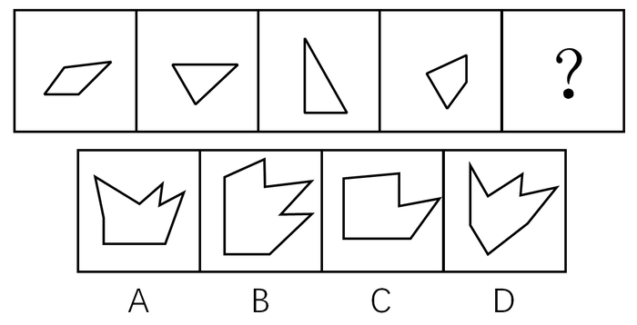

# 图形推理-平面拼合（平行且等长相消法）

考点：[[20-考点/判断推理/图形推理/图形推理-平面拼合（平行且等长相消法）|图形推理 / 图形推理-平面拼合（平行且等长相消法）]]

**问法模型**：题干给出四个小图形、问哪一个选项可由它们仅经上下左右平移拼合而成 → 采用'平行且等长相消'拼合模型：平行且等长的边为内部拼接面相消，剩余边构成外轮廓

## 推理链
1. 第1步：提取题干四图边特征——①斜平行四边形（含两组平行斜边）②尖朝下的三角形③直角三角形（左竖边+下横边+斜边）④不规则四边形（下尖角），各边方向、长度固定（只许平移不许旋转）
2. 第2步：应用规则——拼合只允许平移，故两块图形相接处必须是平行且等长的一对边，拼合后这对边成为内部线段被'消去'，不进入外轮廓
3. 第3步：将四图中平行且等长的边两两配对相消（平行四边形的斜边与三角形的斜边对接、直角边与四边形的对应边对接），剩余未相消的边按原方向拼接出整体轮廓
4. 第4步：相消后外轮廓应为带右侧/上部凹凸锯齿的不规则多边形，斜边朝向由原图平移保持不变
5. 第5步：逐项对照——B项轮廓的凹口位置、斜边方向与四块相消后的组合轮廓一致；A、D凹口形态与斜边朝向对不上，C项锯齿边数与相消结果不符，故选B

**最快解法**：⚡ 平行且等长相消法（排除法辅助）：先在四个小图形间找平行且等长的边作为拼接面两两相消，再把剩余边按'只平移不旋转'的方向直接拼出外轮廓，与选项比对，B项吻合即选

## 易错点
- ⚠ 忽略'只能平移不能旋转'的限制，试图旋转小图形去凑选项，导致误选A或D
- ⚠ 把拼接用的内部公共边误计入外轮廓，拼出的轮廓多出线段而错选
- ⚠ B与A、D轮廓相近，未逐边核对凹口朝向与斜边角度，凭大致形状猜答案

## 母题抽象
> 🧩 当题干出现'若干小图形拼合成一个图形、只能上下左右平移'的特征时，用平行且等长相消法：先配对相消平行等长的拼接边，再用剩余边按原方向拼外轮廓，与选项逐边验证

**同类特征**：四个小图形拼合、只能上下左右平移、含平行四边形和三角形、斜边方向固定、选项为带凹口的不规则多边形、平行且等长相消

## 相关题
- [[10-真题/判断推理/图形推理/4651584 图形推理-平面拼合（平行且等长相消法）|4651584]]（江苏 2022，相关度4）
- [[10-真题/判断推理/图形推理/10975247 图形推理-平面拼合（平行且等长相消法）|10975247]]（江苏 2024，相关度3）
- [[10-真题/判断推理/图形推理/12304870 图形推理-平面拼合（平行且等长相消法）|12304870]]（江苏 2024，相关度3）
- [[10-真题/判断推理/图形推理/1791820 图形推理-平面拼合（平行且等长相消法）|1791820]]（江苏 2016，相关度3）
- [[10-真题/判断推理/图形推理/2172380 图形推理-平面拼合（平行且等长相消法）|2172380]]（江苏 2018，相关度3）

---

### 题干

选项四个图形中，只有一个是由题干的四个图形拼合（只能通过上、下、左、右平移）而成的，请把它找出来填入问号处。

### 选项
- A. A
- B. B　✅
- C. C
- D. D

### 官方解析

本题考查平面拼合，可采用平行且等长相消的方式解题。消去平行且等长的线段后进行组合即可得到轮廓图，即为B项。平行且等长相消的方式如下图所示：

故正确答案为B。

### 给定材料
（无）
