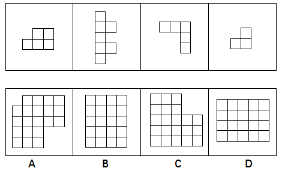

# 平面拼合（平行且等长相消法）

考点：[[20-考点/判断推理/图形推理/平面拼合（平行且等长相消法）|图形推理 / 平面拼合（平行且等长相消法）]]

**问法模型**：四个小图形仅通过上、下、左、右平移拼合成一个整体 → 用'平行且等长相消'法：先数总格数锁定候选轮廓，再以特殊长条图形定朝向，凹凸互补拼出轮廓即答案

## 推理链
1. 第1步：数方格提取前提——题干四个小图形分别含5、7、5、3个单位方格，合计20格，拼合结果必须是20格的图形
2. 第2步：观察图形2是竖向高5格、带两处右侧凸起的长条，只能竖放；题目限定'只能平移'，故整体轮廓必须为高5宽4的竖向矩形，横向排布的D需将图形2旋转才能放入，排除D
3. 第3步：以图形2的竖长条为基准定位（官方解析提示'优先确定第二个图形的位置'），其右侧两处等宽凸起需由其他图形的平行凹口填平
4. 第4步：图形3（上排3格、右端向下延伸2格的L形）平移至顶部，其平行且等长的横边与图形1的横边相消拼接
5. 第5步：图形1（下排3格、上排2格）平移至右下部，图形4（下2上1的三格L形）填补中部剩余缺口，所有平行且等长的边两两相消
6. 第6步：逐项对照——相消后轮廓无任何缺口，得到4列×5行的完整矩形，与B项一致；A、C均为带缺口的不规则轮廓，排除，故选B

**最快解法**：⚡ 数格+平行且等长相消法：先数得四图共20格，锁定候选为20格的完整矩形（B/D）；再用竖高5格的图形2只能竖放、排除需旋转的D，其余图形凹凸互补拼出4×5矩形即B

## 易错点
- ⚠ 忽略'只能平移、不能旋转'的限定，把竖向长条图形2横放而误选D
- ⚠ 只数总格数不验证实际拼合方式，误把同为20格但轮廓带缺口或需旋转的A/C当答案
- ⚠ 图形2两处凸起的朝向看错，导致相消拼合时空缺位置放错

## 母题抽象
> 🧩 当题干出现'若干小图形仅通过平移拼合成一个图形'时，先数总格数锁定候选轮廓，再以最狭长/异形的块确定整体朝向排除旋转项，用平行且等长相消逐一填补凹凸，无缺口者即答案

**同类特征**：只能平移不能旋转、单位方格平面拼合、平行且等长相消、总格数守恒（20格）、竖向长条图形定朝向、完整矩形轮廓

## 相关题
- [[10-真题/判断推理/图形推理/2452762 平面拼合（平行且等长相消法）|2452762]]（江苏 2020，相关度4）
- [[10-真题/判断推理/图形推理/2367984 平面拼合（平行且等长相消法）|2367984]]（江苏 2019，相关度3）
- [[10-真题/判断推理/图形推理/2452538 平面拼合（平行且等长相消法）|2452538]]（江苏 2020，相关度3）
- [[10-真题/判断推理/图形推理/5408660 平面拼合（平行且等长相消法）|5408660]]（四川 2022，相关度3）
- [[10-真题/判断推理/图形推理/10297408 平面拼合（平行且等长相消法）|10297408]]（四川 2025，相关度2）

---

### 题干

下边四个图形中，只有一个是由上边的四个图形拼合（只能通过上、下、左、右平移）而成的，请把它找出来。

### 选项
- A. A
- B. B　✅
- C. C
- D. D

### 官方解析

本题考查平面拼合，可采用平行且等长相消的方式解题。优先考虑确定题干中第二个图形的位置，然后将平行且等长的其余部分进行组合，即可得到轮廓图，即为B项。

平行且等长的组合方式如下图所示：

故正确答案为B。

### 给定材料
（无）
