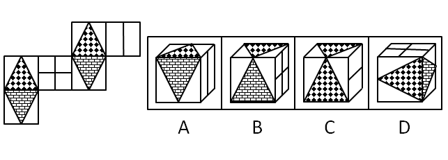
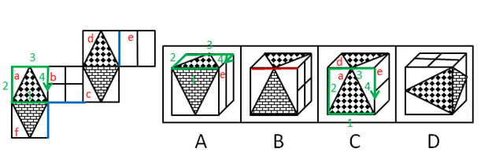

# 空间重构-六面体折叠（相邻面公共边法-画边法排除）

考点：[[20-考点/判断推理/图形推理/空间重构-六面体折叠（相邻面公共边法-画边法排除）|图形推理 / 空间重构-六面体折叠（相邻面公共边法/画边法排除）]]

**问法模型**：'左边给纸盒外表面展开图，右边哪一项能折叠而成'→空间重构题：给六面标号后，以特征面（三角形面、线条面）的相邻关系与公共边细节为标尺，逐项排除

## 推理链
1. 第1步：给展开图六面标号：面a=黑白格三角形（正方形面）、面e=横线纹理三角形（面a正下方）、面d=黑白格三角形（上方菱形面）、面f=横线纹理三角形（面d下方）、面b=带横线的矩形面、面c=带竖线的矩形面；三角形'底边'及'边4'是判定公共边的关键特征
2. 第2步：采用相邻面公共边法+画边法：验证每组相邻面的公共边上是三角形'底边'还是'顶点'、线面中直线与公共边是平行还是垂直，并以面a中三角形底边为起点顺时针给四条边编号
3. 第3步：验A项（侧面为面e、上面为面a或面d）：若上面为面d，选项中面e直线垂直于两面公共边，与题干不一致；若上面为面a，画边法得'边4'在题干挨着面b、在选项却挨着面e，两种情况均矛盾，排除
4. 第4步：验B项（上面+前面为面a与面f，或面d与面c）：题干中这两组相邻面的公共边都是三角形'底边'，选项却画成两个三角形'顶点相交'，公共边特征不符，排除
5. 第5步：验C项（侧面为面e、前面为面a或面d）：错误与A项同源——若前面为面d则面e直线垂直于公共边不符，若前面为面a则'边4'挨面e而非展开图中的面b，排除
6. 第6步：D项的相邻面组合（两三角形面与带线矩形面）及公共边特征均与展开图一致，当选（官方注明其右侧面矩形方向有小瑕疵，但A、B、C相邻面错误更明显，属择优答案）

**最快解法**：⚡ 排除法+公共边法（画边法）：先盯三角形面的公共边——B项'顶点相交'而非'底边相邻'直接排；再查线条面——A、C项中面e直线与公共边的垂直关系不符、画边编号显示'边4'应挨面b却挨面e，排除后锁定D

## 易错点
- ⚠ 只核对图案种类、不核对公共边细节：B项各面图案都对，但'底边相邻'被画成'顶点相交'，漏检公共边就会误选
- ⚠ 忽略面内直线与公共边的平行/垂直关系：A、C项中面e直线垂直于公共边与展开图矛盾，不查此细节排不掉
- ⚠ 相邻面需分情况讨论（上面为面a或面d两种可能）时只验一种就下结论；另D项右侧面矩形方向存在官方自认的瑕疵，严格标准下易误判'无正确答案'

## 母题抽象
> 🧩 当展开图中出现带方向性图案（三角形、单条分割线）的特征面时，先给六面标号，再用'相邻面公共边法+画边法'，逐一验证公共边上的图案细节（底边/顶点、直线与公共边关系、边的编号顺序）以排除错误选项

**同类特征**：纸盒外表面展开图折叠问法、三角形图案面（黑白格与横线纹理两种）、菱形面与正方形面混合的展开图、带方向性线条的矩形面、需检验相邻面公共边细节、选项为四个立体图

## 相关题
（暂无）

---

### 题干

左边给定的是纸盒外表面的展开图，右边哪一项能由它折叠而成？请把它找出来。

### 选项
- A. A
- B. B
- C. C
- D. D　✅

### 官方解析

本题为空间重构题目，用排除思维解题，题干图形标号如下图。

A项：选项侧面为面e，上面为面a或面d。若上面为面d，则选项中面e直线垂直于两面公共边，与题干不一致；若上面为面a，则如上图，以面a中三角形的底边开始顺时针画边，选项中边4挨着面e，而题干中边4挨着面b，与题干不一致，排除；

B项：选项中上面和前面可能是面a与面f，面d与面c，但题干中这两组相邻面的公共边都是两个三角形的底边，而选项中为两个三角形顶点相交，与题干不一致，排除；

C项：选项中侧面为面e，前面为面a或者面d。若前面为面d，则选项中面e直线垂直于两面公共边，与题干不一致；若前面为面a，则如上图，以面a中三角形的底边开始顺时针画边，选项中边4挨着面e，而展开图中边4挨着面b，与题干不一致，排除；

D项：与题干一致，当选。

故正确答案为D。

注：本题不太严谨，因为D项中右侧面里面的矩形方向与题干展开图并不一致，但是因为A、B、C三项相邻面都有明显的错误，所以本题择优选D项。

### 给定材料
（无）

> [!note] 复核版本状态
> 原题不可计分（official_self_contradiction；来源记录的答案键/竞争项：D）；仅当前明确标注的编辑版按答案D计分。
> 详细原题疑点、修订题面、解析和证据见下方独立复核记录。

<!-- CODEX-ANSWER-REVIEW:BEGIN -->
### 本次独立复核

**复核结论：** `resolved`（答案与解析已核定）

**原题计分状态：** 不计分（`official_self_contradiction`：题源答案或解析与数据复算冲突）。来源中记录的答案键/竞争项：D；这些记录不代表原题已核准答案。

**原题疑点与处理：**

江苏 2018 〔20-考点/判断推理/图形推理/空间重构-六面体折叠（相邻面公共边法-画边法排除）〕 — 官方解析自注'D项右侧面里面的矩形方向与题干展开图并不一致'，即D并非严格正确，属命题瑕疵下的择优答案；考生若按最严格标准可能认为四项均有瑕疵，但A、B、C相邻…

**当前计分版本：** 明确标注的编辑版；未列出的题干、材料或选项沿用固定题源。答案不回填为原题答案。

**计分答案：** D（可计分）

**复核解析：**

固定展开图可确定各面身份和相邻关系。A、B、C与展开图的面邻接或面身份至少有一处冲突；D三面组合符合。官方解析同时指出D内部小矩形/线条方向与展开图不完全一致，因此修订版明确不以面内标记朝向作为判据，只考相邻面身份，答案D。

**修订题干：**

【编辑修订】仅根据各选项中三个可见面的身份及相邻关系判断；不以各面内部小标记的旋转朝向作为判据。

**相关信息：**

空间重构—六面体折叠；先验邻接关系再看面内特征，题目需说明是否比较内部标记方向。

**核对依据与来源边界：**

- 固定题源：[原题文件](https://github.com/Mentat-Uran/kaogongzhentizhengliu/blob/84ab93d4b64b61d897bece8a1c0a5bab06b4feb2/10-%E7%9C%9F%E9%A2%98/%E5%88%A4%E6%96%AD%E6%8E%A8%E7%90%86/%E5%9B%BE%E5%BD%A2%E6%8E%A8%E7%90%86/2172569%20%E7%A9%BA%E9%97%B4%E9%87%8D%E6%9E%84-%E5%85%AD%E9%9D%A2%E4%BD%93%E6%8A%98%E5%8F%A0%EF%BC%88%E7%9B%B8%E9%82%BB%E9%9D%A2%E5%85%AC%E5%85%B1%E8%BE%B9%E6%B3%95-%E7%94%BB%E8%BE%B9%E6%B3%95%E6%8E%92%E9%99%A4%EF%BC%89.md)；内容版本 `84ab93d4b64b61d897bece8a1c0a5bab06b4feb2`，源 Markdown blob `68fa86e964a7ef103022ec480abe534b99c583ca`.
- **核心依据：** 固定展开图及标注图核对面身份/相邻关系；修订排除题面存在矛盾的方向判据。
- 固定题图/公式图：`90-图片/题目图/162581be35a8200.png`, `90-图片/题目图/1632ab4f38afa42.png`.

<!-- CODEX-ANSWER-REVIEW:END -->
