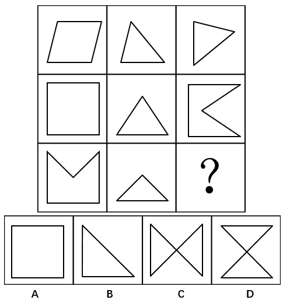

# 样式规律-叠加求异（去同存异）＋位置旋转（逆时针90°）

考点：[[20-考点/判断推理/图形推理/样式规律-叠加求异（去同存异）＋位置旋转（逆时针90°）|图形推理 / 样式规律-叠加求异（去同存异）＋位置旋转（逆时针90°）]]

**问法模型**：九宫格'问号处填入使呈现规律性'→按行寻找'样式求异＋旋转90°'复合规律，并用前两行验证后再套问号行

## 推理链
1. 第1步：九宫格中图形元素组成相似（均为多边形轮廓叠加），优先考虑样式规律，且九宫格优先按行观察
2. 第2步：第一行中，图一（平行四边形）与图二（三角形）先去同存异求异，再逆时针旋转90°，得到图三（向右指的三角形）
3. 第3步：第二行验证：正方形与三角形求异后得到带内凹'Λ'线的方形，逆时针旋转90°恰为图三（右侧内凹'<'缺口的图形），规律成立
4. 第4步：第三行套用规律：'M'形（正方形顶部有V形缺口）与三角形求异——二者共同的底边被去掉，保留左、右竖边及上、下各两条斜线，得到左右两个三角形尖端相对的横向'蝴蝶结'形（即C项方向）
5. 第5步：将求异结果再逆时针旋转90°，横向'蝴蝶结'竖起，变为上下两个三角形尖端相接、上下各带横边的'沙漏'形
6. 第6步：对照选项：A（正方形）、B（直角三角形）未体现任何规律；C正是求异后未旋转的图形；只有D与'求异＋逆时针旋转90°'的结果一致，故选D

**最快解法**：⚡ 按行'求异＋旋转'口诀：先去同存异定轮廓，再逆时针转90°定指向。第三行M形与三角形求异得横向蝴蝶结（C形方向），逆时针转90°即为D；C项恰是'忘了旋转'的陷阱，直接排除。

## 易错点
- ⚠ 只做求异忘记旋转，误选C（C正是未旋转的求异结果，命题人设置的强干扰项）
- ⚠ 旋转方向搞反：顺时针旋转90°指向不符，必须紧扣官方规律'逆时针90°'
- ⚠ 把第三行图一'M'形误看成普通正方形，漏掉顶部V形缺口，导致求异结果判断错误

## 母题抽象
> 🧩 当九宫格图形元素组成相似、呈现同源轮廓叠加特征时，按行使用'去同存异＋旋转90°'复合规律，先用前两行验证旋转方向，再套用到问号所在行，并警惕未旋转的同形干扰项。

**同类特征**：九宫格按行看、元素组成相似、多边形轮廓叠加去同存异、求异后再旋转90°、问号位于第三行、存在未旋转的同形干扰选项

## 相关题
- [[10-真题/判断推理/图形推理/2604255 样式规律-小元素位置关系遍历（相邻-重合-相隔一格）|2604255]]（广东 2020，相关度2）
- [[10-真题/判断推理/图形推理/10204610 样式规律-加减同异（去同存异），九宫格列规律|10204610]]（辽宁 2024，相关度1）
- [[10-真题/判断推理/图形推理/10297349 样式规律-黑白运算|10297349]]（浙江 2025，相关度1）
- [[10-真题/判断推理/图形推理/10297407 样式规律-黑白运算（定义叠加）|10297407]]（四川 2025，相关度1）
- [[10-真题/判断推理/图形推理/11226895 图形推理-样式规律（叠加求同-保留相同部分）|11226895]]（上海 2025，相关度1）

---

### 题干

从四个图中选出唯一的一项，填入问号处，使其呈现出一定的规律性。

### 选项
- A. A
- B. B
- C. C
- D. D　✅

### 官方解析
图形元素组成相似，优先考虑样式规律。九宫格优先按行看，第一行中，图一和图二先求异，然后逆时针旋转90°得到图三，第二行验证规律，与第一行规律相同，第三行也应该满足此规律，即“？”图形由图一和图二先求异，然后逆时针旋转90°得到，只有D选项符合。
故正确答案为D。

### 给定材料
（无）
