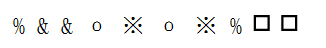
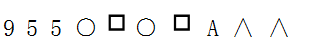
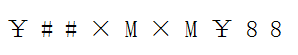

# 样式规律-符号排布的位置对应关系

考点：[[20-考点/判断推理/图形推理/样式规律-符号排布的位置对应关系|图形推理 / 样式规律-符号排布的位置对应关系]]

**问法模型**：题干给出一串符号序列，问哪个选项与之'符号间关系'一致 → 采用'相同符号位置标号比对'模型

## 推理链
1. 第1步：将题干10个符号从左到右编号：第1个%、第2个&、第3个&、第4个o、第5个※、第6个o、第7个※、第8个%、第9个□、第10个□
2. 第2步：归纳相同符号出现的位置对——1与8相同（%）、2与3相同（&）、4与6相同（o）、5与7相同（※）、9与10相同（□）
3. 第3步：逐项核对选项：A项位置1、8的符号不相同，排除；B项位置9、10的符号不相同，排除；C项位置9、10的符号不相同，排除
4. 第4步：D项中位置1与8、2与3、4与6、5与7、9与10的符号均两两相同，五组位置对全部与题干一致，当选

**最快解法**：⚡ 标号比对法：先给题干符号按位置编号并写出'相同符号位置对'清单（1-8、2-3、4-6、5-7、9-10），再按同一位置对逐项检查选项，见不符即排除

## 易错点
- ⚠ 符号形近易看混（如o与※、%与&），某一位置认错即导致整组位置对标错
- ⚠ 只检查连续重复的符号（2与3、9与10），漏掉间隔较远的首尾对应（1与8），误选B或C
- ⚠ 选项符号个数或顺序与题干未逐位对齐，位置编号错位导致误判

## 母题抽象
> 🧩 当题干出现一串符号/图形且选项为同长度序列时，先给题干各位置编号并归纳'相同元素出现的位置对'，再逐项验证选项是否完全复现该位置对应关系

**同类特征**：10个符号组成的序列、符号种类有限且部分重复、相同符号间隔出现（1与8、4与6、5与7）、相邻符号重复（2与3、9与10）、考察位置关系而非符号本身

## 相关题
- [[10-真题/判断推理/图形推理/2172450 符号序列-相同符号位置对应关系|2172450]]（江苏 2018，相关度1）

---

### 题干

### 选项
- A. 

- B. 

- C. 

- D. 

　✅

### 官方解析
第一步：分析题干符号间关系。
从相同符号的位置入手：位置1、8的符号相同；位置2、3的符号相同；位置4、6的符号相同；位置5、7的符号相同；位置9、10的符号相同。
第二步：判断选项符号间关系。
A项：位置1、8的符号不相同，与题干不一致，排除；
B项：位置9、10的符号不相同，与题干不一致，排除；
C项：位置9、10的符号不相同，与题干不一致，排除；
D项：位置1、8的符号相同；位置2、3的符号相同；位置4、6的符号相同；位置5、7的符号相同；位置9、10的符号相同。与题干一致，当选。
故正确答案为D。

### 给定材料
（无）
