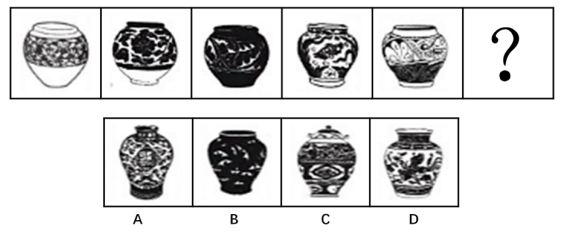

# 图形的实际意义-求最大共同点（器物外形特征：口颈宽窄-长短、有无盖）

考点：[[20-考点/判断推理/图形推理/图形的实际意义-求最大共同点（器物外形特征：口颈宽窄-长短、有无盖）|图形推理 / 图形的实际意义-求最大共同点（器物外形特征：口颈宽窄/长短、有无盖）]]

**问法模型**：问法为'呈现一定规律性'但各图均为实物器物图且花纹各异 → 采用'实际意义找最大共同点'模型，提取器物形状共同特征逐项排除

## 推理链
1. 第1步：题干5个图形均为陶瓷罐/瓶类实物图，但花纹、图案内容各不相同，无法用数量、样式、位置等常规规律解释
2. 第2步：转用'图形实际意义-寻找最大共同点'方法，聚焦器物外形三要素：口颈宽窄、口颈长短、有无盖
3. 第3步：归纳题干五图共同点——口颈均宽大、较短且无盖
4. 第4步：对照A项，其口颈较细，与题干'宽大'不符，排除
5. 第5步：对照C项，其瓶子有盖，与题干'无盖'不符，排除；对照D项，其口颈较长，与题干'较短'不符，排除
6. 第6步：B项口颈宽大、较短且无盖，与题干五图共同特征完全吻合，故为唯一答案B

**最快解法**：⚡ 实际意义求同法+排除法：先确认考点为实物器物特征（放弃数黑块/数花纹），锁定'口颈宽大、较短、无盖'三要素，快速排除A（颈细）、C（有盖）、D（颈长），秒选B

## 易错点
- ⚠ 被花纹、黑白色块干扰，误入数黑块、数部分、样式翻转等无效规律
- ⚠ 忽略'无盖'细节而误选C（C项瓶有盖）
- ⚠ 只识别'都是罐/瓶'这一大类，未做口颈宽窄、长短的二级辨析而误选A或D

## 母题抽象
> 🧩 当图形推理各图均为某类实物（器物/工具等）且表面装饰各异时，改用'实际意义找最大共同点'方法，从形状要素（宽窄、长短、有无附属物）归纳共同点并逐项排除

**同类特征**：均为陶瓷罐/瓶实物图、花纹图案各不相同、口颈宽大、口颈较短、无盖、问号处需延续实物共同特征

## 相关题
（暂无）

---

### 题干

从四个图中选出唯一的一项，填入问号处，使其呈现出一定的规律性。

### 选项
- A. A
- B. B　✅
- C. C
- D. D

### 官方解析
本题考查图形的实际意义，寻找最大共同点。观察发现，题干所有图形都是瓶口颈宽大、较短且无盖，A项瓶口颈较细，C项瓶子有盖，D项瓶口颈较长，只有B项满足题干图形特征。
故正确答案为B。

### 给定材料
（无）
