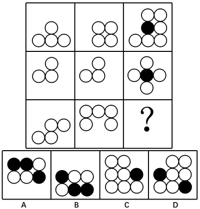

# 样式与位置复合（相加重叠变黑＋旋转180°＋左右翻转）

考点：[[20-考点/判断推理/图形推理/样式与位置复合（相加重叠变黑＋旋转180°＋左右翻转）|图形推理 / 样式与位置复合（相加重叠变黑＋旋转180°＋左右翻转）]]

**问法模型**：九宫格'填入问号处使之符合整个图形的变化规律'→ 竖列寻找'位置变换＋样式叠加'复合规律，并用图形最简的一行先行验证

## 推理链
1. 第1步：九宫格每格均由白圆按规律位置摆放，黑圆仅出现在第三列，元素组成相似，优先考虑样式规律；但两列直接相加方向对不上，需叠加位置变换
2. 第2步：对比竖列发现第二列与第一列方向不同，提出规律：第二列先旋转180°，再与第一列相加、重叠位置的圆变黑，所得图形左右翻转即为第三列
3. 第3步：用第一行验证：第二列2×2四白圆旋转180°后移至左上，与第一列金字塔（下3上1）仅在中心一处重叠变黑，得7圆1黑；左右翻转后顶部双圆与中部白圆翻到右侧，与第一行第三列图形完全一致
4. 第4步：用第二行（图形最简且左右对称）验证：第二列三圆旋转180°后与第一列三圆仅中心一处重叠变黑，合成黑心十字，翻转不变，与第三列一致，规律成立
5. 第5步：将规律套用到第三行：第二列拱形（上3下2）旋转180°变为U形（下3上2），与第一列阶梯状四白圆相加，重叠处变黑，再左右翻转
6. 第6步：对照选项：黑圆只能出现在两图重叠处，A、C、D的黑圆数量或位置与运算及翻转结果不符，只有B项完全吻合，故选B

**最快解法**：⚡ 列间运算法＋最简行验证：先看第二行，第二列旋转180°后与第一列相加、重叠变黑即得第三列黑心十字（对称图形翻转不变，最易验证），锁定'旋转180°→相加重叠变黑→左右翻转'三步规则；再对第三行执行同样操作，对照黑圆位置与数量排除A、C、D，选B

## 易错点
- ⚠ 漏步骤：只做'相加重叠变黑'而漏掉'第二列先旋转180°'或最后'左右翻转'，因方向对不上误判无规律
- ⚠ 把'重叠变黑'与常规黑白叠加运算（黑＋白＝？）混淆；本题黑圆仅出现在两图重叠处，第一、二列本身全为白圆
- ⚠ 被官方解析二'1黑=2白'数量换算思路带偏而误选C；应抓住圆的位置规律摆放、大量重合这一图形特征，锁定样式＋位置复合考法

## 母题抽象
> 🧩 当九宫格图形元素组成相似且元素按规律位置摆放（大量位置重合）时，考虑'列间复合运算：某列旋转/翻转后与另一列相加、重叠变黑'；先用图形最简单的一行验证规律，再套用到问号所在行对照选项

**同类特征**：九宫格按行观察、元素组成相似（均为小圆）、圆的位置规律摆放、大量重合、黑圆仅出现在第三列、列间图形方向存在差异（提示旋转180°）、第三列与叠加结果呈左右翻转关系

## 相关题
- [[10-真题/判断推理/图形推理/2172452 对称性-轴对称图形对称轴方向（顺时针旋转）|2172452]]（江苏 2018，相关度1）

---

### 题干

请选择最适合的一项填入问号处，使之符合整个图形的变化规律。

### 选项
- A. A
- B. B　✅
- C. C
- D. D

### 官方解析

解析一：图形元素组成相似，优先考虑样式规律。观察发现图形第二列旋转180度之后与第一列相加，相加后重叠部分变黑，得到的图形经过左右翻转即可得到第三列图形。经验证，第二行符合规律，故？处选择一个将第二列旋转180度后与第一列相加，相加后重叠部分变黑后再左右翻转的图形，只有B项符合。

故正确答案为B。

解析二：只出现黑圆和白圆两种元素，可以考虑元素的换算。如果将1个黑圆换算成2个白圆，则第一行和第二行均满足白圆数量：，第三行应用此规律，排除D项；观察发现第三列白圆数量均大于黑圆数量，排除A、B两项。 

故正确答案为C。

本题粉笔倾向于解析一，样式和位置的复合考法。如果命题人想考查元素数量的换算，圆的位置可以随便摆放，没必要所有图形中的圆的位置都摆放的特别有规律，而圆摆放有规律使每一行很多圆的位置是重合的，更符合元素组成相似的特征，所以从图形特征来看，考查样式和位置复合的概率更高。 

### 给定材料
（无）

> [!warning] 疑点（官方解析可能有误，待人工复核）
> 官方解析二按'1黑=2白'元素换算推出C项，与正确答案B矛盾；官方已明确倾向解析一（圆位置规律摆放、大量重合更符合样式＋位置复合特征），解析二仅作干扰性思路了解，答案以B为准
