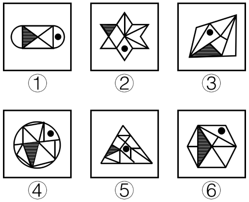

# 功能元素位置关系（小黑圆所在面与阴影三角形所在面是否共边-共点）

考点：[[20-考点/判断推理/图形推理/功能元素位置关系（小黑圆所在面与阴影三角形所在面是否共边-共点）|图形推理 / 功能元素位置关系（小黑圆所在面与阴影三角形所在面是否共边/共点）]]

**问法模型**：六个含相同功能元素（小黑圆+阴影三角形）的图形分为两类 → 锁定功能元素所在封闭面与特征面（阴影三角形）的邻接关系进行分组

## 推理链
1. 第1步：每幅图内部均被线段分割成多个封闭面，且都含一个'小黑圆'和一个'阴影三角形'，属典型功能元素题，优先研究两者的位置关系
2. 第2步：确定观察对象为'小黑圆所在的封闭面'与'阴影三角形所在面'，判断标准是两面有无公共边或公共点（共点也算相邻）
3. 第3步：①中黑圆位于右侧圆弧内的小面，与左侧阴影三角形隔开，无公共边/点；②中黑圆位于星形下方的三角形，与左上阴影三角形无公共边/点；④中黑圆位于右上三角形，与下方阴影三角形无公共边/点
4. 第4步：③中黑圆所在三角形与底部阴影三角形有公共边/点；⑤中黑圆所在面与左侧阴影三角形相邻；⑥中黑圆所在三角形与阴影三角形有公共边/点
5. 第5步：归纳规律——①②④黑圆所在面与阴影三角形不相邻，③⑤⑥两者相邻（有公共边/点）
6. 第6步：对照选项，①②④一组、③⑤⑥一组，只有C项符合

**最快解法**：⚡ 功能元素定位法：先圈出小黑圆所在的那一个面，再看它与阴影三角形是否'共边或共点'——共则归③⑤⑥，不共则归①②④，直接锁定C

## 易错点
- ⚠ 误把'黑圆与阴影三角形的距离远近'当规律，实际考点是两面是否共边/共点，距离远近不构成分类依据
- ⚠ 只检查'公共边'而忽略'公共点'也算相邻，会把仅共顶点的图（如③⑥）误分入①②④组
- ⚠ 被图形复杂分割干扰，转而去数面数、看对称性等无关规律，偏离功能元素考法

## 母题抽象
> 🧩 当一组图形均含同一功能元素（小黑圆）和同一特征图形（阴影面）且被分割成多面时，用'功能元素所在面与特征面有无公共边/点'作分类标准验证分组

**同类特征**：每图含一个小黑圆（功能元素）、每图含一个阴影三角形、图形被内部线段分割为多个封闭面、六图分两类各三个、黑圆所在位置各不相同、考察面与面的邻接关系

## 相关题
（暂无）

---

### 题干

把下面的六个图形分为两类，使每一类图形都有各自的共同特征或规律，分类正确的一项是（    ）。

### 选项
- A. ①③⑥，②④⑤
- B. ①③⑤，②④⑥
- C. ①②④，③⑤⑥　✅
- D. ①②③，④⑤⑥

### 官方解析
本题考查功能元素，每幅图均有一个小黑圆和阴影三角形。考虑小黑圆与阴影三角形之间的关系，①②④中小黑圆所在的面与阴影三角形没有公共边/点，③⑤⑥中小黑圆所在的面与阴影三角形有公共边/点，所以①②④为一组，③⑤⑥为另一组。
故正确答案为C。

### 给定材料
（无）
