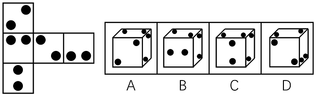

# 空间重构-纸盒折叠（相对面排除+相邻面公共边-公共点图案定位）

考点：[[20-考点/判断推理/图形推理/空间重构-纸盒折叠（相对面排除+相邻面公共边-公共点图案定位）|图形推理 / 空间重构-纸盒折叠（相对面排除+相邻面公共边/公共点图案定位）]]

**问法模型**：“右边哪一项能由它折叠而成”→先用相对面排除，再对剩余选项用公共边/公共点上黑点位置逐项验证的空间重构模型

## 推理链
1. 第1步：展开图仅五个面，空间重构后形成未封顶（无盖）立方体；将各面编号1~5，面1在最上、面2居中、面5在最下，面3、面4依次在面2右侧
2. 第2步：规则一（相对面）：同行隔一面的面1与面5为相对面，折叠后不能同时出现；规则二（相邻面）：看公共边两侧黑点位置、三面公共点是否经过黑点
3. 第3步：A项各相邻面关系及黑点位置与展开图一致，当选
4. 第4步：B项正面为面5，因面5与面1相对，顶面应为面3，右面为面2或面4；若右面为面2，展开图中2、3、5三面的公共点没有经过面3中的小黑点，而选项中经过，排除；若右面为面4，展开图与选项中面3和面4公共边两侧黑点位置不一致，排除
5. 第5步：C项正面为面5，顶面黑点与面5较近故顶面为面4，右面为面3；面3和面4公共边两侧黑点位置与展开图不一致，排除
6. 第6步：D项由面1、面3和另一个面组成，展开图中面1与面3的黑点不挨在一起，而选项中两面黑点有挨着的，排除
7. 第7步：只有A项与展开图完全一致，故正确答案为A

**最快解法**：⚡ 相对面排除法+公共边/公共点描点法：先锁定“面1与面5相对（隔面2）”，凡同时出现面1和面5的构型直接排除；再对B、C、D用“公共点是否经过面3小黑点”“面3与面4公共边两侧黑点位置”两处细节验证，仅A全部吻合

## 易错点
- ⚠ 忽略展开图只有5个面、折成的是无盖立方体，误按常规6面体思路找三组相对面
- ⚠ 只数各面黑点个数、不看黑点在面上的相对位置，漏掉B项“公共点是否经过面3小黑点”、C/D项“公共边两侧黑点位置”等决定性细节
- ⚠ 相对面误判：面1与面5中间隔面2才是相对面，勿把相邻的面1与面2当作相对面

## 母题抽象
> 🧩 当展开图面数不足6（开口纸盒）或面上带点/线图案时，先按“同行隔一面”定相对面排除，再用相邻面公共边两侧、三面公共点处的图案位置逐项验证，全吻合者即为答案

**同类特征**：五面展开图/无盖立方体、各面带黑点（点数与位置）、问“哪一项能由它折叠而成”、相对面不能同时出现、公共边两侧图案位置需一致、三面公共点是否经过图案

## 相关题
- [[10-真题/判断推理/图形推理/2452623 空间重构-六面体折叠（相对面排除＋公共边画边法）|2452623]]（江苏 2020，相关度2）
- [[10-真题/判断推理/图形推理/12019707 空间折叠（六面体折纸盒）——相对面排除＋公共边画边法-公共点引线法|12019707]]（广东 2026，相关度1）
- [[10-真题/判断推理/图形推理/12561915 空间重构-六面体折叠（相对面排除+公共点法）|12561915]]（浙江 2024，相关度1）
- [[10-真题/判断推理/图形推理/16070182 空间重构-六面体展开图折叠（相对面排除＋相邻面数字方向验证）|16070182]]（湖北 2026，相关度1）
- [[10-真题/判断推理/图形推理/1746880 空间重构-六面体折叠（相对面排除+画边法）|1746880]]（国考 2016，相关度1）

---

### 题干

下图左边给定的是纸盒的外表面，右边哪一项能由它折叠而成？

### 选项
- A. A　✅
- B. B
- C. C
- D. D

### 官方解析

本题展开图只有五个面，空间重构后形成一个未封顶的立方体。如下图所示：将左边展开图各个面分别编号为，1、2、3、4、5。

A项：选项与展开图一致，当选；

B项：正面为面5，所以其顶面应当为面3（面5和面1为相对面，不可能同时出现），此时右面为面2或者面4。若右面为面2，则B项是由2、3、5这三个面组成。展开图中，这三个面的公共点没有经过面3中的小黑点，而选项中这三个面的公共点经过了面3中的小黑点，选项与展开图不一致；若右面为面4，则B项是由3、4、5这三个面组成。此时，展开图和选项中，面3和面4公共边两侧的小黑点的位置不一致，选项与展开图不一致，排除；

C项：正面为面5，顶面的黑点与面5比较近，所以顶面为面4，右面为面3（面5和面1为相对面，不可能同时出现）。此时，展开图和选项中，面3和面4公共边两侧的小黑点的位置不一致，选项与展开图不一致，排除；

D项：由面1、面3和另外一个面组成，展开图中，面1与面3不存在挨在一起的黑点，选项中面1黑点与面3黑点之间有一个是挨着的，选项与展开图不一致，排除。

故正确答案为A。

### 给定材料
（无）
