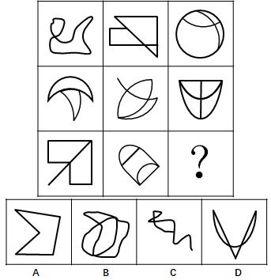

# 数量规律-面数量（九宫格横行等差递增）

考点：[[20-考点/判断推理/图形推理/数量规律-面数量（九宫格横行等差递增）|图形推理 / 数量规律-面数量（九宫格横行等差递增）]]

**问法模型**：九宫格问'？处填入最合适图形使之呈现规律性'→ 元素组成不同且无属性规律时，优先横行数面（封闭区域数）找数量规律

## 推理链
1. 第1步：九宫格中每幅图均为线条分割出的封闭区域，元素组成不同、无对称/曲直等明显属性规律，转向数量规律
2. 第2步：题干图形'面'特征明显，优先数面；九宫格优先横行观察
3. 第3步：第一行三图面数量依次为2、3、4，构成公差为1的递增数列
4. 第4步：第二行三图面数量同样为2、3、4，验证横行递增规律成立
5. 第5步：第三行前两图面数量为2、3，按规律问号处应为4个面的图形
6. 第6步：数选项面数量：A项1个面，B项4个面，C项3个面，D项3个面，仅B项符合

**最快解法**：⚡ 数面法+排除法：九宫格横行数面得'2,3,4'规律，直接数四个选项的封闭区域数，A=1、B=4、C=3、D=3，秒选B

## 易错点
- ⚠ 数面时把非封闭的开放线条误计为面，或漏数被分割出的最小封闭区域
- ⚠ 竖行/对角线方向找规律导致数量不成序列，应牢记'九宫格优先横行看'
- ⚠ B、C、D均含曲线易混淆，需逐块清点封闭区域而非凭图形繁简程度猜测

## 母题抽象
> 🧩 当九宫格图形元素组成不同且无对称、曲直、开闭等属性规律，且每幅图都含明显封闭区域时，优先横行数面，若形成'2,3,4'类等差数列，则在问号处补足数列缺项对应的图形

**同类特征**：九宫格、元素组成不同、无明显属性规律、面特征明显、横行数量递增、问号处补全规律

## 相关题
- [[10-真题/判断推理/图形推理/14993416 数量规律-点数量（黑点个数按行求和恒值）|14993416]]（选调 2024，相关度3）
- [[10-真题/判断推理/图形推理/17467550 数量规律-交点数（九宫格按行等差递增）|17467550]]（湖北 2026，相关度3）
- [[10-真题/判断推理/图形推理/19889518 数量规律-数面（封闭区域数）及行内加减运算|19889518]]（上海 2021，相关度3）
- [[10-真题/判断推理/图形推理/2139602 数量规律-面数量（封闭区域计数）|2139602]]（天津 2017，相关度3）
- [[10-真题/判断推理/图形推理/2172865 数量规律-角（每图含两个相同的角）|2172865]]（广州市考 2018，相关度3）

---

### 题干

从所给的四个选项中，选择最合适的一个填在问号处，使之呈现一定的规律性：

### 选项
- A. A
- B. B　✅
- C. C
- D. D

### 官方解析
观察图形，元素组成不同，且无明显属性规律，则考虑数量规律。题干图形面特征明显，可优先考虑数面。九宫格优先横行看，第一行面数量依次为：2，3，4；第二行面数量依次为：2，3，4；第三行面数量依次为：2，3，？，所以？处应填入有4个面的图形。A项1个面，B项4个面，C项3个面，D项3个面，只有B项符合。
故正确答案为B。

### 给定材料
（无）
