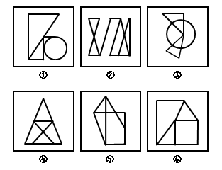

# 图形推理-数量规律（一笔画-奇点计数）

考点：[[20-考点/判断推理/图形推理/图形推理-数量规律（一笔画-奇点计数）|图形推理 / 图形推理-数量规律（一笔画/奇点计数）]]

**问法模型**：'把六个图形分为两类'的分组分类问法 → 元素组成不同且属性规律不明显时，转向数量规律，本题用奇点计数判笔画数并按一笔画/两笔画分组

## 推理链
1. 第1步：六个图形元素组成不同，对称、曲直、开闭等属性均无统一规律，按'属性不通找数量'转入数量规律
2. 第2步：图①③出现圆与直线图形相切/相交，图②为'日字变形图和田字变形图的组合图形'，此类线段交叉特征提示考点为笔画数
3. 第3步：数奇点（从该点引出奇数条线的点）：图①有2个奇点，图③没有奇点，图④有2个奇点，三者均为一笔画图形
4. 第4步：继续数奇点：图②有4个奇点，图⑤有4个奇点，图⑥有4个奇点，按'笔画数=奇点数÷2'三者均为两笔画图形
5. 第5步：归纳分组：①③④均为一笔画一组，②⑤⑥均为两笔画一组
6. 第6步：对照选项，A项为'①③④，②⑤⑥'，与规律完全吻合，故选A

**最快解法**：⚡ 奇点计数法：逐图数奇点（引出奇数条线的交点或端点），口诀'奇点0或2→一笔画，奇点4→两笔画'；本题①③④奇点数为0或2，②⑤⑥奇点数为4，直接锁定A项

## 易错点
- ⚠ 把圆与直线的切点误判为奇点：切点只引出两条线，属偶点，不改变一笔画结论（如图①、图③）
- ⚠ 漏数悬挂线段的端点：端点只引出1条线，必为奇点，交叉复杂图（如图②、图⑥）容易漏数导致笔画数判错
- ⚠ 奇点数与笔画数换算记错：笔画数=奇点数÷2，4个奇点对应两笔画，勿误记为'几个奇点就是几笔画'

## 母题抽象
> 🧩 当分组分类题中图形元素组成不同、无明显属性规律，且出现'日/田字变形、圆与多边形相切或相交、多线条交叉'特征时，用奇点计数法判笔画数：奇点0或2为一笔画、奇点4为两笔画，按笔画数分组验证选项

**同类特征**：元素组成不同、属性规律不明显、日字/田字变形、圆与直线相切、相交、线条交叉及端点、六图分两类

## 相关题
- [[10-真题/判断推理/图形推理/2136768 数量规律-部分数（连通部分数）|2136768]]（河南 2017，相关度2）
- [[10-真题/判断推理/图形推理/2172360 数量规律-笔画数（奇点数法，两笔画规律）|2172360]]（江苏 2018，相关度2）
- [[10-真题/判断推理/图形推理/2444712 数量规律-小元素种类数（九宫格按行递增）|2444712]]（四川 2019，相关度2）
- [[10-真题/判断推理/图形推理/2578095 数量规律-部分数（一部分与多部分分组）|2578095]]（湖南 2020，相关度2）
- [[10-真题/判断推理/图形推理/2725328 数量规律-部分数（相同图形的连通性）|2725328]]（四川 2020，相关度2）

---

### 题干

把下面的六个图形分为两类，使每一类图形都有各自的共同特征或规律，分类正确的一项是：

### 选项
- A. ①③④，②⑤⑥　✅
- B. ①③⑤，②④⑥
- C. ①②⑥，③④⑤
- D. ①④⑥，②③⑤

### 官方解析
观察图形，元素组成不同，且无明显属性规律，则考虑数量规律。因为①和③为直线和圆的相切图形和相交图形，②为日字变形图和田字变形图的组合图形，则可考虑数笔画数，图①有2个奇点，为一笔画图形；图②有4个奇点，为两笔画图形；图③没有奇点，为一笔画图形；图④有2个奇点，为一笔画图形；图⑤有4个奇点，为两笔画图形；图⑥有4个奇点，为两笔画图形。所以，图①③④为一组，均为一笔画图形；图②⑤⑥为一组，均为两笔画图形，对应A项。
故正确答案为A。

### 给定材料
（无）
