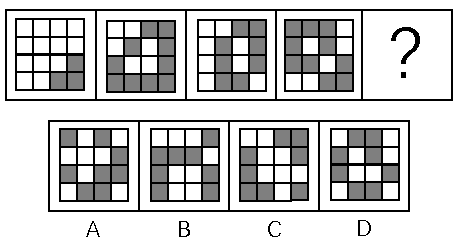

# 数量规律-部分数（白块被黑块分隔的连通部分数）

考点：[[20-考点/判断推理/图形推理/数量规律-部分数（白块被黑块分隔的连通部分数）|图形推理 / 数量规律-部分数（白块被黑块分隔的连通部分数）]]

**问法模型**：问号处填入最合适图形使序列呈现规律 → 黑白块个数无规律时，转向数'一种颜色被另一种颜色分隔成的部分数'

## 推理链
1. 第1步：题干前四幅图均为4×4黑白方格阵，先数黑色方块个数，依次为3、10、8、10，数量无规律
2. 第2步：整体观察发现白块被黑块切割成不同区域，转换考点为'白块被黑块分开的部分数'
3. 第3步：逐图数白块部分数，依次为1、2、3、4，构成等差递增规律，故？处图形白块应被黑块分成5部分
4. 第4步：逐项数选项白块部分数：A项4部分、B项3部分、C项1部分、D项5部分
5. 第5步：只有D项白块被分成5部分，符合规律，故选D

**最快解法**：⚡ 部分数数数法：黑块个数3、10、8、10无规律→立即改数每幅图白块被黑块分割的连通区域数（1、2、3、4→应选5部分），直接数四个选项区域数即可锁定D

## 易错点
- ⚠ 只盯着黑块个数（3,10,8,10）找规律，无规律后误放弃数量类，未想到'部分数'这一衍生数量考点
- ⚠ 数部分数时把被黑块隔开的白块误当作连通整体（或把相邻白块误拆开），导致多数/少数
- ⚠ 误数成'黑块部分数'或'黑块个数'，方向搞反

## 母题抽象
> 🧩 当题干为黑白方块网格且黑、白块个数均无规律时，改数'白块（或黑块）被另一颜色分隔成的部分数'，若呈等差递增/递减则按该规律选答案

**同类特征**：4×4黑白方格阵、黑块个数无规律、白块被黑块切割、求第5幅图（问号处）、选项间部分数差异明显

## 相关题
（暂无）

---

### 题干

从所给的四个选项中，选择最合适的一个填在问号处，使之呈现一定的规律性：

### 选项
- A. A
- B. B
- C. C
- D. D　✅

### 官方解析
观察图形，每个图形都由不同数量的黑块和白块组成，优先考虑数量规律，黑块数量分别是3，10，8，10，数量无规律。再整体观察图形，图形中白块被黑块分成了不同的部分，则可考虑白块被黑块分开的部分数。白块部分数分别是1，2，3，4，故？处白块应被黑块分成5部分。观察选项，A项4部分，B项3部分，C项1部分，D项5部分，D项符合。
故正确答案为D。

### 给定材料
（无）
