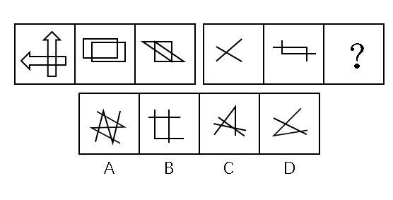

# 特殊规律-图形组合方式（两个相同小图形相交）

考点：[[20-考点/判断推理/图形推理/特殊规律-图形组合方式（两个相同小图形相交）|图形推理 / 特殊规律-图形组合方式（两个相同小图形相交）]]

**问法模型**：'使之呈现一定的规律性'且元素组成不同、属性数量均无规律→转向特殊规律，拆分每幅图观察其构成与组合方式

## 推理链
1. 第1步：两组图形元素组成不同，尝试属性规律（对称、曲直、开闭）与数量规律（点、线、角、面）均无规律，转而观察特殊规律。
2. 第2步：拆解第一组图的构成方式：图1由两个相同的箭头相交而成，图2由两个相同的长方形相交而成，图3由两个相同的三角形相交而成，归纳出规律——每幅图都是'两个相同的小图形相交'。
3. 第3步：将规律应用到第二组：图1为两条直线相交，图2为两条'L'型线条相交，均符合'两个相同图形相交'，故问号处也应由两个相同的小图形相交构成。
4. 第4步：逐项拆分对照：A项由两个相同的'Z'字相交构成；B项由一个直角和两条直线相交构成；C项由一个锐角和两条直线相交构成；D项由一个锐角和一条直线相交构成。
5. 第5步：只有A项满足'两个相同小图形相交'的组合规律，故选A。

**最快解法**：⚡ 特殊规律拆分法+排除法：口诀'每组图形=两个相同小图形相交'，先由第一组归纳出该规律，再逐项拆分选项看构成个体是否相同，快速锁定A（两个相同Z字相交），其余选项均由不同图形（直角/锐角与直线）拼合，直接排除。

## 易错点
- ⚠ 在属性、数量规律上反复纠结浪费考场时间，忽略'元素组成不同'时优先考虑组合方式等特殊规律
- ⚠ 对B、C、D项拆分不清：把'直角/锐角+两条直线'误判为三个相同图形，忽略各组成个体形状不同
- ⚠ 误以为第二组规律是'相交线段数量递增'或'交点数量递变'，未从第一组图1~图3'两个相同图形相交'这一本质规律入手

## 母题抽象
> 🧩 当两组式图形题出现'元素组成不同、属性数量均无规律'特征时，考虑图形构成/组合方式规律（本题：每幅图由两个相同小图形相交而成），拆分每幅图验证'由几个什么图形、如何组合'后再逐项排除。

**同类特征**：元素组成不同、属性数量无规律、两组式对比型图形、图形相交结构、两个相同小图形相交、特殊规律

## 相关题
- [[10-真题/判断推理/图形推理/2049952 图形共性-特定元素存在（每图均含三角形）|2049952]]（新疆 2017，相关度2）
- [[10-真题/判断推理/图形推理/4004575 图形推理-位置规律（指向性元素-箭头指向逆时针旋转90°）|4004575]]（新疆 2021，相关度2）
- [[10-真题/判断推理/图形推理/10204454 数量规律-部分数（黑白球连通区域数做和）|10204454]]（甘肃 2024，相关度1）
- [[10-真题/判断推理/图形推理/10204604 数量规律-线数量（汉字横线数）|10204604]]（辽宁 2024，相关度1）
- [[10-真题/判断推理/图形推理/10297050 数量规律-特殊计数（线条穿过小白球的数量）|10297050]]（天津 2025，相关度1）

---

### 题干

从所给的四个选项中，选择最合适的一个填在问号处，使之呈现一定的规律性：

### 选项
- A. A　✅
- B. B
- C. C
- D. D

### 官方解析
元素组成不同，属性、数量无规律，考虑特殊规律。第一组图形，图1是两个箭头相交，图2是两个长方形相交，图3是两个三角形相交，即每一幅图形都是两个相同的小图形相交得到的；第二组图应用此种规律，图1是两条直线相交，图2是两条“L”型的线条相交，？处也应为两个相同的小图形相交。A项是两个Z字相交，B项是一个直角和两条直线相交，C项是一个锐角和两条直线相交，D项是一个锐角和一条直线相交，只有A项符合。
故正确答案为A。

### 给定材料
（无）
