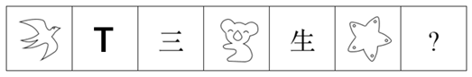

# 数量规律-笔画数（简笔画+汉字-字母混合计数等差递增）

考点：[[20-考点/判断推理/图形推理/数量规律-笔画数（简笔画+汉字-字母混合计数等差递增）|图形推理 / 数量规律-笔画数（简笔画+汉字/字母混合计数等差递增）]]

**问法模型**：'选择最适合的一个填入问号处，使之呈现一定的规律性'且图形元素杂乱、夹有简单汉字 → 优先走数量规律中的笔画数递推模型

## 推理链
1. 第1步：六幅图元素组成不同（燕子、T、三、考拉、生、海星），对称、封闭、曲直等属性均无统一规律，转向数量规律
2. 第2步：图3为汉字'三'、图5为汉字'生'，均为极简单汉字，提示优先考虑笔画数
3. 第3步：依次计数：燕子简笔画1笔、字母T为2笔（一+丨）、'三'3笔、考拉简笔画4笔、'生'5笔、海星6笔，构成1、2、3、4、5、6的等差数列
4. 第4步：按等差递推，问号处应填入一个7笔画的图形
5. 第5步：逐项数选项：A'形'＝'开'4画+'彡'3画＝7画；B'94'＝9一画+4一画＝2画；C'田'＝5画；D'XY'＝X两画+Y两画＝4画
6. 第6步：仅A项为7笔画，与递推结论吻合，故选A

**最快解法**：⚡ 笔画数递推法：看到'三''生'两个简单汉字即锁定笔画考点，题干依次为1~6递增，问号求7画；快速拆解选项数笔画，'形'（开4+彡3）恰为7画，直接锁定A

## 易错点
- ⚠ 只给汉字数笔画，误以为规律只存在于'三''生'之间，忽略燕子、考拉、海星等简笔画同样按笔画计入数列
- ⚠ 不会拆分选项字符：'94'需按两个数字各1画计为2画、'XY'按两个字母各2画计为4画，拆错则选项笔画全盘错乱
- ⚠ '形'字笔画易数错：左侧'开'为4画、右侧'彡'为3画，漏数或错数'彡'即与'田'（5画）一样落入陷阱项

## 母题抽象
> 🧩 当图形元素杂乱且夹有简单汉字/字母/数字时，先考虑笔画数等差递推；选项同样逐字符拆解计数验证，取唯一符合递推值者

**同类特征**：元素组成不同且属性规律缺失、简笔画与汉字混排（三、生）、出现字母T与动物、海星简笔画、笔画数1~6等差递增、问号处求第7项（7笔画）、选项为汉字/数字/字母混编

## 相关题
（暂无）

---

### 题干

从所给四个选项中，选择最适合的一个填入问号处，使之呈现一定的规律性：

### 选项
- A. 形　✅
- B. 94
- C. 田
- D. XY

### 官方解析
元素组成不同，且无明显属性规律，考虑数量规律。观察发现，图3、图5出现简单汉字，优先考虑笔画数。题干六幅图的笔画数依次为1、2、3、4、5、6，因此？处应选择一个7笔画图形，A项7笔画，B项2笔画，C项5笔画，D项4笔画，只有A项符合。
故正确答案为A。

### 给定材料
（无）
