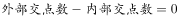
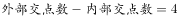

# 图形推理-数量规律（交点计数-内外交点分开数并作差）

考点：[[20-考点/判断推理/图形推理/图形推理-数量规律（交点计数-内外交点分开数并作差）|图形推理 / 图形推理-数量规律（交点计数-内外交点分开数并作差）]]

**问法模型**：把六个图形分为两类使每类有共同规律 → 分组分类模型：元素组成不同→先属性后数量→本题整体数交点无规律时，转为内外交点分开数并作差验证

## 推理链
1. 第1步：六图元素组成不同（五角星框、矩形加三角、三角框、圆内交叉线等），无明显属性规律，且每幅图都有外框、线线相交明显，锁定数量规律中的交点考点
2. 第2步：整体数交点无规律，依据'每幅图都有外框'的特征，改为分开数外部交点（线与外框相交处）与内部交点（框内线线相交处）
3. 第3步：逐一计数——外部交点：图①5、图②6、图③5、图④5、图⑤8、图⑥4；内部交点：图①5、图②6、图③1、图④1、图⑤4、图⑥4
4. 第4步：单独看内外交点数均无法分成两组，考虑内外交点作差运算：图①②⑥均为外部减内部=0（5-5、6-6、4-4），图③④⑤均为外部减内部=4（5-1、5-1、8-4）
5. 第5步：按差值分组：①②⑥（外=内）一组，③④⑤（外-内=4）一组
6. 第6步：对照选项，A项为①②⑥，③④⑤，与分组结果一致，故选A

**最快解法**：⚡ 内外交点作差法：每图先数外框上的交点数，再数框内交点数，求差——①②⑥差均为0，③④⑤差均为4，直接锁定A

## 易错点
- ⚠ 整体数交点无规律后直接放弃或转其他考点，未想到'有外框→内外交点分开数'这一进阶思路
- ⚠ 内外交点界定不清：误把外框顶点计入内部交点或漏数线与外框的交点，导致计数偏差、差值不成规律
- ⚠ 数出内外交点后只单独比较，未做差/和等二级运算，错判为'无规律'

## 母题抽象
> 🧩 当分组分类题中六图均含封闭外框且线线相交明显、整体数交点无规律时，分开数外部交点与内部交点并作差（或求和），按运算结果是否恒定分组

**同类特征**：分组分类问法、元素组成不同、每幅图都有外框、线线相交明显、整体交点数无规律、内外交点差值分组

## 相关题
- [[10-真题/判断推理/图形推理/2387810 数量规律-交点计数（细化：圆内交点）|2387810]]（浙江 2019，相关度3）
- [[10-真题/判断推理/图形推理/10297262 数量规律-面的形状种类（封闭面种类数分组）|10297262]]（浙江 2025，相关度2）
- [[10-真题/判断推理/图形推理/12536392 数量规律-黑色区域面积（宫格面积折算）|12536392]]（四川 2024，相关度2）
- [[10-真题/判断推理/图形推理/12882156 图形推理-对称性（仅轴对称 vs 既轴对称又中心对称）|12882156]]（黑龙江 2025，相关度2）
- [[10-真题/判断推理/图形推理/15833781 属性规律-对称性（轴对称与中心对称组合分组）|15833781]]（内蒙古 2026，相关度2）

---

### 题干

把下面的六个图形分为两类，使每一类图形都有各自的共同特征或规律，分类正确的一项是：

### 选项
- A. ①②⑥，③④⑤　✅
- B. ①④⑤，②③⑥
- C. ①④⑥，②③⑤
- D. ①②⑤，③④⑥

### 官方解析

本题为分组分类题目。元素组成不同，无明显属性规律，优先考虑数量规律。观察发现，图形线与线相交明显，优先考虑数交点，但整体数交点无规律。再观察发现每幅图都有外框，考虑分开数内外交点。图1至图6外部交点数分别为：5、6、5、5、8、4，内部交点数分别为：5、6、1、1、4、4，单独看内部和外部交点数无规律，考虑内外交点运算。图①②⑥，图③④⑤。即①②⑥为一组，③④⑤为一组。

故正确答案为A。

### 给定材料
（无）

> [!warning] 疑点（官方解析可能有误，待人工复核）
> 官方解析结尾'考虑内外交点运算'后未明确写出运算规则与各图差值（①②⑥外-内=0，③④⑤外-内=4），存在跳步，但结论①②⑥、③④⑤分组与数值核对一致，不影响答案A的正确性
