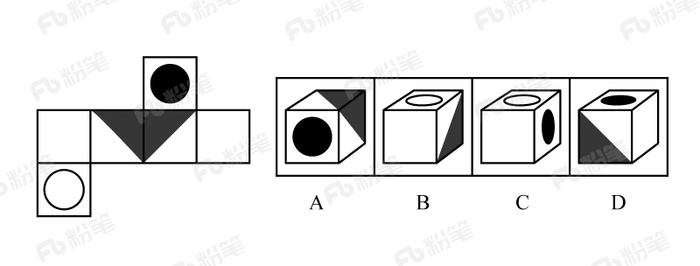

# 空间重构-六面体折叠（相对面排除+相邻面公共边特征验证）

考点：[[20-考点/判断推理/图形推理/空间重构-六面体折叠（相对面排除+相邻面公共边特征验证）|图形推理 / 空间重构-六面体折叠（相对面排除+相邻面公共边特征验证）]]

**问法模型**：问'哪个选项与题干展开图折成同一个立体图形'→采用空间重构模型：先给展开图标面，用相对面不同时出现排除，再用相邻面公共边特征逐项验证。

## 推理链
1. 第1步：给题干展开图六个面标号，识别特征面：带黑色实心圆的面（面k）、带白色空心圆的面（面i）、带大黑色三角形的面（面e），其余为空白面（面f、g、h）
2. 第2步：先做相对面判定：展开图中同行/同列隔一个面的两方为相对面，面k与面e为相对面，相对面在立体图中不能同时出现
3. 第3步：排除C项：C项顶面为面k（圆面）、侧面为面e（三角面），相对面同时出现，与展开图矛盾
4. 第4步：提取相邻面公共边特征：展开图中面e（黑三角面）与相邻面g、h的公共边均为黑色三角形的直角边，而非斜边
5. 第5步：排除A项：A项由面e、g、h构成，但选项中面e与g、h的公共边表现为白色三角形的直角边，与展开图'黑色直角边'不符
6. 第6步：排除D项：D项顶面为面e、正面为面g或面h，其公共边同样显示为白色三角形直角边，与展开图不符
7. 第7步：验证B项：B项由面k、面h、面i构成，黑圆面与白圆面、空白面的相邻关系及公共边特征均与展开图一致，故B与题干折叠结果相同

**最快解法**：⚡ 相对面排除+公共边法：一眼先看C项——圆面k与三角面e是隔面相对面，同现即排除；再用'黑三角的直角边才是公共边'这一颜色边型特征，A、D两选项公共边处呈现白色直角边，直接排除，锁定B。

## 易错点
- ⚠ 相对面判定失误：误把面k（黑圆面）与面e（黑三角面）当作相邻面，漏掉'隔一面即相对'规则，导致C项排除不了
- ⚠ 忽略公共边边型差异：黑三角形有直角边和斜边之分，公共边必须落在直角边上，A、D正是把直角边/斜边位置弄反
- ⚠ 未先标面就凭空间想象硬想：六个面不标号直接脑补折叠，容易把面f、i、k的归属搞混，浪费时间且易错

## 母题抽象
> 🧩 当题干给出六面体展开图和多个立体图选项时，先给展开图标面，用'相对面不能同时出现'排除明显错误项，再用'相邻面公共边的图案朝向/颜色/边型（如三角形直角边vs斜边）'逐项验证剩余选项。

**同类特征**：六面体展开图、问'和题干图形是同一个'、展开图含特征面：黑圆面、白圆面、黑三角面、需判定相对面、需验证相邻面公共边特征、选项为同一立方体的不同视角

## 相关题
- [[10-真题/判断推理/图形推理/1791646 空间重构-六面体折叠（公共点法+相对面排除）|1791646]]（江苏 2016，相关度1）
- [[10-真题/判断推理/图形推理/19181439 空间重构-六面体折叠（相邻面公共边-公共点特征验证）|19181439]]（吉林 2024，相关度1）
- [[10-真题/判断推理/图形推理/2042730 空间重构-六面体折叠（画边法-相邻面公共边）|2042730]]（江苏 2017，相关度1）
- [[10-真题/判断推理/图形推理/2049948 空间重构-六面体折叠（切角纸盒展开图-公共边重合与缺角顶点验证）|2049948]]（新疆 2017，相关度1）
- [[10-真题/判断推理/图形推理/2097180 空间重构-六面体折叠（相对面排除+画边法验证相邻面）|2097180]]（四川 2017，相关度1）

---

### 题干

下列选项中，和题干所给图形是同一个的是：

### 选项
- A. A
- B. B　✅
- C. C
- D. D

### 官方解析

将题干展开图标上序号，如下图所示，逐一进行分析。

A项：选项由面e、面g、面h构成，展开图中面e与面g、面h的公共边均为黑色三角形的直角边，选项中面e与面g、面h的公共边为白色三角形的直角边，选项与题干展开图不一致，排除；

B项：选项由面k、面h、面i构成，选项与题干展开图一致，当选；

C项：选项中顶面是面k，侧面是面e，由于面k与面e为相对面，相对面不能同时出现，选项与题干展开图不一致，排除；

D项：选项中顶面是面e，正面是面g或面h，侧面是面f或面i。展开图中面e与面g、面h的公共边均为黑色三角形的直角边，选项中面e与面g或面h的公共边为白色三角形的直角边，选项与题干展开图不一致，排除。

故正确答案为B。 

### 给定材料
（无）
