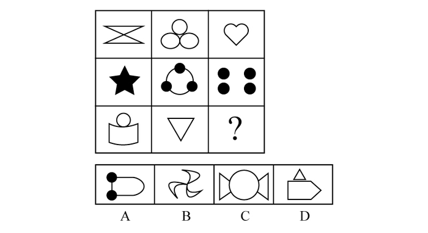

# 属性规律-对称性（轴对称及对称轴方向为竖直）

考点：[[20-考点/判断推理/图形推理/属性规律-对称性（轴对称及对称轴方向为竖直）|图形推理 / 属性规律-对称性（轴对称及对称轴方向为竖直）]]

**问法模型**：『选择最合适的一个填入问号处使之呈现规律性』的九宫格题 → 元素组成不同时优先看属性规律，本题用『轴对称+对称轴竖直方向』筛选选项

## 推理链
1. 第1步：九宫格8个已知图形（蝴蝶结、三圆品字、心形、五角星、圆上三黑点、2×2四黑点、圆+书形底座、倒三角）元素组成各不相同，优先考虑属性规律
2. 第2步：逐一检验对称性：心形、倒三角、五角星（尖朝上）、三圆品字排列、圆+书形底座等均为轴对称图形，且对称轴都是竖直方向
3. 第3步：归纳规律——题干每个图形都有且存在一条竖着的对称轴，故『？』处图形也必须具有竖直对称轴
4. 第4步：对照选项：A项黑点偏左、左右不对称，B项为风车状仅中心对称无对称轴，D项五边形尖端朝右破坏竖直对称，只有C项（圆+左右对称三角）关于竖直轴镜像对称，符合规律

**最快解法**：⚡ 对称轴方向法：快速扫一遍题干，确认全是轴对称且对称轴竖直后，直接用『竖直对称轴』排除法——A左右不对称、B无对称轴、D主体朝右不对称，秒选C

## 易错点
- ⚠ B项是中心对称（旋转对称）图形，易与轴对称混淆而误选
- ⚠ D项顶部小三角形看似居中对称，但主体五边形尖端朝右，竖直对称轴并不存在，易被局部对称迷惑
- ⚠ 只验证『轴对称』而不验证『对称轴方向』，A项存在上下方向的对称性，忽略方向要求可能误判

## 母题抽象
> 🧩 当九宫格/一组图形元素组成不同、外形杂乱时，优先考虑属性规律；若图形均为轴对称，则继续比较对称轴的方向（竖直/水平/斜向）或数量，问号处选对称轴方向与题干一致的选项

**同类特征**：元素组成不同、九宫格、均为轴对称图形、对称轴均为竖直方向、属性规律优先于数量规律

## 相关题
- [[10-真题/判断推理/图形推理/11367791 属性类-对称性（对称轴方向与条数、轴对称+中心对称）＋数量类-面数量（九宫格横行复合规律）|11367791]]（江苏 2025，相关度2）
- [[10-真题/判断推理/图形推理/11881082 属性规律-对称性（对称轴方向）|11881082]]（黑龙江 2024，相关度2）
- [[10-真题/判断推理/图形推理/12881896 属性规律-曲直性（九宫格横行遍历）|12881896]]（新疆 2025，相关度2）
- [[10-真题/判断推理/图形推理/14993416 数量规律-点数量（黑点个数按行求和恒值）|14993416]]（选调 2024，相关度2）
- [[10-真题/判断推理/图形推理/16095265 属性规律-对称性（轴对称+对称轴方向旋转）|16095265]]（江苏 2024，相关度2）

---

### 题干

从所给四个选项中，选择最合适的一个填入问号处，使之呈现一定的规律性：

### 选项
- A. A
- B. B
- C. C　✅
- D. D

### 官方解析
元素组成不同，优先考虑属性规律。观察发现，题干图形均为轴对称图形，且均有一条竖着的对称轴，因此“？”处也应为有一条竖着的对称轴的图形，只有C项符合。
故正确答案为C。

### 给定材料
（无）
