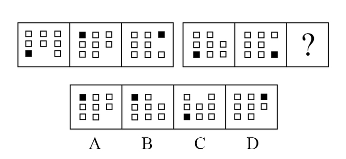

# 位置规律-外圈循环移动（黑块与空位顺-逆时针移动）

考点：[[20-考点/判断推理/图形推理/位置规律-外圈循环移动（黑块与空位顺-逆时针移动）|图形推理 / 位置规律-外圈循环移动（黑块与空位顺/逆时针移动）]]

**问法模型**：两段式图形问'填入问号处使之呈现规律性' → 先在第一组归纳各元素的移动步数与方向，第二组套用验证（警惕第二组方向反转），再从组内末图推出问号处位置

## 推理链
1. 第1步：两组图形元素组成相同——均为3×3外圈8格上分布7个白方块、1个小黑正方形和1个空位，中心格始终不动，优先考虑位置规律
2. 第2步：第一组找规律——小黑正方形每次沿顺时针移动两格（左下→左上→右上），空白位置每次沿逆时针移动一格（下中→右下→右中），三幅图完全吻合
3. 第3步：第二组验证并注意变化——第一幅图小黑正方形在左下角，到第二幅图移到右下角，是沿逆时针移动了两格；空白从右上角移到右中，是沿顺时针移动了一格，即第二组移动方向与第一组相反
4. 第4步：延续第二组规律推问号处——小黑正方形从右下角沿逆时针再移两格到右上角，空白从右中沿顺时针再移一格到右下角
5. 第5步：逐项对照——A、B项小黑正方形在左上角，C项在左下角，均排除；D项小黑正方形在右上角、空白在右下角，与推导完全一致
6. 第6步：故正确答案为D

**最快解法**：⚡ 排除法+黑块定位：只追踪小黑正方形——第二组黑块从图2的右下角逆时针走两格必到右上角，扫一眼四个选项仅D的黑块在右上角，直接锁定D，再用空位移到右下角快速验证

## 易错点
- ⚠ 第二组移动方向与第一组相反（黑块由顺时针变逆时针、空白由逆时针变顺时针），照搬第一组方向会把黑块推到左上角而误选A或B
- ⚠ 只盯黑块而忽略'空白部分'（缺失空位）同样是移动元素，漏验空位可能误判
- ⚠ 沿3×3外圈8格循环计数时，在拐角处易数错方向或格数

## 母题抽象
> 🧩 当两段式图形元素组成相同、仅黑块与空位位置变动时，用'外圈循环移动'法：分别数出黑块和空位每次移动的格数与方向；若第二组方向发生反转，需重新标定方向后再从末图推出问号处位置

**同类特征**：元素组成相同、3×3外圈8格分布（中心格不动）、1个小黑正方形+1个空位+7个白方块、两段式对照求问号、顺/逆时针循环移动、第二组移动方向与第一组相反

## 相关题
- [[10-真题/判断推理/图形推理/2172768 位置规律（旋转-翻转）|2172768]]（海南 2021，相关度1）
- [[10-真题/判断推理/图形推理/10204458 位置规律-平移（特征交点沿内圈循环平移）|10204458]]（甘肃 2024，相关度1）
- [[10-真题/判断推理/图形推理/10204614 图形推理-位置规律（旋转+翻转交替循环）|10204614]]（黑龙江 2024，相关度1）
- [[10-真题/判断推理/图形推理/10297399 位置规律—平移（多黑块分组循环平移）|10297399]]（四川 2025，相关度1）
- [[10-真题/判断推理/图形推理/11226892 位置规律-九宫格小元素沿固定循环链移动|11226892]]（上海 2025，相关度1）

---

### 题干

从所给四个选项中，选择最合适的一个填入问号处，使之呈现一定的规律性：

### 选项
- A. A
- B. B
- C. C
- D. D　✅

### 官方解析
元素组成相同，优先考虑位置规律。观察发现，前一组图中小黑正方形每次沿顺时针方向移动两格，空白部分每次沿逆时针方向移动一格。第二组图运用此规律，观察发现，第一幅图到第二幅图中，小黑正方形沿逆时针方向移动了两格，空白部分沿顺时针方向移动了一格，因此？处图形的小黑正方形应在右上角，空白部分应在右下角，对应D项。
故正确答案为D。

### 给定材料
（无）
