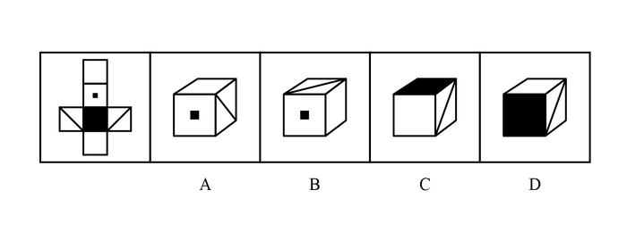

# 空间重构-六面体折叠（相对面排除＋公共点法）

考点：[[20-考点/判断推理/图形推理/空间重构-六面体折叠（相对面排除＋公共点法）|图形推理 / 空间重构-六面体折叠（相对面排除＋公共点法）]]

**问法模型**：“左边给定纸盒外表面，哪项能由它折叠而成” → 先用相对面排除不能同时出现的选项，再用公共边/公共顶点法检验相邻面图案（对角线端点）的相对位置

## 推理链
1. 第1步：给展开图标号：面1为顶端空白面、面2为带小黑点面、面3为黑色面、面4为底端空白面、面5与面6为左右两个对角线面；同列相隔一个面为相对面，故面1与面3相对、面2与面4相对、面5与面6相对
2. 第2步：规则一：相对面在立体图中不能同时出现，据此先做排除；规则二：相邻面上对角线的端点与公共顶点的相对位置折叠后不变（公共点法）
3. 第3步：A项可见面为“空白顶面＋黑点前面＋对角线右面”，不含任何相对面；顶面是面1、前面是面2，展开图中与面2在折叠后右侧相邻的对角线面是面6，即右侧面为面6，三面相邻关系与图案位置均与展开图一致，当选
4. 第4步：B项前面为面2（黑点面），侧面为面1（空白面），顶面只能是面5或面6；由展开图折叠关系，无论顶面是面5还是面6，对角线的一个端点都应落在三个面的公共顶点上，而B项对角线端点不在公共顶点，排除
5. 第5步：C项上面为面3（黑面）、前面为面4（空白面，因面1与面3相对不能同现），侧面为面5或面6；同理，展开图中对角线端点应落在三面公共顶点上，C项对角线位置不符，排除
6. 第6步：D项前面为面3（黑面）、上面为面4（空白面），侧面为面5或面6；对角线端点同样不在三面公共顶点上，与展开图不一致，排除

**最快解法**：⚡ 相对面排除＋公共点法：先用“面1—面3、面2—面4不能同现”排查，A项三个可见面无相对面冲突，且黑点面（面2）右侧对角线面为面6、图案方位吻合，可直接锁定A；B/C/D再用“对角线端点是否压住三面公共顶点”一步排除

## 易错点
- ⚠ 相对面判定失误：误把相邻的面1与面2当成相对面（正确规则是同行/同列相隔一个面，或Z字形两端）
- ⚠ 只验证“三个图案能否相邻”，忽略对角线端点与公共顶点的相对位置（公共点法缺位），从而误选B/C/D
- ⚠ 对角线有方向性：凭感觉画对角线走向，未回到展开图核对端点落在哪条边、哪个顶点，导致面5与面6方位混淆

## 母题抽象
> 🧩 当六面体展开图上出现黑点、黑面、对角线等有方向性的图案时，先用相对面排除不能同时出现的选项，再用“图案端点（对角线顶点、箭头尖端）是否落在相邻面公共顶点/公共边上”检验剩余选项的相邻方位

**同类特征**：纸盒外表面展开图（十字形）、面上含黑色面、中心黑点面、两个对角线面等方向性图案、相对面不能同时出现、公共顶点/公共边定位、对角线端点位置、问“能由它折叠而成的一项”

## 相关题
- [[10-真题/判断推理/图形推理/12019707 空间折叠（六面体折纸盒）——相对面排除＋公共边画边法-公共点引线法|12019707]]（广东 2026，相关度1）
- [[10-真题/判断推理/图形推理/12561915 空间重构-六面体折叠（相对面排除+公共点法）|12561915]]（浙江 2024，相关度1）
- [[10-真题/判断推理/图形推理/16070182 空间重构-六面体展开图折叠（相对面排除＋相邻面数字方向验证）|16070182]]（湖北 2026，相关度1）
- [[10-真题/判断推理/图形推理/1746880 空间重构-六面体折叠（相对面排除+画边法）|1746880]]（国考 2016，相关度1）
- [[10-真题/判断推理/图形推理/1791826 空间重构-六面体折叠（公共点法+相对面排除）|1791826]]（江苏 2016，相关度1）

---

### 题干

左边给定的是纸盒的外表面，下列能由它折叠而成的一项是：

### 选项
- A. A　✅
- B. B
- C. C
- D. D

### 官方解析

将原展开图标上序号，如上图所示，逐一进行分析。

A项：已知面2和面4是相对面，不能同时出现，故A项上面是面1，前面是面2，对角线面在面2的右侧，则右侧是面6，选项与题干展开图一致，当选；

B项：已知面2和面4是相对面，不能同时出现，故B项侧面是面1，前面是面2，观察题干展开图发现，不论上面是面5还是面6，对角线面中的对角线的一个顶点都在三个面的公共点上，选项与题干展开图不一致，排除；

C项：已知面1和面3是相对面，不能同时出现，故C项上面是面3，前面是面4，观察题干展开图发现，不论侧面是面5还是面6，对角线面的对角线的一个顶点都在三个面的公共点上，选项与题干展开图不一致，排除；

D项：已知面1和面3是相对面，不能同时出现，故D项前面是面3，上面是面4，观察题干展开图发现，不论侧面是面5还是面6，对角线面的对角线的一个顶点都在三个面的公共点上，选项与题干展开图不一致，排除。

故正确答案为A。

### 给定材料
（无）
