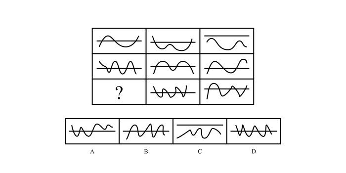

# 数量规律-数面（封闭区域数，九宫格行等差规律）

考点：[[20-考点/判断推理/图形推理/数量规律-数面（封闭区域数，九宫格行等差规律）|图形推理 / 数量规律-数面（封闭区域数，九宫格行等差规律）]]

**问法模型**：九宫格'问号处填入最合适图形使之呈现规律性'→ 元素不同、属性无规律时，优先横行数面（封闭区域）找等差规律

## 推理链
1. 第1步：九宫格中每格均为一条曲线与横线交织，'窟窿'（封闭区域）明显；元素组成不同且无对称、曲直等属性规律，转向数量规律
2. 第2步：九宫格优先横看，逐格数面（封闭区域）数量
3. 第3步：第一行面数量为2、1、0，第二行为4、3、2，均为公差-1的等差递减
4. 第4步：第三行已知后两格为5、4，按每行递减1的规律，？处面数量应为6
5. 第5步：逐项数面：A项3个、B项5个、C项0个（曲线未封闭）、D项6个，只有D项为6
6. 第6步：与规律对照，仅D项满足第三行'6、5、4'的等差结构，故选D

**最快解法**：⚡ 数面法+等差口诀：九宫格横行数封闭区域，得2、1、0 / 4、3、2 / ？、5、4，？=6，直接锁定D

## 易错点
- ⚠ 曲线与横线交织处易漏数或误数封闭区域（如C项曲线未闭合，面数为0，易误当有面）
- ⚠ 误按列或整体递增思路推理（虽然本题按列2、4、6/1、3、5/0、2、4也自洽，但应优先横行验证）
- ⚠ 属性规律（对称、开闭、曲直）走不通时要及时切换到数量规律，勿在属性上纠缠

## 母题抽象
> 🧩 当九宫格图形封闭区域（窟窿）明显且属性无规律时，横行数面找等差数列，用已知两格推问号处数值再对照选项

**同类特征**：九宫格、曲线与横线交织、窟窿多/封闭区域明显、元素组成不同、无明显属性规律、问号位于第三行首格

## 相关题
- [[10-真题/判断推理/图形推理/14993416 数量规律-点数量（黑点个数按行求和恒值）|14993416]]（选调 2024，相关度3）
- [[10-真题/判断推理/图形推理/17467550 数量规律-交点数（九宫格按行等差递增）|17467550]]（湖北 2026，相关度3）
- [[10-真题/判断推理/图形推理/19889518 数量规律-数面（封闭区域数）及行内加减运算|19889518]]（上海 2021，相关度3）
- [[10-真题/判断推理/图形推理/2139602 数量规律-面数量（封闭区域计数）|2139602]]（天津 2017，相关度3）
- [[10-真题/判断推理/图形推理/2172865 数量规律-角（每图含两个相同的角）|2172865]]（广州市考 2018，相关度3）

---

### 题干

从所给四个选项中，选择最合适的一个填入问号处，使之呈现一定的规律性：

### 选项
- A. A
- B. B
- C. C
- D. D　✅

### 官方解析
元素组成不同，且无明显属性规律，考虑数量规律。题干图形中“窟窿”较多，考虑数面，九宫格优先横看，第一行面数量是：2、1、0；第二行面数量是：4、3、2；第三行面数量是：？5、4，故？处面数量应为6，A项为3，B项为5，C项为0，D项为6，只有D项符合。
故正确答案为D。

### 给定材料
（无）
