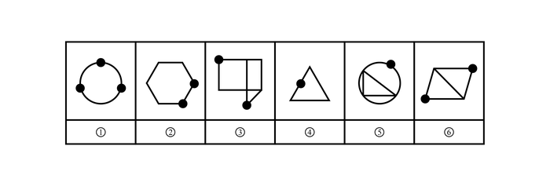

# 功能元素-小黑点位置标记（线上-交点上）

考点：[[20-考点/判断推理/图形推理/功能元素-小黑点位置标记（线上-交点上）|图形推理 / 功能元素-小黑点位置标记（线上/交点上）]]

**问法模型**：'把六个图形分为两类，使每一类都有各自共同特征'的分组分类问法 → 识别每图共有功能元素（小黑点），按其相对线条的位置属性做3+3二分。

## 推理链
1. 第1步：六图元素组成不同，但每幅图均含'小黑点'，且除小黑点外无其他共性元素，优先考虑功能元素的标记作用
2. 第2步：功能元素常考'标记位置'（标记线、标记交点、标记面内/面外、标记角），逐图核对小黑点落在图形线条的什么位置
3. 第3步：图①黑点压在圆周弧线上，图④黑点压在三角形左边线段上，图⑤黑点压在圆的轮廓线上——三者黑点均只在单一'线'上，不处于两线相交处
4. 第4步：图②黑点在六边形的顶点（两条边交汇处），图③黑点在图形线条交汇的端点/拐角处，图⑥黑点在平行四边形顶点（含对角线交汇处）——三者黑点均标记在'交点'上
5. 第5步：据此二分：①④⑤为一组（点在线上），②③⑥为一组（点在交点处）
6. 第6步：对照选项，B项'①④⑤，②③⑥'与该分组完全一致

**最快解法**：⚡ 功能元素位置法：六图共有元素只有小黑点→直接看黑点是否压在两条线的交汇'拐角/顶点'上；②③⑥黑点都在线条交汇处，①④⑤黑点都在单一线段/弧上，秒分3+3选B。

## 易错点
- ⚠ 只区分黑点'在图形内部还是轮廓上'，忽略'线上还是交点上'这一更精细的位置层级
- ⚠ 图⑤圆内有内接三角形，易把圆弧上的黑点误看成三角形顶点（交点）而错入②③⑥一组
- ⚠ 图③下方黑点位置形态不规则，易忽视其仍处于线条交汇的端点处而误判为'线上'

## 母题抽象
> 🧩 当分类分组题中每幅图都出现同一小元素（黑点/小圆圈/箭头）时，用功能元素位置法，验证该元素相对线条的位置类型（线上/交点上/面内/角上）能否把六图干净二分为3+3。

**同类特征**：六图两两分类问法、每图均含小黑点、元素组成不同、功能元素标记位置、线上与交点二分、3+3分组

## 相关题
- [[10-真题/判断推理/图形推理/10204454 数量规律-部分数（黑白球连通区域数做和）|10204454]]（甘肃 2024，相关度1）
- [[10-真题/判断推理/图形推理/10204604 数量规律-线数量（汉字横线数）|10204604]]（辽宁 2024，相关度1）
- [[10-真题/判断推理/图形推理/10297050 数量规律-特殊计数（线条穿过小白球的数量）|10297050]]（天津 2025，相关度1）
- [[10-真题/判断推理/图形推理/10297127 图形间关系-相交图形中不相交边数量（黑白图形相交）|10297127]]（天津 2025，相关度1）
- [[10-真题/判断推理/图形推理/10297148 数量规律-线的细化（端点连线穿过线条数；备选：平行线组数）|10297148]]（天津 2025，相关度1）

---

### 题干

把下面的六个图形分为两类，使每一类图形都有各自的共同特征或规律，分类正确的一项是：

### 选项
- A. ①②④，③⑤⑥
- B. ①④⑤，②③⑥　✅
- C. ①③④，②⑤⑥
- D. ①③⑥，②④⑤

### 官方解析
元素组成不同，题干图形均有小黑点，考虑功能元素。观察发现，图①④⑤中小黑点标记在线上，图②③⑥中小黑点标记在交点处。即图①④⑤为一组，图②③⑥为一组。
故正确答案为B。

### 给定材料
（无）
