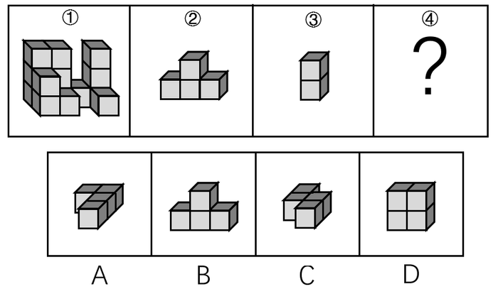
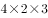

# 立体拼合（小立方体拼长方体：数量守恒+凹凸互补+旋转-翻转变换）

考点：[[20-考点/判断推理/图形推理/立体拼合（小立方体拼长方体：数量守恒+凹凸互补+旋转-翻转变换）|图形推理 / 立体拼合（小立方体拼长方体：数量守恒+凹凸互补+旋转/翻转变换）]]

**问法模型**：题干问'选④使①②③④拼成完整长方体'→采用立体拼合模型：先数小立方体块数做体积守恒校验，再按凹凸互补与旋转/翻转逐一嵌入空位。

## 推理链
1. 第1步：明确目标——①②③④共同拼成一个完整长方体，拼合前后小立方体总数守恒，可先用数量关系缩小选项范围
2. 第2步：数块定位——图②为'凸/山'形共4块（下层3块+上层中间1块），图③为1×1×2竖条共2块，图①为占据主体的多块大组件，拼合后留有三个待填空位（蓝色、黄色、橘黄色）
3. 第3步：先嵌最规则块——③是2块竖条，恰好竖直放入蓝色空位（1×1×2竖槽），凹凸完全咬合
4. 第4步：处理②——黄色空位为倒'凸'形凹槽，需将②上下翻转（下层3块翻到上层、中间块朝下）后嵌入
5. 第5步：剩余橘黄色空位呈竖向的L形（层状）空缺，对应④必须'立起'（绕水平轴旋转90°）才能填入
6. 第6步：逐项验证——C项图形立起后轮廓与橘黄空位完全咬合；A块数偏多且形状不符，B为与②形近的'凸'形立起后无法咬合，D为2×2平板四块，旋转后均填不满该竖向空位
7. 第7步：确认拼合顺序——③入蓝色位→②上下翻转入黄色位→C立起入橘黄色位，四块合成完整长方体，故选C

**最快解法**：⚡ 凹凸互补法（先小后大、先规则后不规则）：先将最规则的③竖条入位锁定基准，再把②上下翻转嵌入凹槽，最后将剩余空缺轮廓与四个选项逐一'立起/翻转'比对，唯一能咬合的即为C。

## 易错点
- ⚠ 忽略空间变换：②须上下翻转、C项须'立起'才能咬合，直接按选项原图形状比对会误排除C或误选与②形近的B
- ⚠ 跳过数量守恒校验：不数各块小立方体个数，忽视A、D与剩余空位体积不符
- ⚠ 看错空位方向与层数：橘黄色空位是竖向空缺，误当成水平空位而错选平面形状相近的D类平板选项

## 母题抽象
> 🧩 当题干给出若干小立方体组合体并要求'拼成完整长方体/正方体'时，用'数量守恒→凹凸互补→旋转/翻转移块'三步法：先数块数排除，再按先规则小块后不规则大块顺序入位，最后以剩余空缺轮廓经旋转变换后反选答案。

**同类特征**：立体图形拼合、组成完整长方体、①②③④四块互补、小立方体数量守恒、图形需上下翻转/立起旋转、问号处补第四块

## 相关题
（暂无）

---

### 题干

从所给的四个选项中，选择最合适的一个填入问号处，使下图中的立体图形①、②、③和④可组成一个完整的长方体：

### 选项
- A. A
- B. B
- C. C　✅
- D. D

### 官方解析

题干中的立体图形可共同构成一个的长方体。如图所示：

将③放入蓝色位置，图②上下翻转放入黄色位置，将C项图形立起放入橘黄色位置，即是一个完整长方体。

故正确答案为C。 

### 给定材料
（无）
