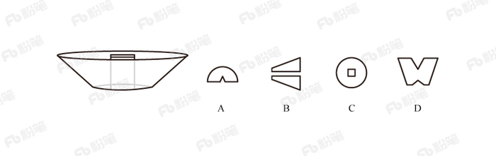
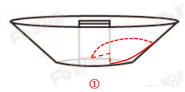
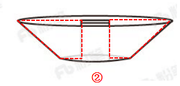

# 截面图-挖空立体（圆台挖长方体）截面正误判断

考点：[[20-考点/判断推理/图形推理/截面图-挖空立体（圆台挖长方体）截面正误判断|图形推理 / 截面图-挖空立体（圆台挖长方体）截面正误判断]]

**问法模型**：题干问'从任一面切开，哪一个不可能是截面'（选非题）→ 逐项反推切割平面的方向与位置：外轮廓定切向、内部缺口定与空腔的关系，选出无法由同一平面同时切出的一项

## 推理链
1. 第1步：题干立体图形为圆台（上大下小漏斗状）内部挖去一个截面为正方形、竖直放置的长方体空腔，图中虚线显示空腔贯穿上下
2. 第2步：将每个选项拆为'外轮廓+内部缺口'两个要素，分别反推切割平面方向（水平切/竖直切/斜切）及是否穿过空腔
3. 第3步：A项外轮廓为带底弧的弧形、底部中央有缺口：从圆台侧面斜切入、经过长方体空腔、止于底面，弧线与方形缺口可同时出现，可切出
4. 第4步：B项为两个分离的梯形块：沿过长方体中心轴线的竖直平面纵切，圆台截面为梯形、中间被长方形空腔整段断开成两块，可切出
5. 第5步：C项为圆中带方孔（类似铜钱）：用平行于底面的水平面横切，圆台截面为圆、长方体截面为正方形空腔，可切出
6. 第6步：D项为顶边带两个缺口的连通W形：要得到梯形外轮廓必须竖直切，而竖直面与长方体空腔（凸体）的交集是一个连通矩形区域，只能'整体断开成两块'或形成'一个大缺口'，不可能形成两个缺口且底部连通的形状
7. 第7步：故A、B、C均可切出，D不可能；本题为选非题，正确答案为D

**最快解法**：⚡ 截面反推法+凸空腔性质：D项外轮廓是梯形→必竖直切；竖直切必穿过中央方形空腔→空腔截面为一个连通矩形，中间应整段镂空（断成两块如B或一个大缺口），绝不可能出现'两个缺口且底部连通'的W形，直接锁定D。

## 易错点
- ⚠ 选非题惯性思维：误把'能切出的'当答案，看到A/B/C形状奇特就误选
- ⚠ 忽略长方体空腔是凸体且贯穿：单个平面截凸空腔只能得到一个连通矩形区域，误以为D的两个缺口可分别由空腔两侧切出
- ⚠ 对A项'斜切经过空腔'的空间想象不足，误认为弧形带缺口切不出而错选A

## 母题抽象
> 🧩 当题干出现'立体图形挖空/组合体+问（不）可能截面'时，用'外轮廓定切向、内部缺口定空腔'的反推法，验证外轮廓与镂空能否由同一平面同时切出；牢记单个凸空腔（长方体、圆柱等）的截面必为连通区域，不可能产生两个分离缺口。

**同类特征**：圆台、挖去截面为正方形的长方体、竖直贯穿的方形空腔、从任一面切开、选非题-找不可能的截面、外轮廓与内部镂空对应切法

## 相关题
（暂无）

---

### 题干

左图是从圆台中挖出一个截面为正方形的长方体形成的立体图形，如果从任一面切开，以下哪一个不可能是该立体图形的截面？

### 选项
- A. A
- B. B
- C. C
- D. D　✅

### 官方解析

A项：可从圆台的侧面切入，经过长方体，到圆台底，如图1所示即可切出，排除；

B项：在圆台正中间竖着切，如图2所示，排除；

C项：可沿水平方向切出，如图3所示，排除；

D项：不能切出，因为如果外侧要切出梯形，只能从中间竖着切，中间应是中空的，无法切出中间两个缺口，当选。

本题为选非题，故正确答案为D。 

### 给定材料
（无）
