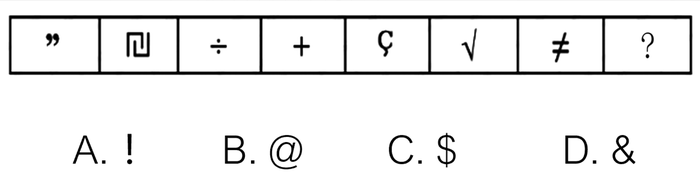

# 属性规律-开闭性（全开放图形）

考点：[[20-考点/判断推理/图形推理/属性规律-开闭性（全开放图形）|图形推理 / 属性规律-开闭性（全开放图形）]]

**问法模型**：符号类小图形且元素组成不同、问'呈现一定规律性'→优先走属性规律三查（对称/曲直/开闭），锁定'封闭面均为0（全开放）'规律后，排除选项中含封闭面的图形

## 推理链
1. 第1步：提取题干图形——引号"、类π符号、除号÷、加号+、Ç、根号√、不等号≠，共7个元素各异的符号小图形
2. 第2步：元素组成不同，按'属性规律'依次检验：各图形对称方向不一致、曲直属性混杂，对称与曲直均无统一规律
3. 第3步：转向开闭性检验——题干7个图形均不含任何封闭区域，共同规律为'全开放图形'
4. 第4步：逐项对照选项：A'!'由线段加点构成、无封闭面；B'@'内含封闭圈；C'$'线条交叉构成封闭区域；D'&'上部有封闭圈，B、C、D均含封闭面
5. 第5步：只有A项同为全开放图形，能使整组图形呈现一致的属性规律，故选A

**最快解法**：⚡ 属性规律之开闭性口诀：元素不同看属性，先数'封闭面'——题干图形封闭面全为0（全开放），一眼排除含封闭圈的@、$、&，秒选'!'（A）

## 易错点
- ⚠ 在标点、运算符等'非标准图形'上轻敌，误以为找不到图形规律而放弃属性分析
- ⚠ 误认为'$'只是S加竖线属于开放图形，忽略线条交叉形成的封闭区域，从而错选C
- ⚠ 只检验部分题干图形（如÷、+）就下结论，漏看√、≠等也须满足全开放这一整体规律

## 母题抽象
> 🧩 当题干出现一串标点、运算符等元素组成不同的小符号时，优先检验属性规律中的开闭性：若题干图形封闭面数量一致（如全为0），则在选项中排除含封闭面的图形即可锁定答案

**同类特征**：元素组成不同的符号序列、标点与运算符混合出现、全开放图形、封闭面数量为0、属性规律优先于数量规律

## 相关题
- [[10-真题/判断推理/图形推理/2185083 图形推理-属性规律-对称性（轴对称图形间隔出现）|2185083]]（广东 2018，相关度1）
- [[10-真题/判断推理/图形推理/2187829 属性规律-曲直性（全曲线-全直线分组）|2187829]]（河北 2018，相关度1）
- [[10-真题/判断推理/图形推理/2188222 属性规律-对称性（轴对称及对称轴方向为竖直）|2188222]]（江西 2018，相关度1）
- [[10-真题/判断推理/图形推理/2374744 属性规律-轴对称（对称轴方向为竖直方向）|2374744]]（广东 2019，相关度1）
- [[10-真题/判断推理/图形推理/5676965 属性规律-开闭性（全封闭与全开放交替）|5676965]]（上海 2018，相关度1）

---

### 题干

从所给四个选项中，选择最合适的一个填入问号处，使之呈现一定的规律性：

### 选项
- A. A　✅
- B. B
- C. C
- D. D

### 官方解析
元素组成不同，优先考虑属性规律。观察发现，题干都是全开放的图形，故问号处也应该是全开放的图形，只有A项符合。
故正确答案为A。

### 给定材料
（无）
