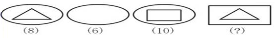
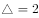
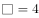

# 数量规律-图形元素赋值求和（相邻图形作差定值）

考点：[[20-考点/判断推理/图形推理/数量规律-图形元素赋值求和（相邻图形作差定值）|图形推理 / 数量规律-图形元素赋值求和（相邻图形作差定值）]]

**问法模型**：每幅图下方标注数字且图形可拆分为基本几何元素的问号补充题 → 采用元素赋值法：相邻图形作差求出每种元素的数值，再对问号图形所含元素求和

## 推理链
1. 第1步：提取题干数据：图1（椭圆+三角形）对应(8)，图2（纯椭圆）对应(6)，图3（椭圆+矩形）对应(10)，图4（矩形+三角形）对应(?)
2. 第2步：对比图1与图2，二者仅相差一个内部三角形，数值由8变为6，故'减少一个三角形，数量减少2'，即三角形赋值为2
3. 第3步：对比图2与图3，二者仅相差一个内部矩形，数值由6变为10，即矩形赋值为4；纯椭圆本身对应6
4. 第4步：回验图1：椭圆6+三角形2=8，与标注(8)吻合，说明'元素数值可加'的赋值体系成立，且外框与内部元素同属一套赋值
5. 第5步：问号处图形为'一个矩形和一个三角形的组合'，按同一体系求和：矩形4+三角形2=6
6. 第6步：对照选项，6对应C项，故选C

**最快解法**：⚡ 元素赋值法（相邻作差）：图1-图2差2得三角形=2，图3-图2差4得矩形=4，纯椭圆=6；问号图=矩形4+三角形2=6，直接锁定C

## 易错点
- ⚠ 误把下方数字当作图形属性计数（如按边数：三角形3、矩形4），推出7之类的干扰项，而本题是'元素赋值'而非'边数/交点数'
- ⚠ 只给内部元素赋值、漏算外框：图4的外框矩形与图3内部矩形赋值相同（均为4），必须一并计入求和
- ⚠ 对比基准选错：应与相邻图形作差（图1比图2、图3比图2），若拿图1与图3直接比较会同时引入两种元素、无法分离单个元素的数值

## 母题抽象
> 🧩 当一组图形每幅下方标注数字、且各图由椭圆/三角形/矩形等可拆分元素组合而成时，用相邻图形作差求出每种元素的赋值，再对目标图形的全部元素（含外框）求和验证答案

**同类特征**：图形下方标注数字、由椭圆/三角形/矩形组合而成、相邻图形仅差一个元素、外框与内部元素共用一套赋值、数量规律-元素赋值求和

## 相关题
（暂无）

---

### 题干

从所给四个选项中，选择最合适的一个填入问号处，使之呈现一定的规律性：

### 选项
- A. 3
- B. 5
- C. 6　✅
- D. 7

### 官方解析

我们发现每个图形下面都对应一个数字，因此图形跟下面的数字有关。图1和图2的区别是内部的一个三角形，也就是减少一个三角形，数量减少2，即；图2和图3的区别是内部的一个长方形，也就是增加一个长方形，数量增加4，即；问号处为一个和一个的组合，即。

故正确答案为C。

### 给定材料
（无）

> [!warning] 疑点（官方解析可能有误，待人工复核）
> 官方解析中公式部分显示缺失（'即；'处数值未展示），但按其文字逻辑可完整还原为：椭圆=6、三角形=2、矩形=4，问号=4+2=6，与答案C一致，无实质矛盾

<!-- CODEX-ANSWER-REVIEW:BEGIN -->
### 本次独立复核

**复核状态：** `confirmed`（独立复算确认答案）

**计分答案：** C（可计分）

**复核解析：**

题干字母运算可逐项还原：E+T=8且E=6，所以T=2；E+R=10，所以R=4。问号为R+T=4+2=6，选项C。

**相关信息：**

判断推理—字母与数字对应；先由已知等式解出各字母数值，再代回目标式。

**题源依据：** [固定版本原题](https://github.com/Mentat-Uran/kaogongzhentizhengliu/blob/84ab93d4b64b61d897bece8a1c0a5bab06b4feb2/10-%E7%9C%9F%E9%A2%98/%E5%88%A4%E6%96%AD%E6%8E%A8%E7%90%86/%E5%9B%BE%E5%BD%A2%E6%8E%A8%E7%90%86/2188770%20%E6%95%B0%E9%87%8F%E8%A7%84%E5%BE%8B-%E5%9B%BE%E5%BD%A2%E5%85%83%E7%B4%A0%E8%B5%8B%E5%80%BC%E6%B1%82%E5%92%8C%EF%BC%88%E7%9B%B8%E9%82%BB%E5%9B%BE%E5%BD%A2%E4%BD%9C%E5%B7%AE%E5%AE%9A%E5%80%BC%EF%BC%89.md)；固定内容 commit `84ab93d4b64b61d897bece8a1c0a5bab06b4feb2`，Markdown blob `6b521de8e87361e797f41772b3daa111503acff5`。
<!-- CODEX-ANSWER-REVIEW:END -->
